# Cybersecurity Lab Portfolio

Hands-on IT support and security labs I built in a home lab in October 2026. Each lab follows the same format: objective, setup, evidence, investigation, resolution, and lessons learned.

## At a glance

Six self-built labs covering help desk support, Active Directory administration, security monitoring, cloud SIEM, incident investigation, and phishing analysis. I built a ticketing system and a Windows domain, resolved 9 support and security tickets, detected a simulated attack in Windows logs, and investigated a suspicious login in Splunk (finding and fixing a logging gap), and traced it back to a spear-phishing email.

**Skills:** osTicket · Active Directory · Windows Server · Group Policy · Sysmon · Splunk Cloud · Event Viewer and PowerShell log analysis · Phishing and email header analysis (SPF, DKIM, DMARC) · VirtualBox

**Currently training:** Working through the TryHackMe *Cyber Security 101* path (hands-on labs in Linux, networking, defensive and offensive security).

**Detection queries:** the actual PowerShell and Splunk searches I wrote are in [/detections](detections/).

## Lab architecture

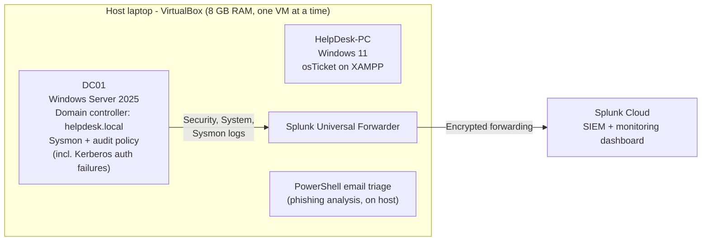

---

## Lab 1: Help desk ticket system

**Objective:** Learn how a help desk ticket system works by building one and resolving support tickets from start to finish.

**Setup**

- VirtualBox virtual machine running Windows 11
- XAMPP (Apache web server, MariaDB database, PHP 8.2)
- osTicket 1.18.4 with 2 departments (IT Support, Security), 3 test users, and help topics that route tickets

**Evidence**

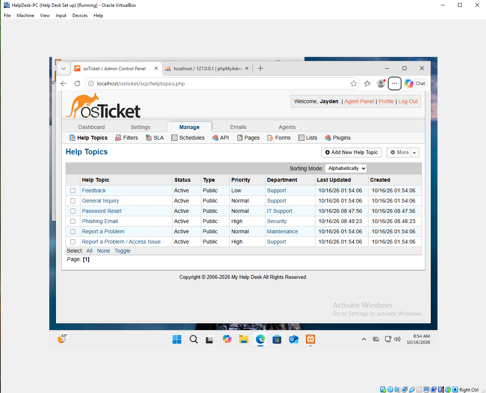

*Help topics route password resets to IT Support and phishing reports to Security at High priority.*

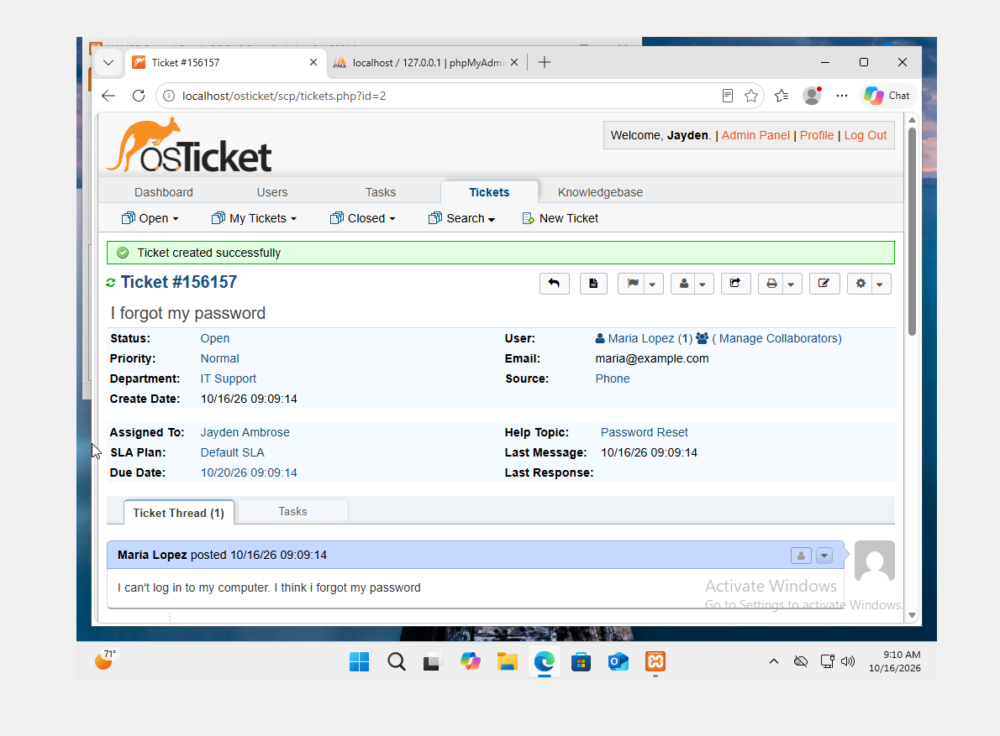

*A password reset ticket created, assigned, and tracked.*

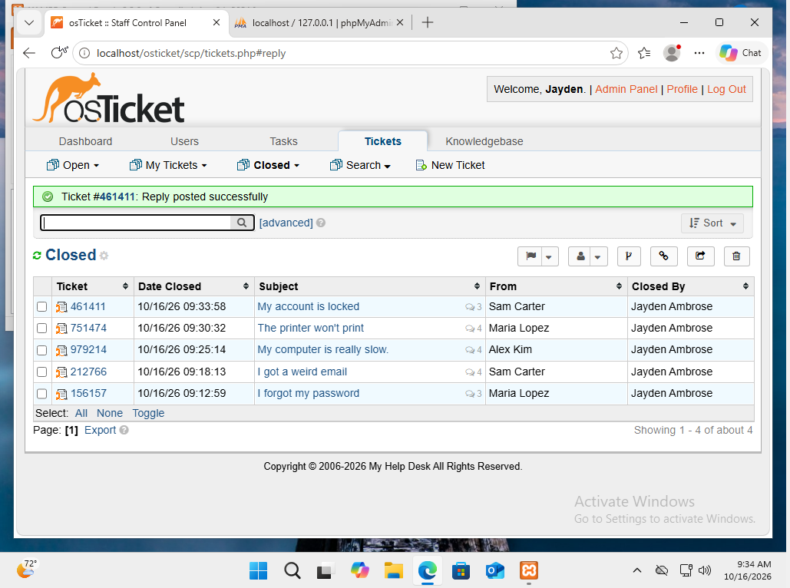

*All five support tickets resolved and closed.*

**Investigation**

- The install failed with HTTP Error 500. The Apache error log showed "Access denied for user root," so the installer was using the wrong database account.
- The new ticket form was missing its Issue Summary field. Testing a second help topic showed it was not my setup but a known osTicket bug.
- For each ticket, I identified the cause: a forgotten password, a phishing email with a fake login link, too many programs running, an offline printer, and a lockout from typos.

**Resolution**

- Created a separate database user with access to only the osTicket database, then finished the install.
- Set a default help topic, which fixed the missing field.
- Resolved all 5 tickets, verifying identity before every password reset or unlock.
- Secured the install by deleting the setup folder and making the config file read-only.

**Lessons learned**

- Check error logs first. They named the exact problem faster than guessing.
- Clear browser autofill before typing credentials. It silently reused the wrong username.
- Take a snapshot before every big step, so mistakes are easy to undo.

---

## Lab 2: Active Directory domain

**Objective:** Learn how companies manage user accounts with Active Directory, and practice the account problems help desks handle every day.

**Setup**

- VirtualBox virtual machine running Windows Server 2025 (DC01)
- New domain: helpdesk.local
- OUs for IT, Sales and Security; 3 users; a Sales Team security group
- Account lockout policy in Group Policy: 5 failed logins locks an account for 10 minutes

**Evidence**

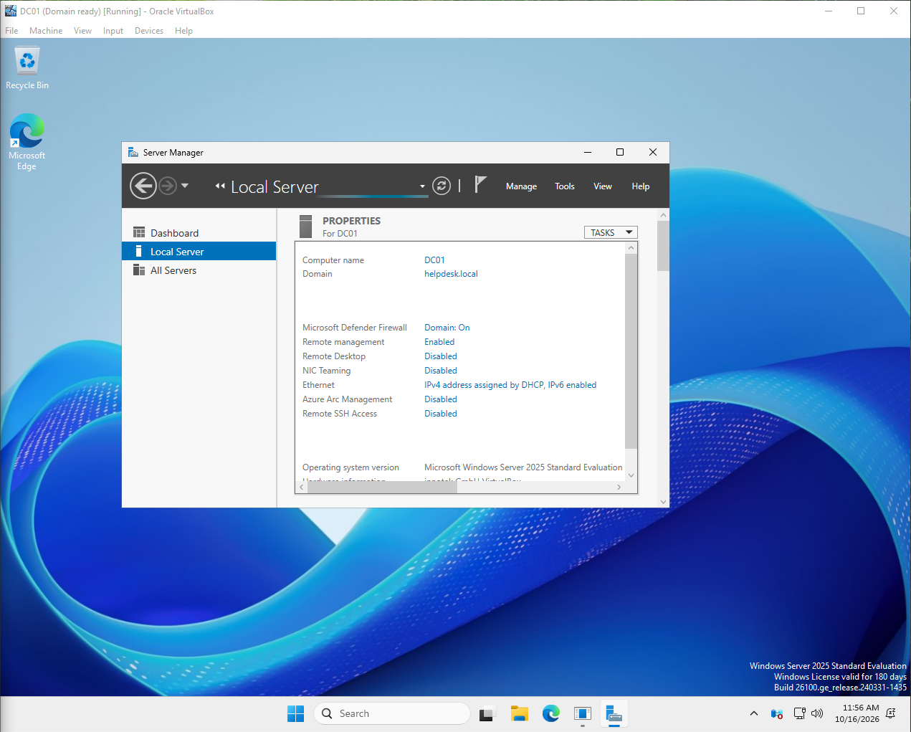

*DC01 running as the domain controller for helpdesk.local.*

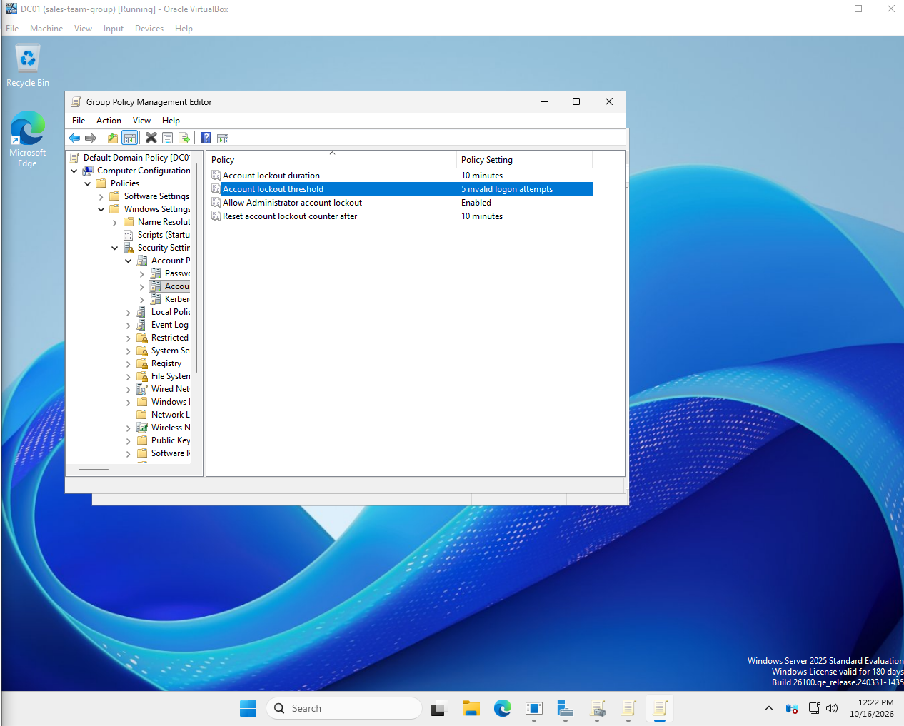

*Account lockout policy: 5 failed logins locks an account for 10 minutes.*

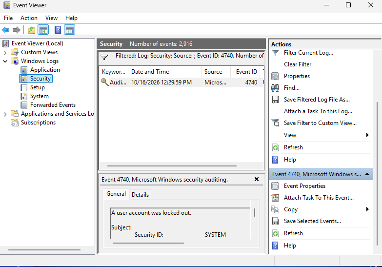

*Event ID 4740 in the Security log, showing the lockout.*

**Investigation**

- Searched 2,916 Security events and found the 1 lockout event (4740), with the time, account and computer it came from.
- The domain policy could not be edited. My admin account had server rights but not Domain Admin rights.
- My first try at the lockout setting was in Default Domain Controllers Policy. User lockout rules only work in Default Domain Policy.

**Resolution**

- Unlocked the account and confirmed the error changed from 1909 (locked) to 1326 (wrong password).
- Reset a password and required a new one at next logon.
- Disabled the account of an employee who left, with a dated note, instead of deleting it.
- Logged each fix as a ticket in osTicket.

**Lessons learned**

- Use a separate admin account for admin work, instead of giving my everyday account Domain Admin rights.
- When a wizard freezes, try PowerShell. It installed Active Directory when the wizard would not.
- Check memory before running 2 virtual machines. With 8 GB, running both crashed my computer.

---

## Lab 3: Windows security monitoring

**Objective:** Learn how a SOC analyst detects an attack in Windows logs, by attacking my own lab and then hunting for each step.

**Setup**

- DC01 (Windows Server 2025) from Lab 2
- Audit policy for logons, new programs with full command lines, account and group changes, and scheduled tasks
- Sysmon 15.22 with the SwiftOnSecurity config, and PowerShell script block logging
- Event Viewer custom view and PowerShell (Get-WinEvent) for searching

**Evidence**

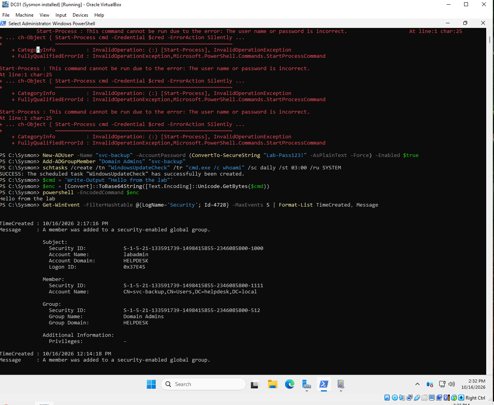

*svc-backup added to Domain Admins (Event 4728).*

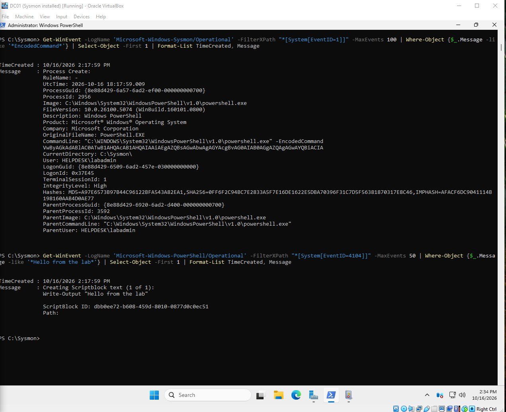

*The scrambled PowerShell command in Sysmon, decoded via Event 4104.*

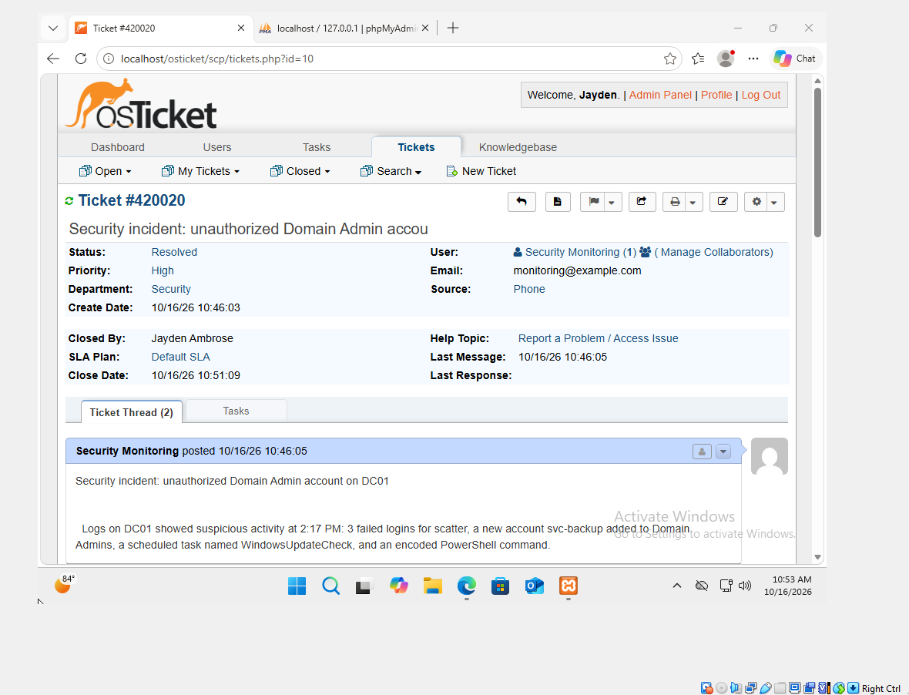

*The incident documented and resolved in osTicket.*

**Investigation**

| What happened | Event ID | What the log showed |
| --- | --- | --- |
| Password guessing | 4625 | 3 failed logins for scarter within seconds |
| Hidden admin account | 4720, 4728 | New account svc-backup, added to Domain Admins |
| Persistence task | 4698 | Task "WindowsUpdateCheck" set to run cmd.exe daily at 3 AM |
| Encoded PowerShell | Sysmon 1, 4104 | Sysmon caught the scrambled command; Event 4104 showed the real one |

I also ruled out 2 false alarms: one failed login that was my own typo, and a group change made by Windows during setup.

**Resolution**

- Disabled svc-backup and removed it from Domain Admins.
- Deleted the scheduled task.
- Confirmed Domain Admins had only the expected accounts.
- Documented the investigation and response in an incident ticket.

**Lessons learned**

- Turn logging on before an incident happens. Without it, the encoded command would have been invisible.
- Check which window a command will run in. I once ran commands on my real computer by mistake.
- Remove installer discs from virtual machines after setup. One rebooted into the Windows installer, and a snapshot saved it.
- Next time, send logs to a SIEM tool like Wazuh or Splunk, so alerts happen automatically.

---

## Lab 4: Cloud SIEM monitoring with Splunk

**Objective:** Learn how a SOC collects logs into one central SIEM, by streaming my domain controller's logs to Splunk Cloud and building a monitoring dashboard.

**Setup**

- DC01 (Windows Server 2025) from Labs 2 and 3
- Splunk Cloud Platform (free trial) as the central SIEM
- Splunk Universal Forwarder 10.6.1 on DC01, connected with the Splunk Cloud credentials package
- Log sources: Windows Security, System, and Sysmon

**Evidence**

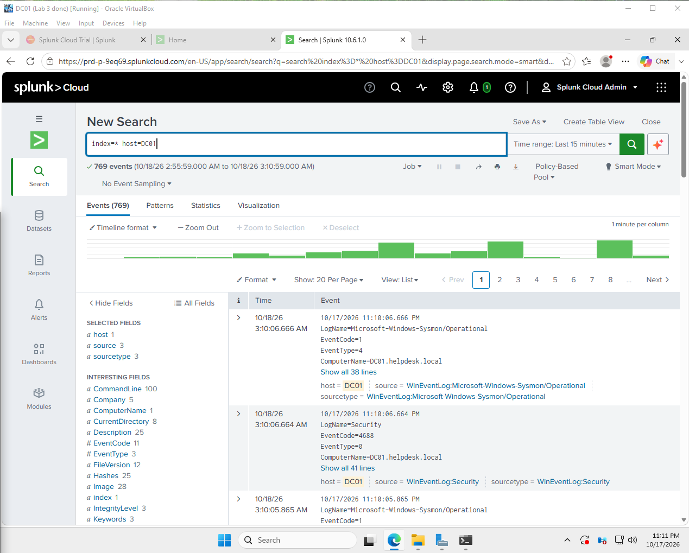

*All three log sources streaming from DC01 into Splunk Cloud.*

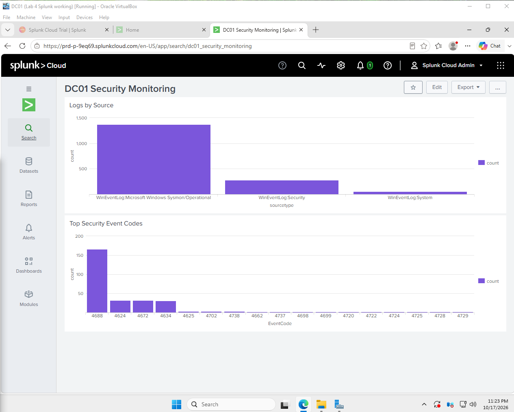

*The "DC01 Security Monitoring" dashboard: logs by source and top Security event codes.*

**Investigation**

| Problem | What I found |
| --- | --- |
| Wazuh Cloud dashboard login kept failing | Single sign-on from the console would not pass through |
| Forwarder said "No users exist" | The admin account was never created during install |
| Only System logs arrived | The forwarder ran as a limited account that could not read the Security log |

The "Top Security Event Codes" panel showed my test activity and my cleanup, including account changes (4720, 4728, 4729, 4725) and scheduled task events (4698, 4699).

**Resolution**

- Switched from Wazuh Cloud to Splunk Cloud instead of losing time on a broken login.
- Created the forwarder admin account and installed the credentials package.
- Configured the forwarder to send Security, System, and Sysmon logs.
- Changed the forwarder service account so it could read every log.
- Built a two-panel monitoring dashboard.

**Lessons learned**

- When a tool keeps fighting you, pivot. Splunk Cloud did the same job without the login problems.
- Running the forwarder as LocalSystem worked, but in production I would use a dedicated account with only the access it needs (least privilege).
- Most events are normal noise. The skill is spotting the few that matter.
- A cloud SIEM let me run a real logging pipeline on an 8 GB laptop with one VM.

---

## Lab 5: Suspicious login investigation

**Objective:** Learn how a SOC analyst investigates an unexpected login, by simulating a dormant account being taken over outside business hours and tracing it in Splunk.

**Setup**

- DC01 (Windows Server 2025) streaming Security logs to Splunk Cloud (from Lab 4)
- Test account: `akim` (Alex Kim), disabled and unused
- Simulated activity on a Sunday morning: the account was re-enabled, its password reset, a few wrong-password attempts, then a successful network login

**Evidence**

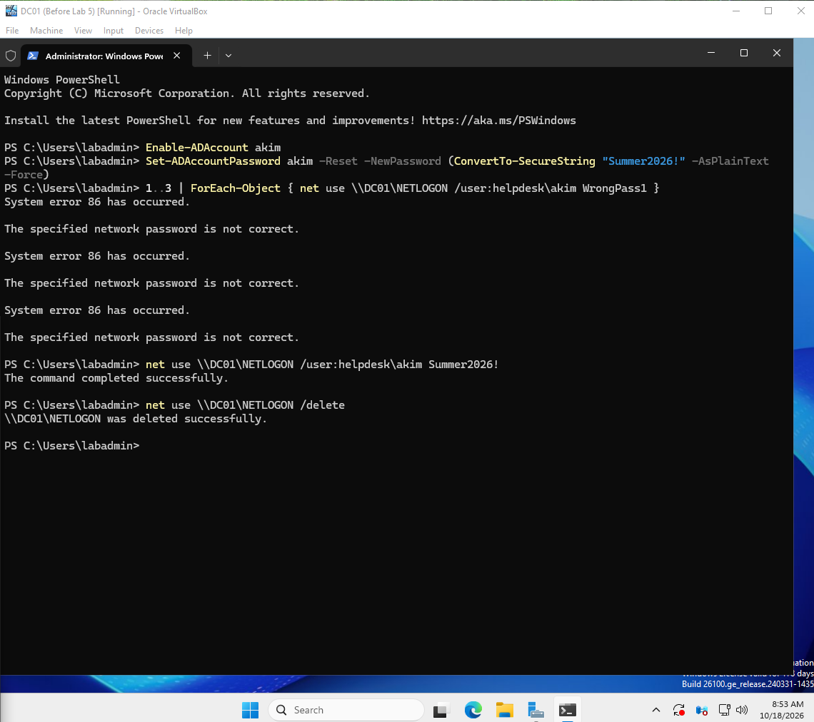

*The simulated activity on DC01: account enabled, password reset, wrong-password attempts, then a successful login.*

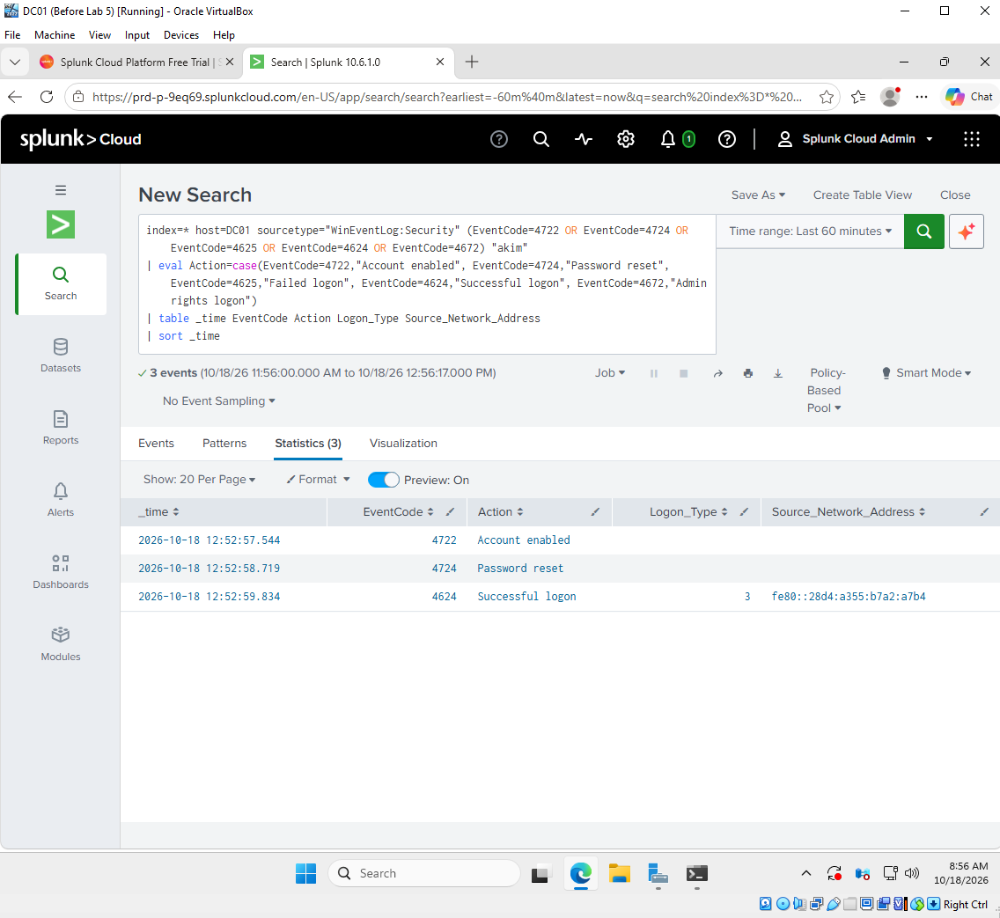

*Account enabled, password reset, and network login, all within 2 seconds.*

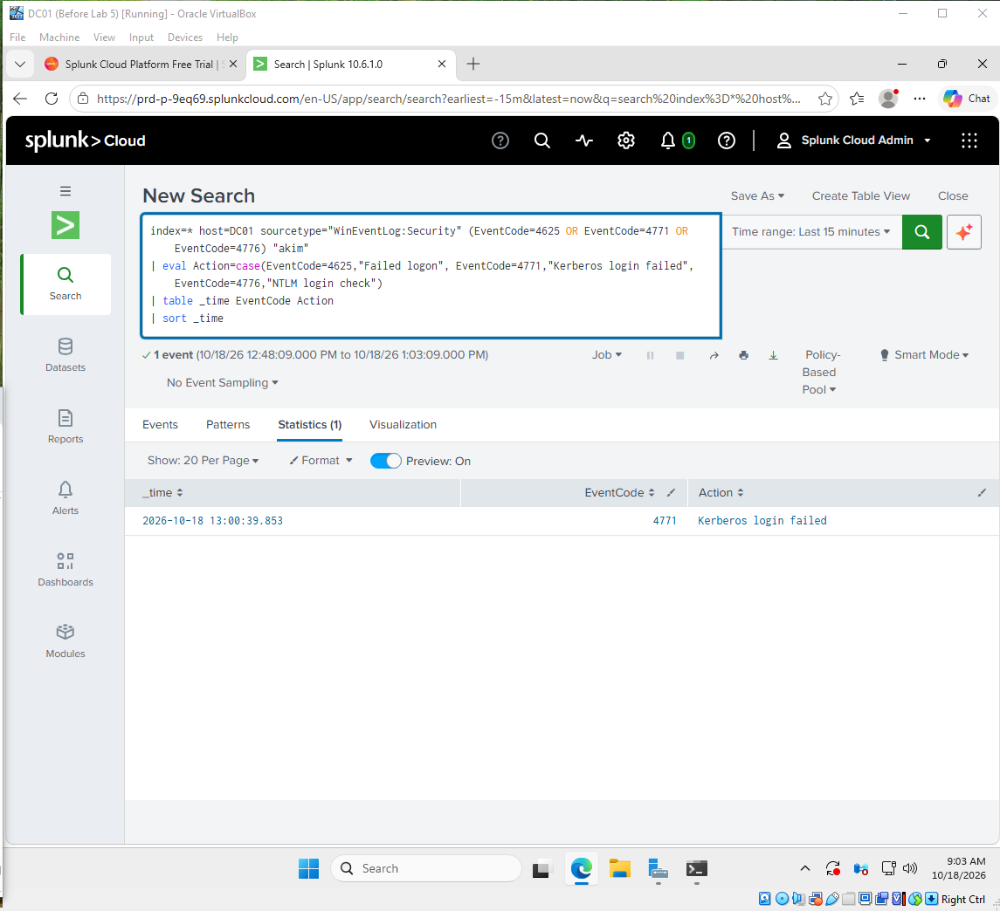

*After the audit fix, Splunk caught the failed login as Event 4771.*

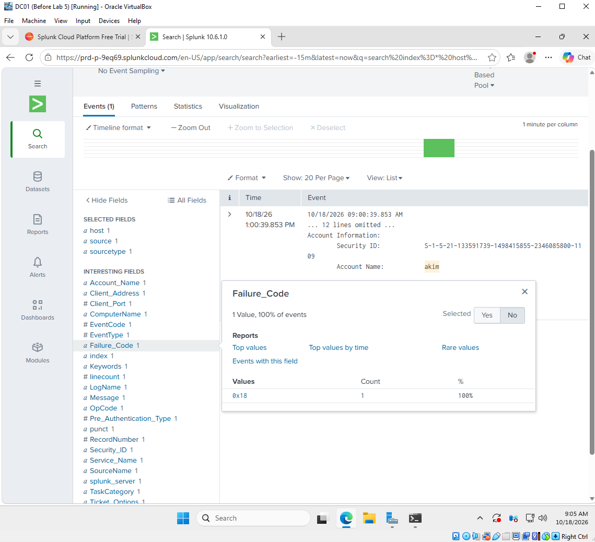

*Failure Code 0x18 confirms a wrong password.*

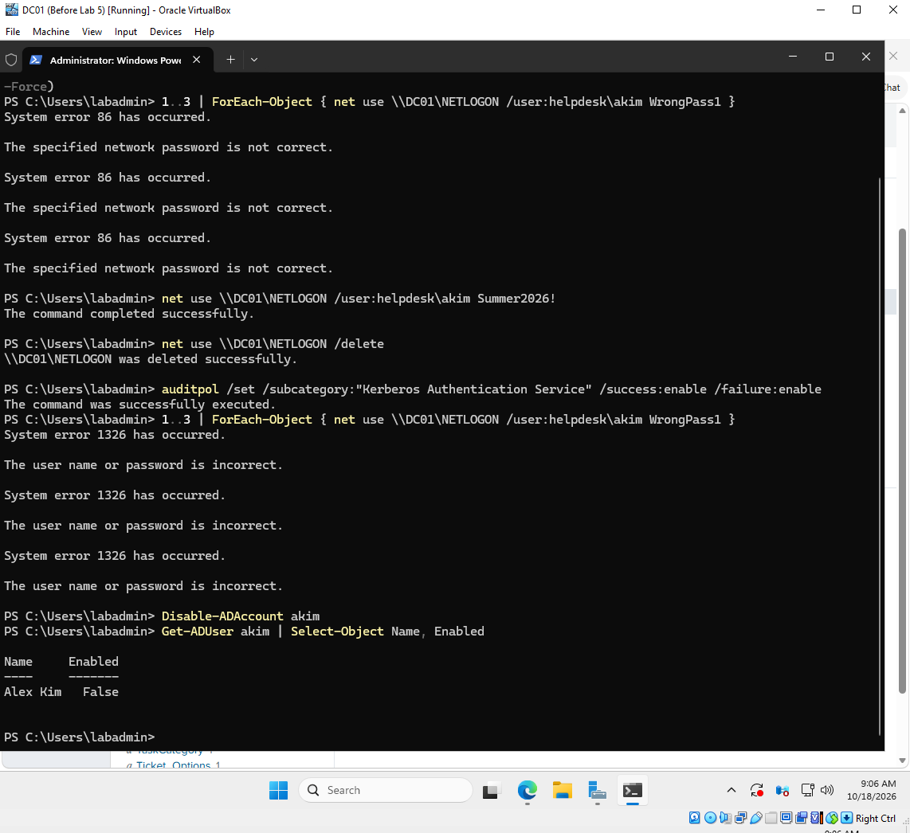

*Account disabled (Enabled: False) and password reset.*

**Investigation**

| Time (ET, Sun Oct 18) | Event ID | What happened |
| --- | --- | --- |
| 8:52:57 AM | 4722 | Dormant account `akim` re-enabled |
| 8:52:58 AM | 4724 | Password reset by an admin account |
| (not logged) | none | 3 wrong-password attempts left no record |
| 8:52:59 AM | 4624 | Successful network login (Logon Type 3) |
| 9:00:39 AM | 4771 | Wrong-password attempt caught after the audit fix (Failure Code 0x18) |

- **Red flags:** Sunday morning, a dormant account, and enable → reset → login in 2 seconds.
- **No 4672:** the account had no admin rights, which limited the impact.
- **Audit gap:** I searched for failed logins (4625, 4771, 4776) and found none. On a domain controller, failed domain logins log as 4771, and Kerberos failure auditing was off. The attempts happened, but nothing recorded them.

**Root cause:** A disabled account was turned back on and given a known password. Missing Kerberos failure auditing hid the password guessing.

**Resolution**

- Disabled the account and confirmed `Enabled: False`.
- Reset the password so the known one no longer works, and required a change at next logon.
- Turned on Kerberos Authentication Service auditing (success and failure) and re-tested to prove failures now reach Splunk.
- Saved the searches in [/detections](detections/lab5-suspicious-login.md), including an off-hours login alert idea.

**Lessons learned**

- No logs does not mean nothing happened. Test that each detection can actually fire.
- On a domain controller, failed logins show up as 4771 (Kerberos) or 4776 (NTLM), not just 4625.
- Speed between events is a clue. People do not enable, reset, and log in within 2 seconds.
- Next step: delete or tightly manage dormant accounts, and alert on 4722 for any account that has been disabled a long time.

---

## Lab 6: Phishing email analysis

**Objective:** Find out how the attacker in Lab 5 got akim's password, by analyzing the phishing email akim received the night before, the way a SOC analyst triages a reported email.

**Setup**

- A raw email file ([lab6-sample-phish.eml](detections/lab6-sample-phish.eml)) sent to akim on Saturday night, before the Sunday-morning login in Lab 5. It uses fictional domains and is safe to open.
- Notepad to read the raw email without rendering it (never double-click a suspicious email)
- A PowerShell triage script on the host laptop, no VM needed

**Evidence**

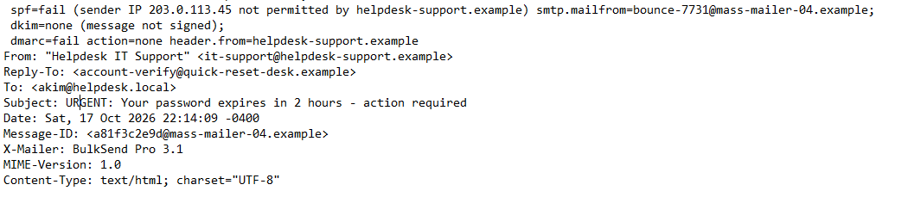

*Failed SPF, DKIM, and DMARC checks, and a Reply-To that doesn't match the sender.*

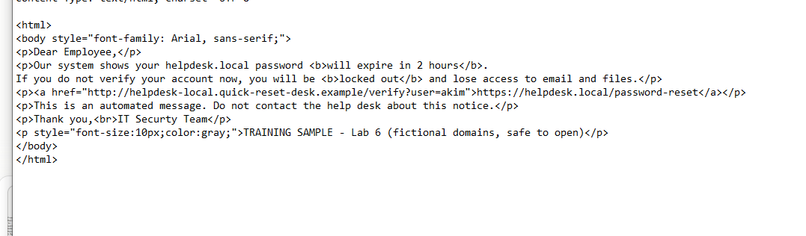

*Urgent message, generic greeting, typo, and a link whose text doesn't match where it goes.*

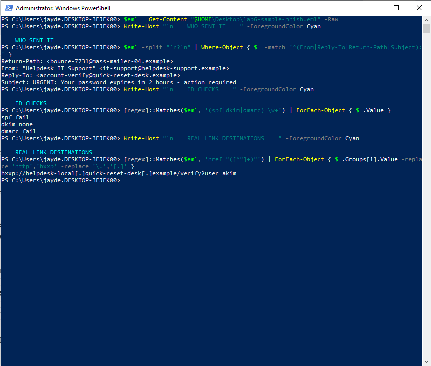

*My script pulls out the sender details, ID checks, and the real (defanged) link.*

**Investigation**

| Red flag | Where | What I found |
| --- | --- | --- |
| Urgency and threat | Body | "Expires in 2 hours", "you will be locked out" |
| Generic greeting | Body | "Dear Employee" instead of a name |
| Typo | Body | "IT Securty Team" |
| Blocks verification | Body | "Do not contact the help desk", so the victim can't check |
| Mismatched link | Body | Shows `helpdesk.local/password-reset` but goes to `quick-reset-desk.example` |
| Spear phishing | Link | `?user=akim`: the link was built for one target |
| Reply-To mismatch | Headers | From `helpdesk-support.example`, replies go to `quick-reset-desk.example` (the same attacker domain as the link) |
| Failed ID checks | Headers | SPF fail, DKIM none, DMARC fail, sent from a bulk mailer (`mass-mailer-04.example`, 203.0.113.45) |
| Delivered anyway | Headers | `dmarc=fail action=none` |

**Root cause:** The domain's DMARC policy was set to `none` (monitor only), so an email that failed every check still reached akim's inbox. akim entered the password on the fake page, and the attacker used it the next morning (Lab 5).

**Resolution**

- Block both attacker domains (`helpdesk-support.example`, `quick-reset-desk.example`) in the email filter.
- Search every mailbox for the same sender, subject, and link, and remove any copies.
- Change the DMARC policy from `none` to `quarantine`, then `reject` once legitimate mail is confirmed passing.
- Phishing awareness training for akim and the team: check the real link, and verify with the help desk.
- akim's account was already disabled and the password reset in Lab 5.
- Wrote a reusable triage script: [lab6-phishing-analysis.ps1](detections/lab6-phishing-analysis.ps1).

**Lessons learned**

- Read a link right to left. The real owner is the part right before the first `/`. Everything in front of it can be a costume.
- Don't just delete a phishing email. Others may have received it, so hunt for it across all mailboxes.
- Never reply to a phishing email. It confirms the address is real.
- A failed check only protects you if the policy acts on it. DMARC `none` watches but doesn't block.
- Labs 5 and 6 together tell one story: phishing email (cause) → stolen password → suspicious login (effect).
