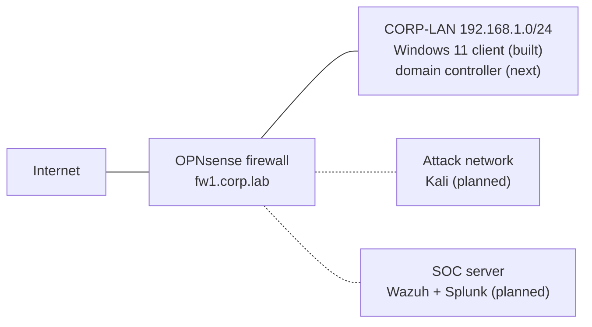

# Jayden | Cybersecurity Home Lab Portfolio

   

Hands-on IT support and cybersecurity labs I built and documented myself in a home lab. Every lab shows what I set up, what broke, how I investigated it, and how I fixed it, with real screenshots as evidence.

---

## About me

I'm an aspiring **SOC analyst** based in **Jacksonville, NC**, building practical skills through a self-built home lab. I learn best by doing: I break things, read the logs, and fix them, then document each step so I can explain it clearly.

**Looking for:** IT Help Desk · IT Support Technician · Junior System Administrator · Cybersecurity internships

---

## Highlights

- 🔎 **Connected investigation:** traced a suspicious Sunday-morning login ([Lab 5](labs/05-suspicious-login-investigation/)) back to the spear-phishing email that stole the password ([Lab 6](labs/06-phishing-email-analysis/)).
- 🛡️ **Vulnerability management:** took a domain controller from **1 Critical + 7+ High** findings to **0** with Nessus, then re-scanned to prove it ([Lab 7](labs/07-vulnerability-scanning-nessus/)).
- 🕳️ **Found logging gaps:** failed domain logins weren't being recorded (Lab 5), and Ubuntu's new `sudo-rs` silently skipped logging a denied privilege escalation ([Lab 8](labs/08-linux-security-monitoring/)).
- 🧱 **Network segmentation:** built an isolated company network behind an OPNsense firewall ([Lab 10](labs/10-opnsense-firewall-network/)).

---

## Labs

| # | Lab | What I did | Key result | Focus |
| --- | --- | --- | --- | --- |
| 1 | [Help desk ticket system](labs/01-helpdesk-ticket-system/) | Built osTicket and worked support tickets | 5 tickets resolved end to end | Help Desk |
| 2 | [Active Directory domain](labs/02-active-directory-domain/) | Built a Windows domain, users, groups and lockout policy | Traced a lockout to Event 4740 | SysAdmin |
| 3 | [Windows security monitoring](labs/03-windows-security-monitoring/) | Attacked my own DC, then hunted each step in the logs | 4 attack steps detected and removed | SOC |
| 4 | [Cloud SIEM with Splunk](labs/04-cloud-siem-splunk/) | Forwarded Windows logs to Splunk Cloud | 3 log sources + monitoring dashboard | SOC |
| 5 | [Suspicious login investigation](labs/05-suspicious-login-investigation/) | Rebuilt an account-takeover timeline in Splunk | Found and fixed a Kerberos audit gap | SOC |
| 6 | [Phishing email analysis](labs/06-phishing-email-analysis/) | Analyzed headers and links of a spear-phish | Root cause: DMARC set to `none` | SOC |
| 7 | [Vulnerability scanning with Nessus](labs/07-vulnerability-scanning-nessus/) | Credentialed scans, patching, re-scans | 1 Critical + 7+ High → 0 | SOC / SysAdmin |
| 8 | [Linux security monitoring](labs/08-linux-security-monitoring/) | Monitored and hardened an Ubuntu server in Splunk | Detected SSH guessing; SSH now key-only | SOC / Linux |
| 9 | [Home lab v2 architecture](labs/09-home-lab-v2-architecture/) | Inventoried hardware and audited the old lab | Designed a segmented v2 lab | Planning |
| 10 | [OPNsense firewall network](labs/10-opnsense-firewall-network/) | Built a firewall and isolated company LAN | Lab PC reaches the internet only through the firewall | Networking |

My own detection queries and scripts are in [`/detections`](detections/).

---

## Skills demonstrated

| Area | Skills |
| --- | --- |
| **Help desk / IT support** | Ticket lifecycle, password resets and account unlocks with identity verification, troubleshooting from error logs |
| **System administration** | Active Directory (OUs, users, groups), Group Policy, Windows Server, Windows Update, Linux (Ubuntu Server), SSH hardening, systemd |
| **Security monitoring (SOC)** | Windows Event IDs, Sysmon, PowerShell log hunting, Splunk SPL searches and dashboards, detection tuning, finding audit gaps |
| **Investigation** | Timeline reconstruction, phishing header analysis (SPF, DKIM, DMARC), IOC extraction, root-cause analysis |
| **Vulnerability management** | Credentialed Nessus scans, CVSS vs. EPSS prioritization, patch verification |
| **Networking** | Firewall WAN/LAN setup, network segmentation, DHCP, APIPA troubleshooting |

---

## Tools and technologies

**SIEM / monitoring:** Splunk Cloud · Splunk Universal Forwarder · Sysmon · Event Viewer
**Security:** Nessus Essentials · OPNsense · PowerShell triage scripts
**Systems:** Windows Server 2025 · Active Directory · Group Policy · Windows 11 · Ubuntu Server 26.04 LTS
**Help desk:** osTicket · XAMPP (Apache, MariaDB, PHP)
**Virtualization:** Oracle VirtualBox

---

## Certifications and training

| | Status |
| --- | --- |
| CompTIA Security+ (SY0-701) | 📚 Studying |
| TryHackMe *Cyber Security 101* path | 📚 In progress |

---

## Home lab

**Labs 1-8** ran on one 8 GB machine, one VM at a time:


**Home lab v2** (in progress) runs on a 32 GB laptop with a firewall-segmented network. See [Lab 9](labs/09-home-lab-v2-architecture/) for the design and [Lab 10](labs/10-opnsense-firewall-network/) for the build.



---

## Career goals

- **Now:** land an IT Help Desk or IT Support role and earn CompTIA Security+.
- **Next:** grow into a Junior System Administrator or SOC Tier 1 analyst role.
- **Long term:** work as a SOC analyst doing detection and incident response.

---

## How each lab is documented

Every lab follows the same format: **Objective → Setup → Evidence → Investigation → Root cause → Resolution → Lessons learned**, with a summary box of tools, skills and results at the top.

```
cybersecurity-labs/
├── README.md            ← you are here
├── detections/          ← my Splunk and PowerShell detection queries
└── labs/
    ├── 01-helpdesk-ticket-system/
    │   ├── README.md
    │   └── screenshots/
    └── ...
```
