# Cybersecurity Lab Portfolio

Hands-on IT support and security labs I built in a home lab in October 2026. Each lab follows the same format: objective, setup, evidence, investigation, resolution, and lessons learned.

## At a glance

Eight self-built labs covering help desk support, Active Directory administration, Windows and Linux security monitoring, cloud SIEM, incident investigation, phishing analysis, and vulnerability management. I built a ticketing system and a Windows domain, resolved 9 support and security tickets, detected a simulated attack in Windows logs, and investigated a suspicious login in Splunk (finding and fixing a logging gap), traced it back to a spear-phishing email, took a domain controller from 1 Critical and 7+ High vulnerabilities to zero with Nessus, and monitored and hardened a Linux server in Splunk.

**Skills:** osTicket · Active Directory · Windows Server · Group Policy · Sysmon · Splunk Cloud · Event Viewer and PowerShell log analysis · Phishing and email header analysis (SPF, DKIM, DMARC) · Nessus vulnerability scanning · Linux (Ubuntu Server, SSH hardening) · VirtualBox

**Now building:** Home lab v2, a segmented company network (OPNsense firewall, domain-joined workstations, Kali) on a new 32 GB laptop, with a separate on-prem SOC server running Wazuh and Splunk. The design is in [Lab 9](#lab-9-home-lab-v2-hardware-assessment-and-architecture-redesign); the build started in [Lab 10](#lab-10-opnsense-firewall-and-isolated-lab-network).

**Currently training:** Working through the TryHackMe *Cyber Security 101* path (hands-on labs in Linux, networking, defensive and offensive security).

**Detection queries:** the actual PowerShell and Splunk searches I wrote are in [/detections](detections/).

## Lab architecture (Labs 1-8)

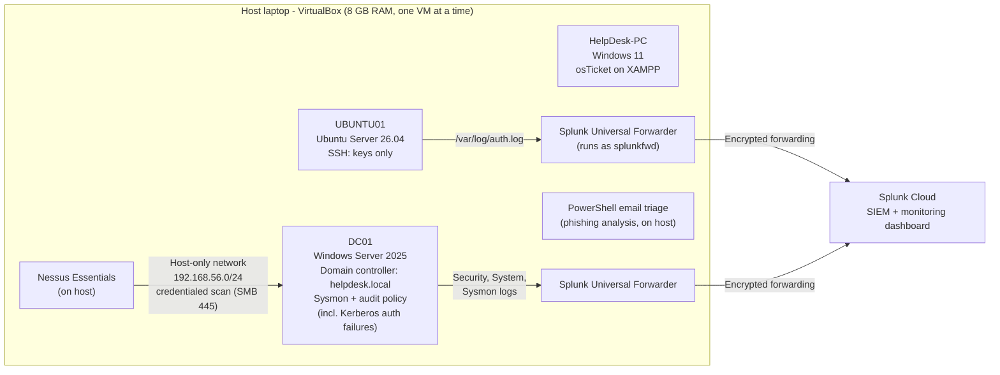

---

## Lab 1: Help desk ticket system

**Objective:** Learn how a help desk ticket system works by building one and resolving support tickets from start to finish.

**Setup**

- VirtualBox virtual machine running Windows 11
- XAMPP (Apache web server, MariaDB database, PHP 8.2)
- osTicket 1.18.4 with 2 departments (IT Support, Security), 3 test users, and help topics that route tickets

**Evidence**

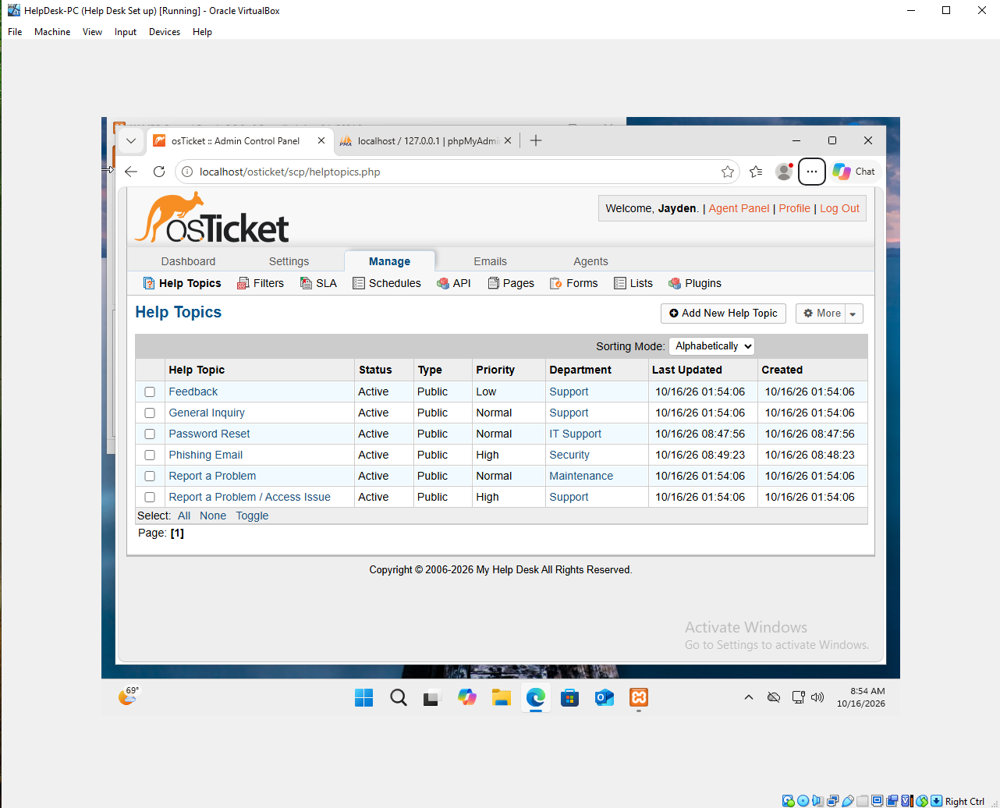

*Help topics route password resets to IT Support and phishing reports to Security at High priority.*

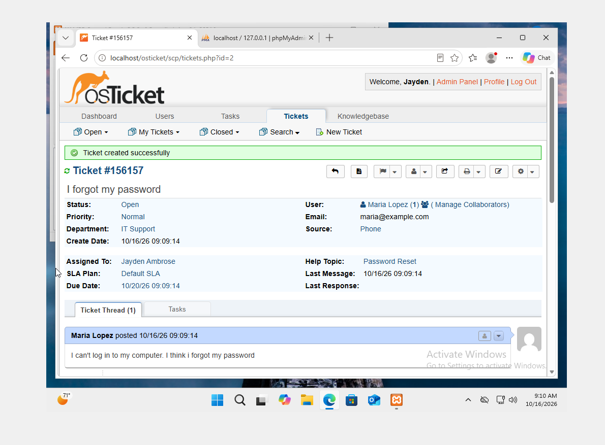

*A password reset ticket created, assigned, and tracked.*

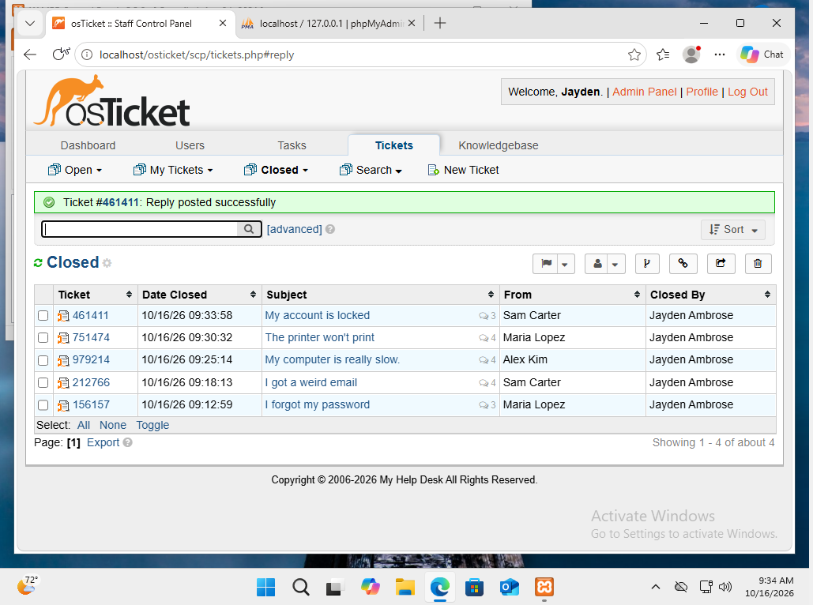

*All five support tickets resolved and closed.*

**Investigation**

- The install failed with HTTP Error 500. The Apache error log showed "Access denied for user root," so the installer was using the wrong database account.
- The new ticket form was missing its Issue Summary field. Testing a second help topic showed it was not my setup but a known osTicket bug.
- For each ticket, I identified the cause: a forgotten password, a phishing email with a fake login link, too many programs running, an offline printer, and a lockout from typos.

**Resolution**

- Created a separate database user with access to only the osTicket database, then finished the install.
- Set a default help topic, which fixed the missing field.
- Resolved all 5 tickets, verifying identity before every password reset or unlock.
- Secured the install by deleting the setup folder and making the config file read-only.

**Lessons learned**

- Check error logs first. They named the exact problem faster than guessing.
- Clear browser autofill before typing credentials. It silently reused the wrong username.
- Take a snapshot before every big step, so mistakes are easy to undo.

---

## Lab 2: Active Directory domain

**Objective:** Learn how companies manage user accounts with Active Directory, and practice the account problems help desks handle every day.

**Setup**

- VirtualBox virtual machine running Windows Server 2025 (DC01)
- New domain: helpdesk.local
- OUs for IT, Sales and Security; 3 users; a Sales Team security group
- Account lockout policy in Group Policy: 5 failed logins locks an account for 10 minutes

**Evidence**

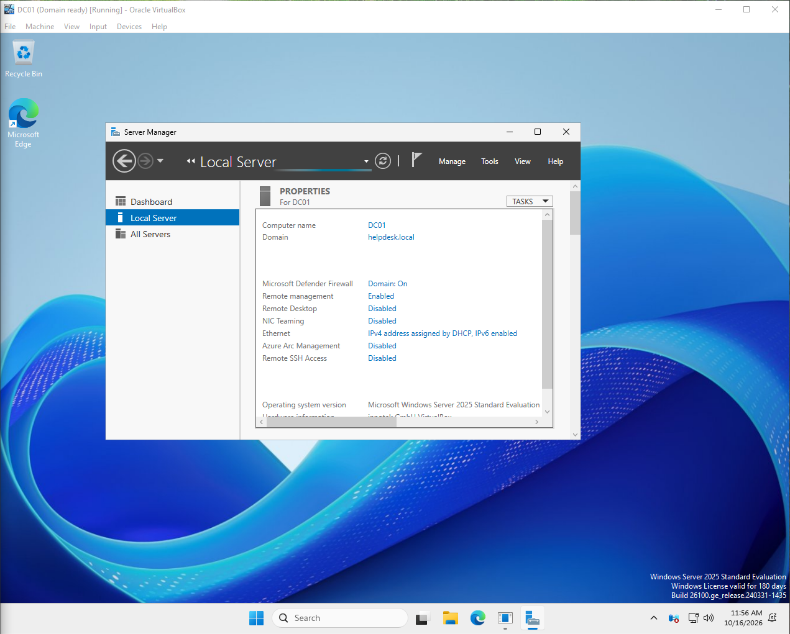

*DC01 running as the domain controller for helpdesk.local.*

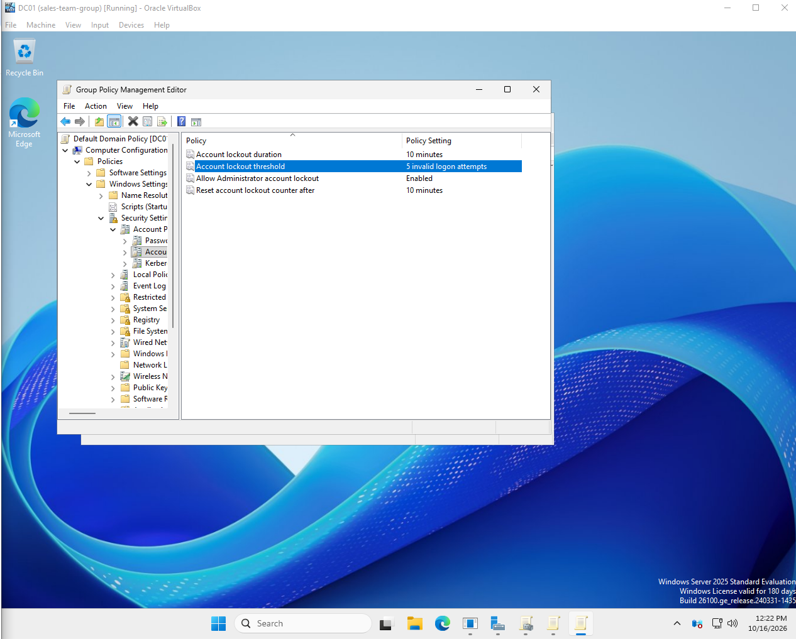

*Account lockout policy: 5 failed logins locks an account for 10 minutes.*

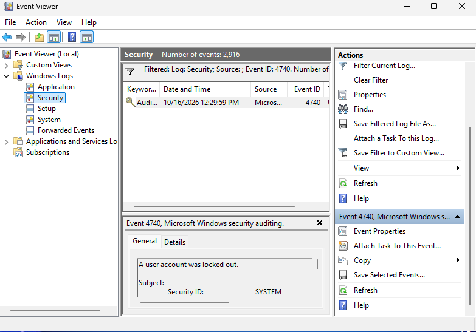

*Event ID 4740 in the Security log, showing the lockout.*

**Investigation**

- Searched 2,916 Security events and found the 1 lockout event (4740), with the time, account and computer it came from.
- The domain policy could not be edited. My admin account had server rights but not Domain Admin rights.
- My first try at the lockout setting was in Default Domain Controllers Policy. User lockout rules only work in Default Domain Policy.

**Resolution**

- Unlocked the account and confirmed the error changed from 1909 (locked) to 1326 (wrong password).
- Reset a password and required a new one at next logon.
- Disabled the account of an employee who left, with a dated note, instead of deleting it.
- Logged each fix as a ticket in osTicket.

**Lessons learned**

- Use a separate admin account for admin work, instead of giving my everyday account Domain Admin rights.
- When a wizard freezes, try PowerShell. It installed Active Directory when the wizard would not.
- Check memory before running 2 virtual machines. With 8 GB, running both crashed my computer.

---

## Lab 3: Windows security monitoring

**Objective:** Learn how a SOC analyst detects an attack in Windows logs, by attacking my own lab and then hunting for each step.

**Setup**

- DC01 (Windows Server 2025) from Lab 2
- Audit policy for logons, new programs with full command lines, account and group changes, and scheduled tasks
- Sysmon 15.22 with the SwiftOnSecurity config, and PowerShell script block logging
- Event Viewer custom view and PowerShell (Get-WinEvent) for searching

**Evidence**

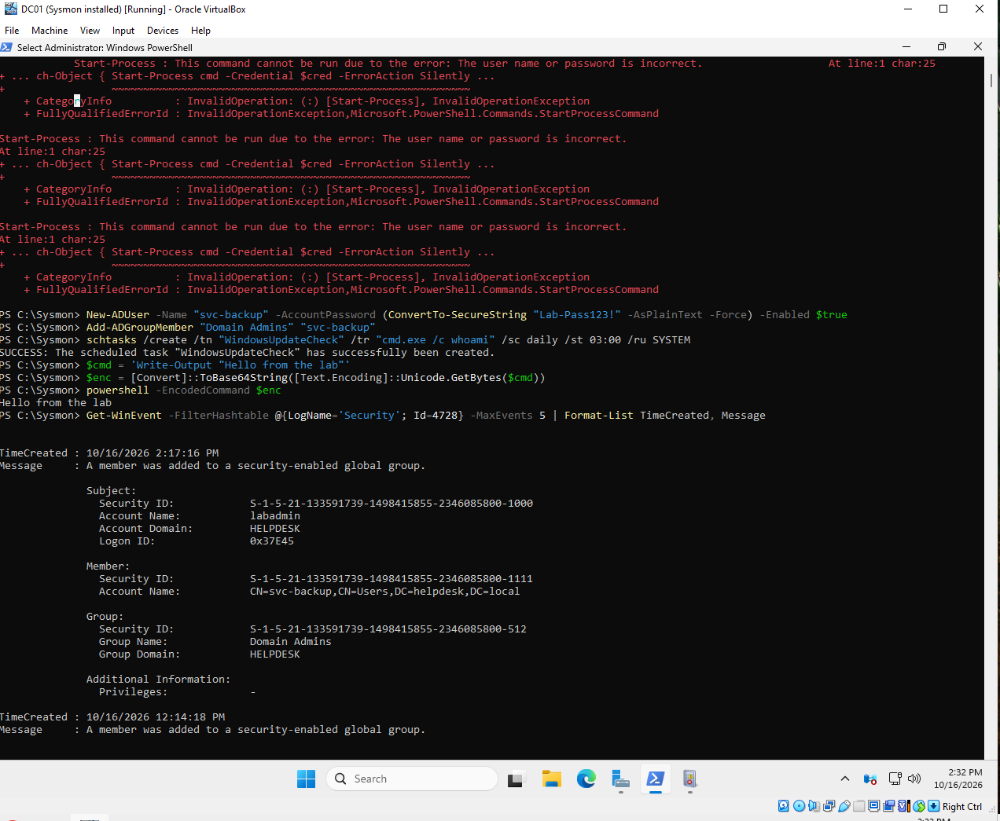

*svc-backup added to Domain Admins (Event 4728).*

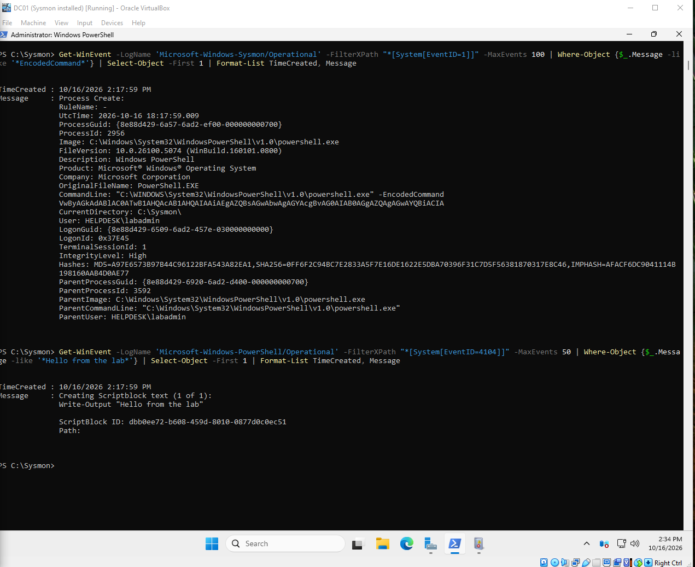

*The scrambled PowerShell command in Sysmon, decoded via Event 4104.*

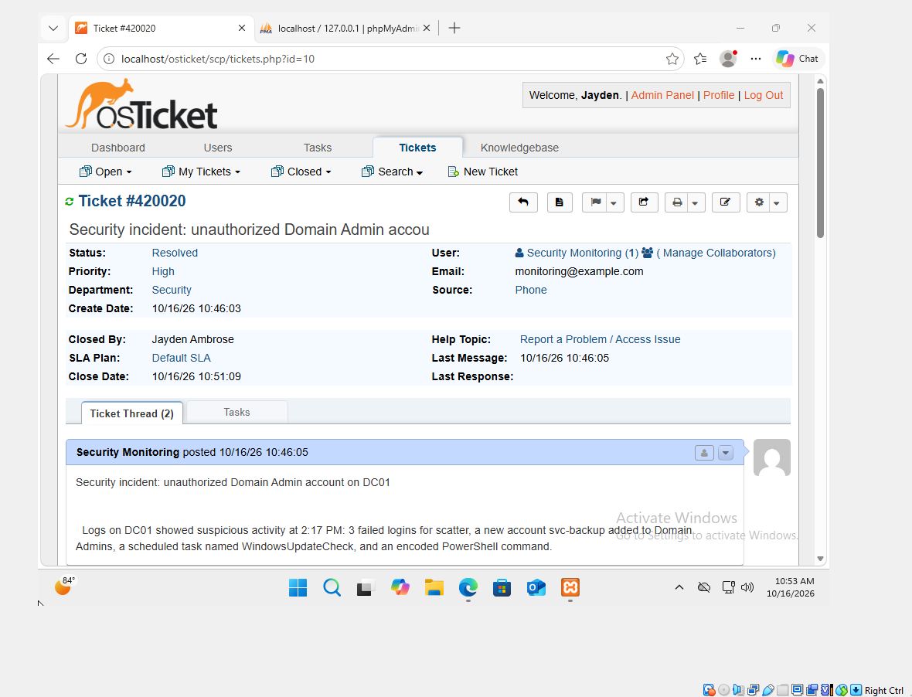

*The incident documented and resolved in osTicket.*

**Investigation**

| What happened | Event ID | What the log showed |
| --- | --- | --- |
| Password guessing | 4625 | 3 failed logins for scarter within seconds |
| Hidden admin account | 4720, 4728 | New account svc-backup, added to Domain Admins |
| Persistence task | 4698 | Task "WindowsUpdateCheck" set to run cmd.exe daily at 3 AM |
| Encoded PowerShell | Sysmon 1, 4104 | Sysmon caught the scrambled command; Event 4104 showed the real one |

I also ruled out 2 false alarms: one failed login that was my own typo, and a group change made by Windows during setup.

**Resolution**

- Disabled svc-backup and removed it from Domain Admins.
- Deleted the scheduled task.
- Confirmed Domain Admins had only the expected accounts.
- Documented the investigation and response in an incident ticket.

**Lessons learned**

- Turn logging on before an incident happens. Without it, the encoded command would have been invisible.
- Check which window a command will run in. I once ran commands on my real computer by mistake.
- Remove installer discs from virtual machines after setup. One rebooted into the Windows installer, and a snapshot saved it.
- Next time, send logs to a SIEM tool like Wazuh or Splunk, so alerts happen automatically.

---

## Lab 4: Cloud SIEM monitoring with Splunk

**Objective:** Learn how a SOC collects logs into one central SIEM, by streaming my domain controller's logs to Splunk Cloud and building a monitoring dashboard.

**Setup**

- DC01 (Windows Server 2025) from Labs 2 and 3
- Splunk Cloud Platform (free trial) as the central SIEM
- Splunk Universal Forwarder 10.6.1 on DC01, connected with the Splunk Cloud credentials package
- Log sources: Windows Security, System, and Sysmon

**Evidence**

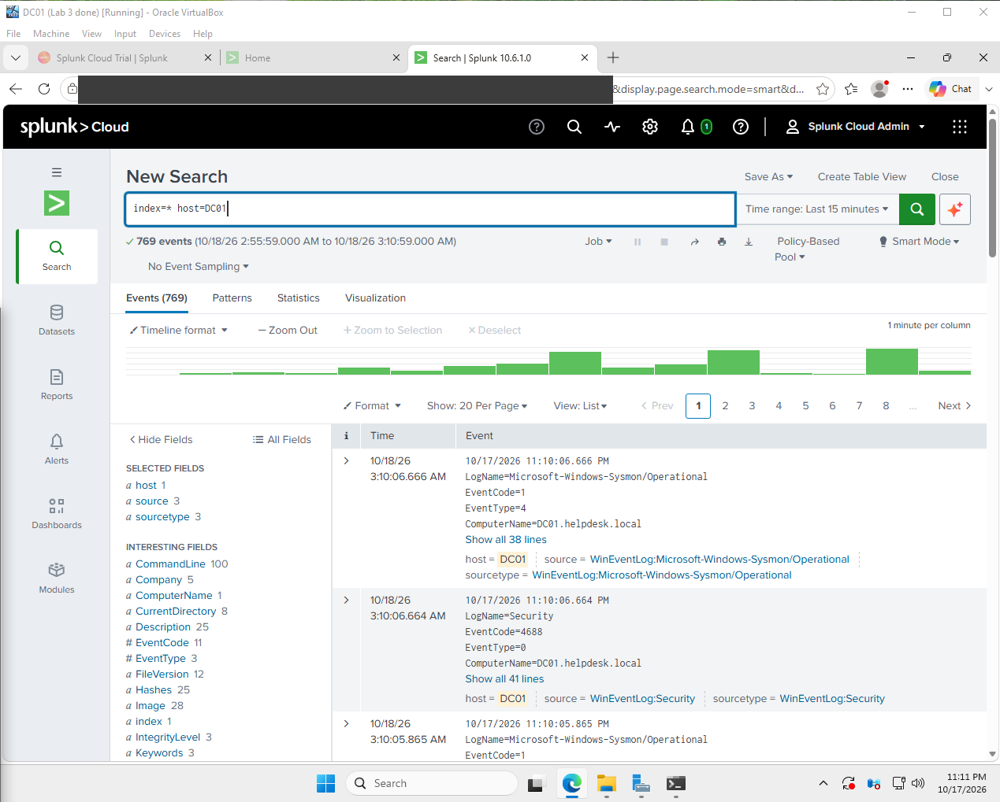

*All three log sources streaming from DC01 into Splunk Cloud.*

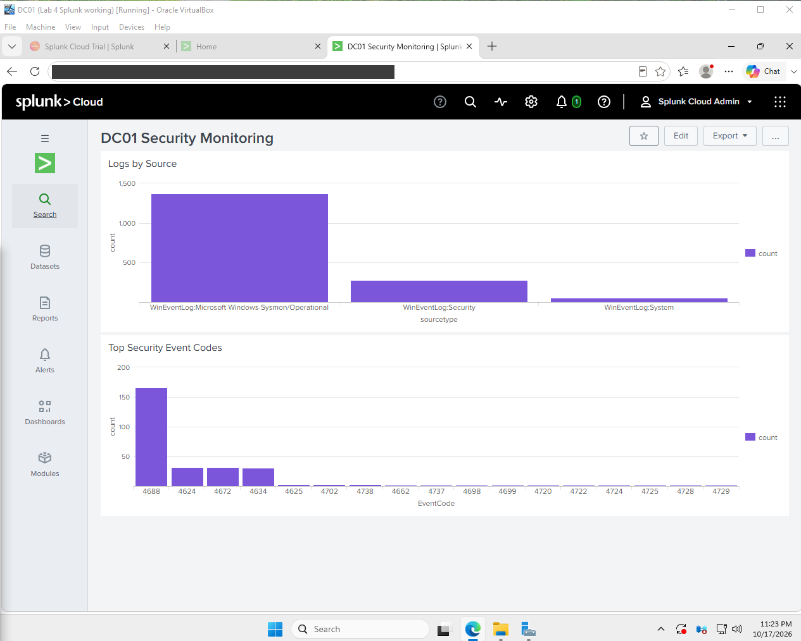

*The "DC01 Security Monitoring" dashboard: logs by source and top Security event codes.*

**Investigation**

| Problem | What I found |
| --- | --- |
| Wazuh Cloud dashboard login kept failing | Single sign-on from the console would not pass through |
| Forwarder said "No users exist" | The admin account was never created during install |
| Only System logs arrived | The forwarder ran as a limited account that could not read the Security log |

The "Top Security Event Codes" panel showed my test activity and my cleanup, including account changes (4720, 4728, 4729, 4725) and scheduled task events (4698, 4699).

**Resolution**

- Switched from Wazuh Cloud to Splunk Cloud instead of losing time on a broken login.
- Created the forwarder admin account and installed the credentials package.
- Configured the forwarder to send Security, System, and Sysmon logs.
- Changed the forwarder service account so it could read every log.
- Built a two-panel monitoring dashboard.

**Lessons learned**

- When a tool keeps fighting you, pivot. Splunk Cloud did the same job without the login problems.
- Running the forwarder as LocalSystem worked, but in production I would use a dedicated account with only the access it needs (least privilege).
- Most events are normal noise. The skill is spotting the few that matter.
- A cloud SIEM let me run a real logging pipeline on an 8 GB laptop with one VM.

---

## Lab 5: Suspicious login investigation

**Objective:** Learn how a SOC analyst investigates an unexpected login, by simulating a dormant account being taken over outside business hours and tracing it in Splunk.

**Setup**

- DC01 (Windows Server 2025) streaming Security logs to Splunk Cloud (from Lab 4)
- Test account: `akim` (Alex Kim), disabled and unused
- Simulated activity on a Sunday morning: the account was re-enabled, its password reset, a few wrong-password attempts, then a successful network login

**Evidence**

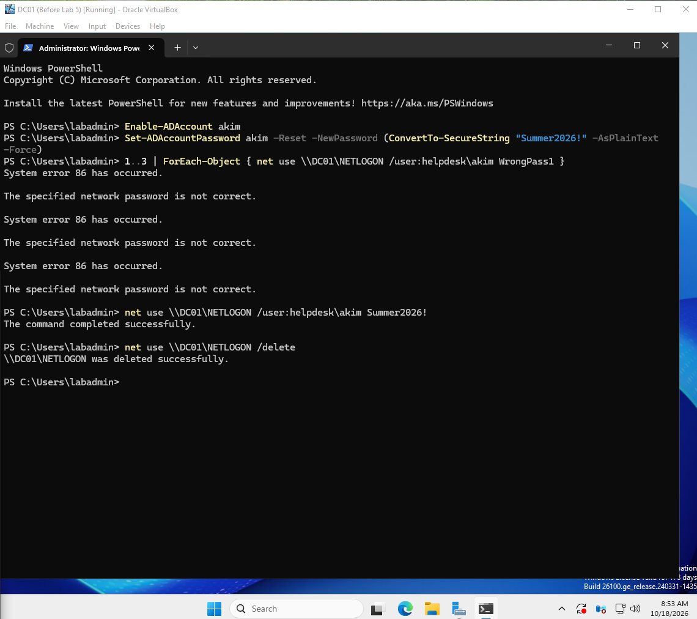

*The simulated activity on DC01: account enabled, password reset, wrong-password attempts, then a successful login.*

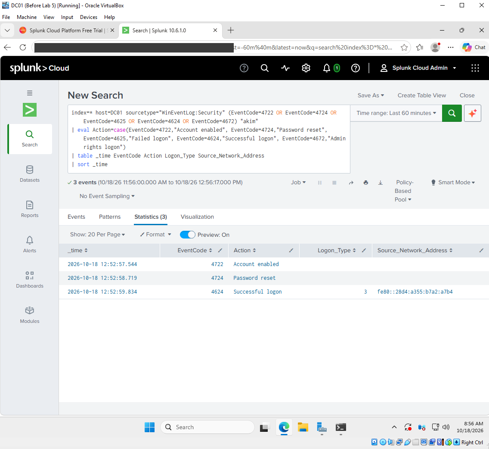

*Account enabled, password reset, and network login, all within 2 seconds.*

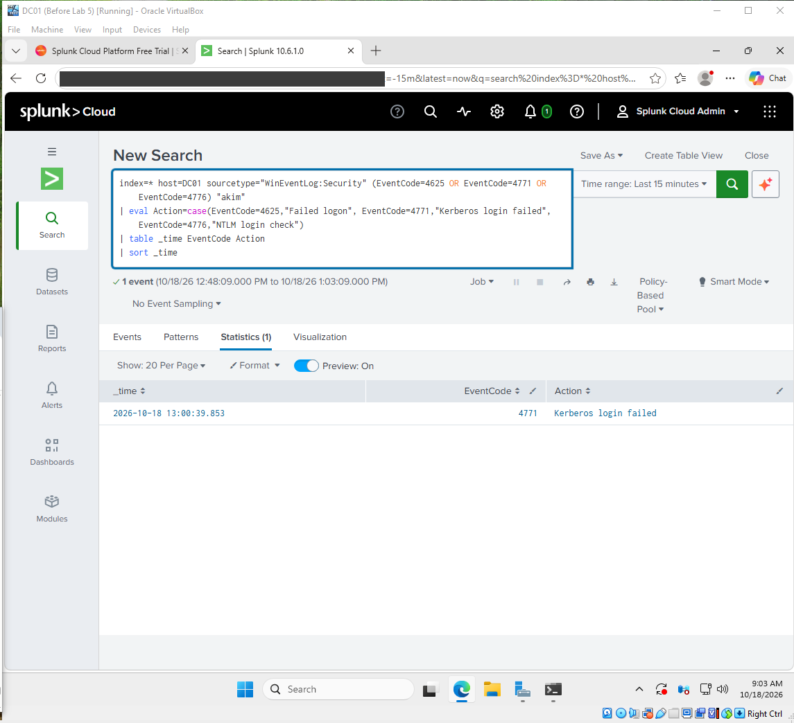

*After the audit fix, Splunk caught the failed login as Event 4771.*

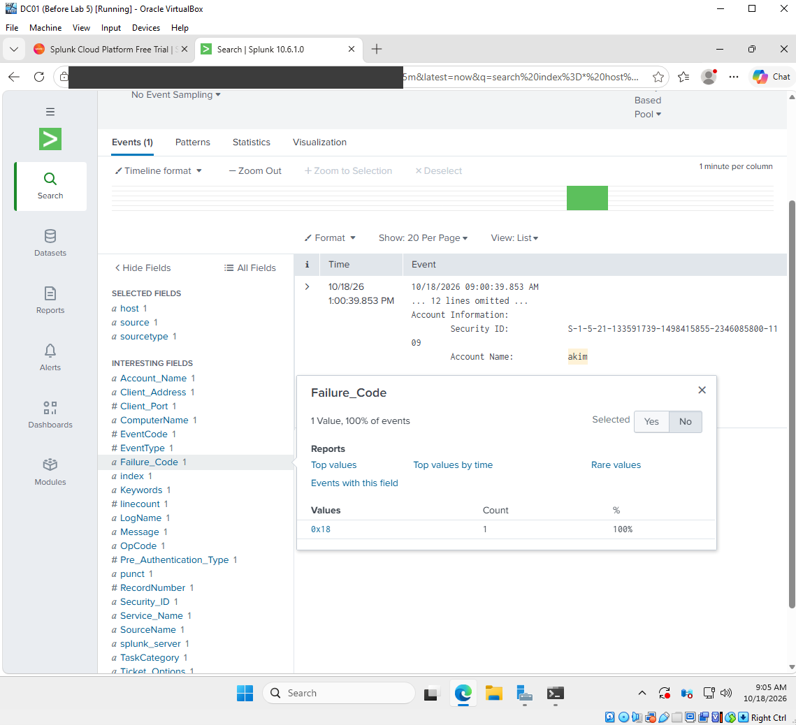

*Failure Code 0x18 confirms a wrong password.*

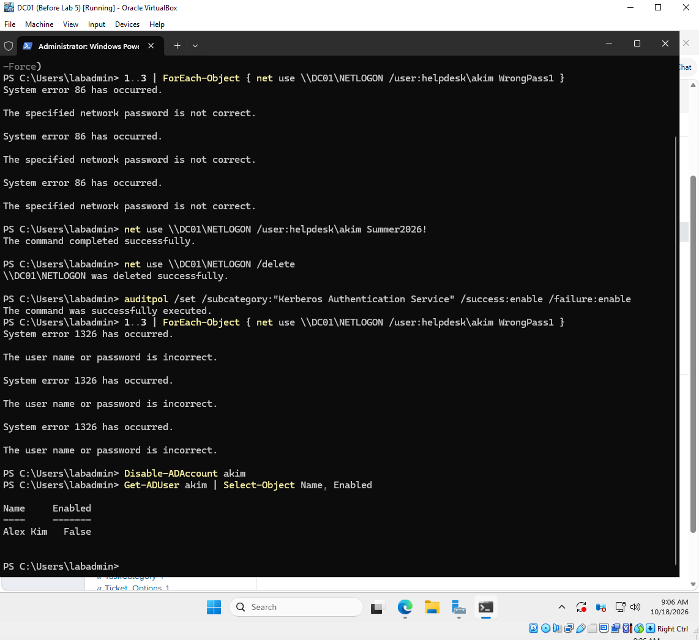

*Account disabled (Enabled: False) and password reset.*

**Investigation**

| Time (ET, Sun Oct 18) | Event ID | What happened |
| --- | --- | --- |
| 8:52:57 AM | 4722 | Dormant account `akim` re-enabled |
| 8:52:58 AM | 4724 | Password reset by an admin account |
| (not logged) | none | 3 wrong-password attempts left no record |
| 8:52:59 AM | 4624 | Successful network login (Logon Type 3) |
| 9:00:39 AM | 4771 | Wrong-password attempt caught after the audit fix (Failure Code 0x18) |

- **Red flags:** Sunday morning, a dormant account, and enable → reset → login in 2 seconds.
- **No 4672:** the account had no admin rights, which limited the impact.
- **Audit gap:** I searched for failed logins (4625, 4771, 4776) and found none. On a domain controller, failed domain logins log as 4771, and Kerberos failure auditing was off. The attempts happened, but nothing recorded them.

**Root cause:** A disabled account was turned back on and given a known password. Missing Kerberos failure auditing hid the password guessing.

**Resolution**

- Disabled the account and confirmed `Enabled: False`.
- Reset the password so the known one no longer works, and required a change at next logon.
- Turned on Kerberos Authentication Service auditing (success and failure) and re-tested to prove failures now reach Splunk.
- Saved the searches in [/detections](detections/lab5-suspicious-login.md), including an off-hours login alert idea.

**Lessons learned**

- No logs does not mean nothing happened. Test that each detection can actually fire.
- On a domain controller, failed logins show up as 4771 (Kerberos) or 4776 (NTLM), not just 4625.
- Speed between events is a clue. People do not enable, reset, and log in within 2 seconds.
- Next step: delete or tightly manage dormant accounts, and alert on 4722 for any account that has been disabled a long time.

---

## Lab 6: Phishing email analysis

**Objective:** Find out how the attacker in Lab 5 got akim's password, by analyzing the phishing email akim received the night before, the way a SOC analyst triages a reported email.

**Setup**

- A raw email file ([lab6-sample-phish.eml](detections/lab6-sample-phish.eml)) sent to akim on Saturday night, before the Sunday-morning login in Lab 5. It uses fictional domains and is safe to open.
- Notepad to read the raw email without rendering it (never double-click a suspicious email)
- A PowerShell triage script on the host laptop, no VM needed

**Evidence**

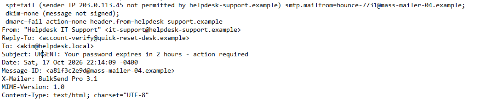

*Failed SPF, DKIM, and DMARC checks, and a Reply-To that doesn't match the sender.*

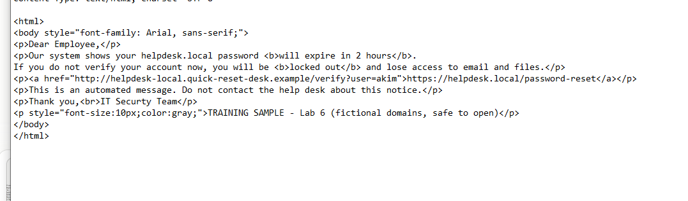

*Urgent message, generic greeting, typo, and a link whose text doesn't match where it goes.*

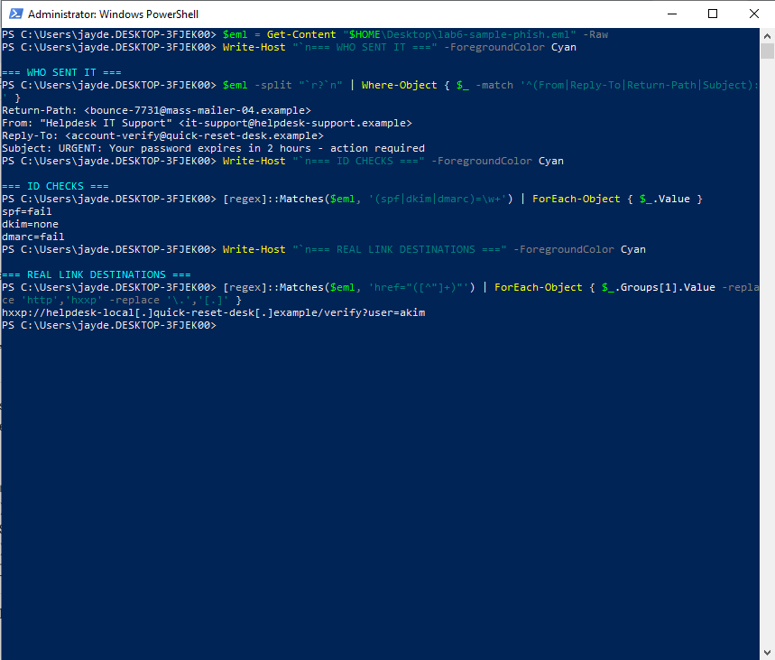

*My script pulls out the sender details, ID checks, and the real (defanged) link.*

**Investigation**

| Red flag | Where | What I found |
| --- | --- | --- |
| Urgency and threat | Body | "Expires in 2 hours", "you will be locked out" |
| Generic greeting | Body | "Dear Employee" instead of a name |
| Typo | Body | "IT Securty Team" |
| Blocks verification | Body | "Do not contact the help desk", so the victim can't check |
| Mismatched link | Body | Shows `helpdesk.local/password-reset` but goes to `quick-reset-desk.example` |
| Spear phishing | Link | `?user=akim`: the link was built for one target |
| Reply-To mismatch | Headers | From `helpdesk-support.example`, replies go to `quick-reset-desk.example` (the same attacker domain as the link) |
| Failed ID checks | Headers | SPF fail, DKIM none, DMARC fail, sent from a bulk mailer (`mass-mailer-04.example`, 203.0.113.45) |
| Delivered anyway | Headers | `dmarc=fail action=none` |

**Root cause:** The domain's DMARC policy was set to `none` (monitor only), so an email that failed every check still reached akim's inbox. akim entered the password on the fake page, and the attacker used it the next morning (Lab 5).

**Resolution**

- Block both attacker domains (`helpdesk-support.example`, `quick-reset-desk.example`) in the email filter.
- Search every mailbox for the same sender, subject, and link, and remove any copies.
- Change the DMARC policy from `none` to `quarantine`, then `reject` once legitimate mail is confirmed passing.
- Phishing awareness training for akim and the team: check the real link, and verify with the help desk.
- akim's account was already disabled and the password reset in Lab 5.
- Wrote a reusable triage script: [lab6-phishing-analysis.ps1](detections/lab6-phishing-analysis.ps1).

**Lessons learned**

- Read a link right to left. The real owner is the part right before the first `/`. Everything in front of it can be a costume.
- Don't just delete a phishing email. Others may have received it, so hunt for it across all mailboxes.
- Never reply to a phishing email. It confirms the address is real.
- A failed check only protects you if the policy acts on it. DMARC `none` watches but doesn't block.
- Labs 5 and 6 together tell one story: phishing email (cause) → stolen password → suspicious login (effect).

---

## Lab 7: Vulnerability scanning with Nessus

**Objective:** Learn how vulnerability management works, by scanning my domain controller with and without credentials, fixing what the scan found, and re-scanning to prove the fixes worked.

**Setup**

- Nessus Essentials 10.12.5 (free) installed on my host laptop
- Added a VirtualBox **Host-only** adapter to DC01 (192.168.56.101) so the scanner could reach it, while the NAT adapter kept the Splunk forwarder online
- Confirmed the path with `Test-NetConnection 192.168.56.101 -Port 445` (SMB, needed for credentialed checks)
- Two Basic Network Scans: one with no credentials, one with a domain admin login (Remote Registry and admin shares enabled during the scan, NTLMv1 disabled, credentials never sent in the clear)
- Snapshot taken before patching

**Evidence**

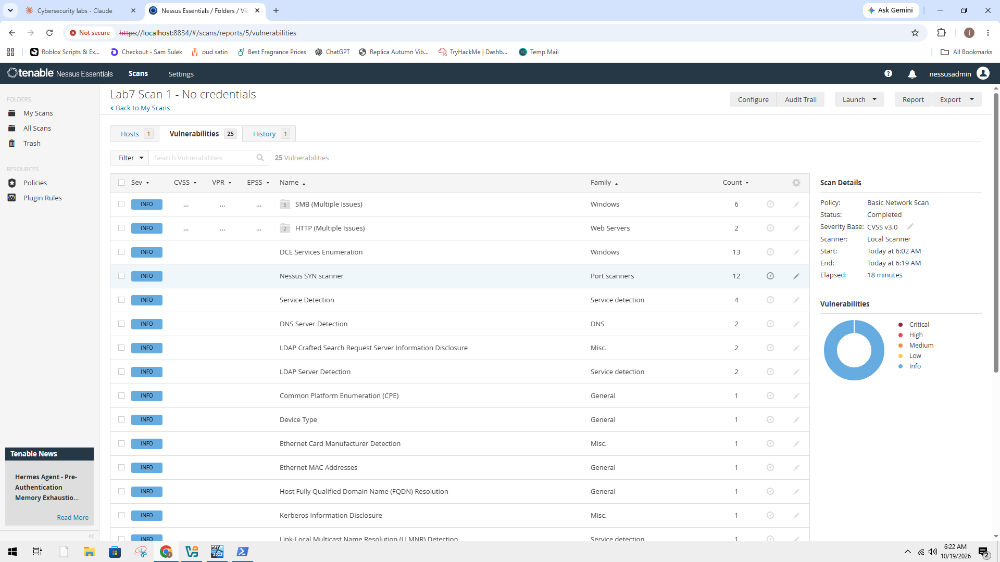

*Scan 1 (outsider view): 25 findings, all Info.*

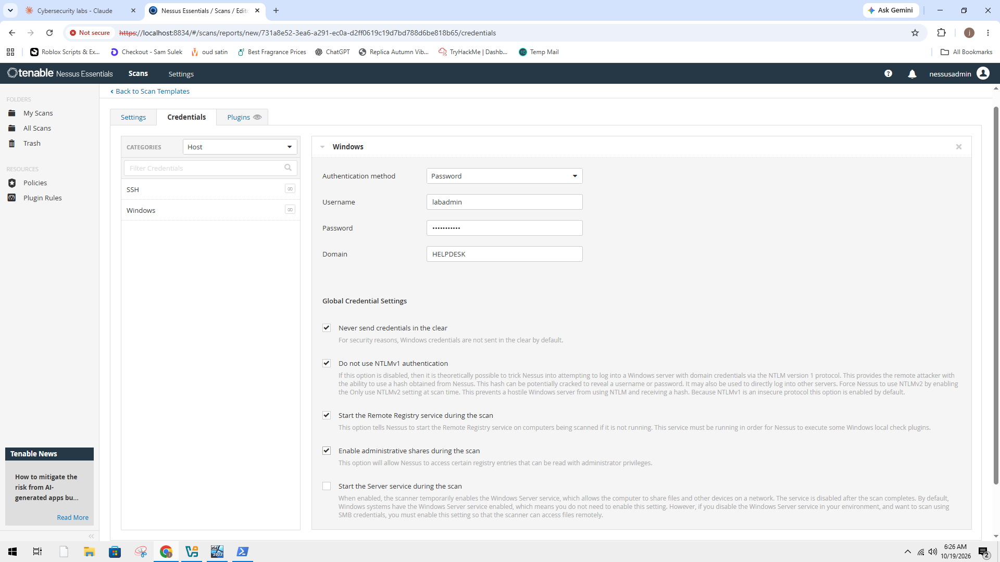

*Scan 2 credentials: domain login, NTLMv1 disabled, credentials never sent in the clear.*

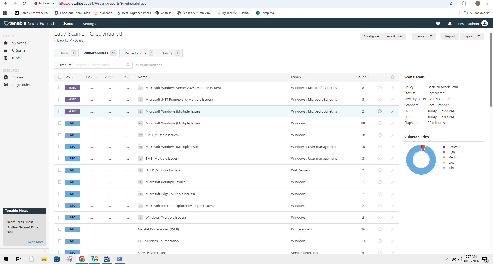

*Scan 2 (credentialed): 59 findings, including missing Windows and .NET security updates.*

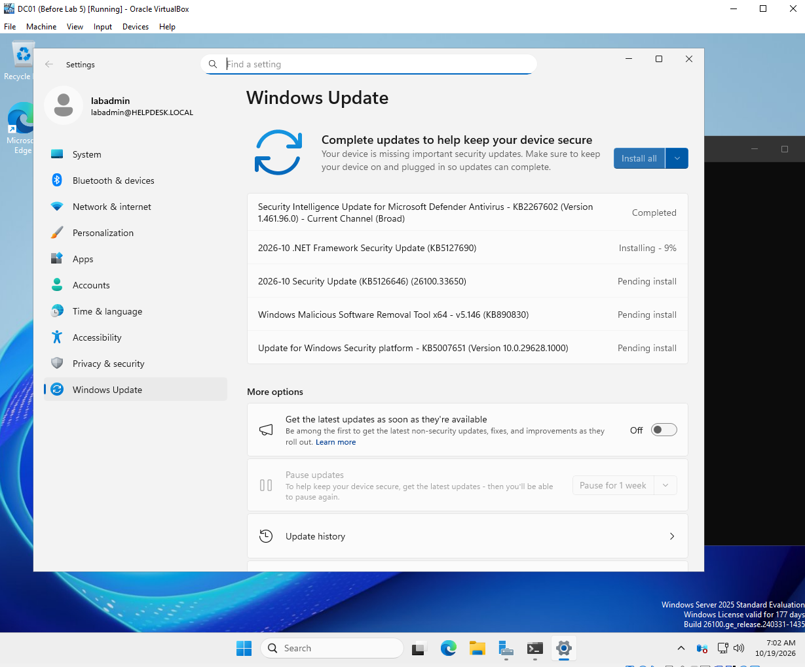

*Installing the October 2026 Windows and .NET security updates (after taking a snapshot first).*

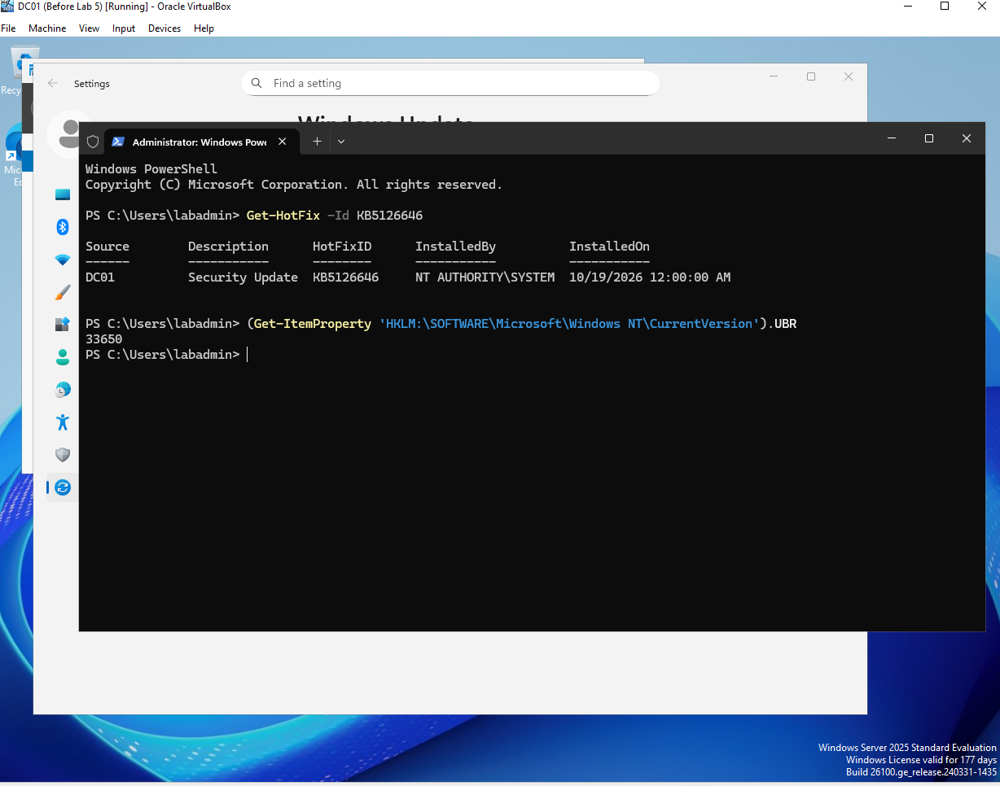

*PowerShell proof the October 2026 update (KB5126646, build 33650) installed, even though the Windows Update screen was stuck at 7%.*

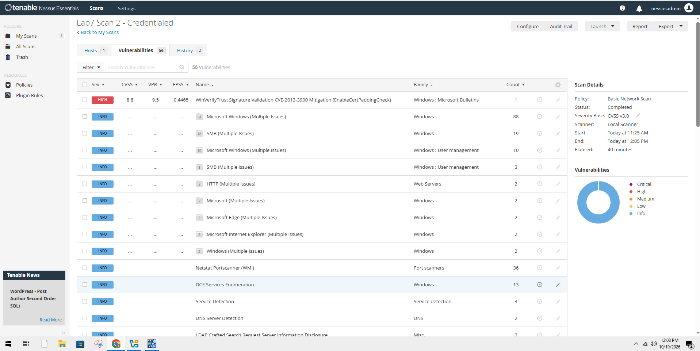

*Re-scan after patching: Critical gone, one High left (CVE-2013-3900).*

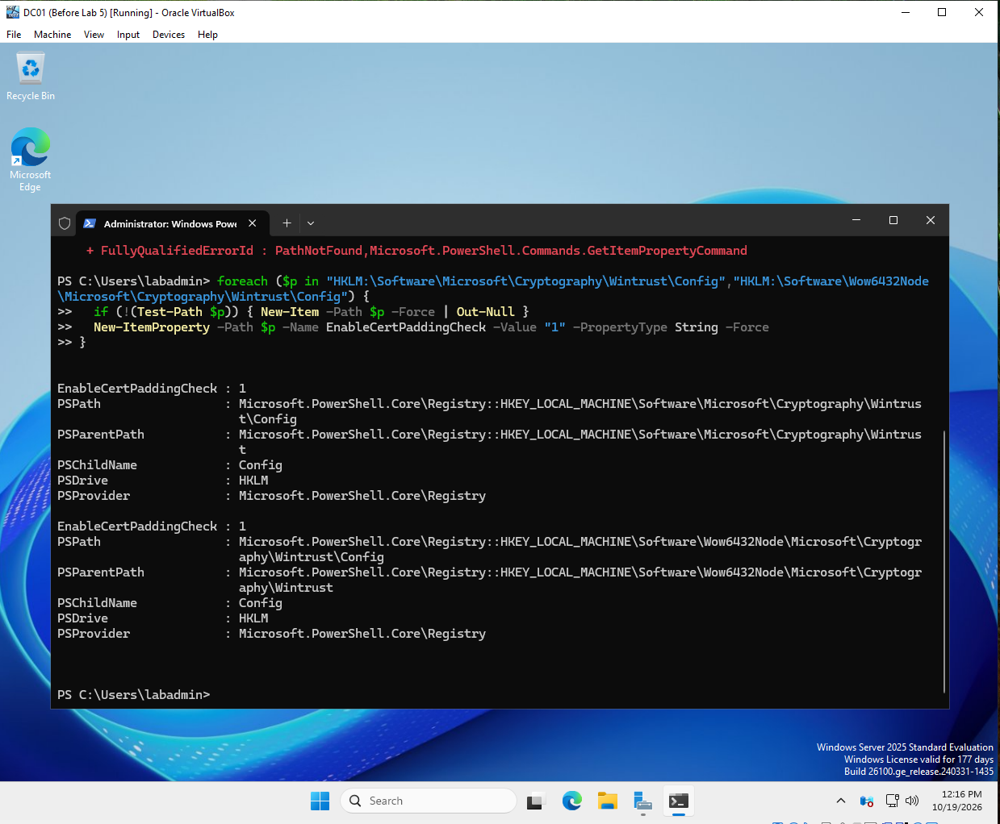

*CVE-2013-3900 fix turned on in both registry locations.*

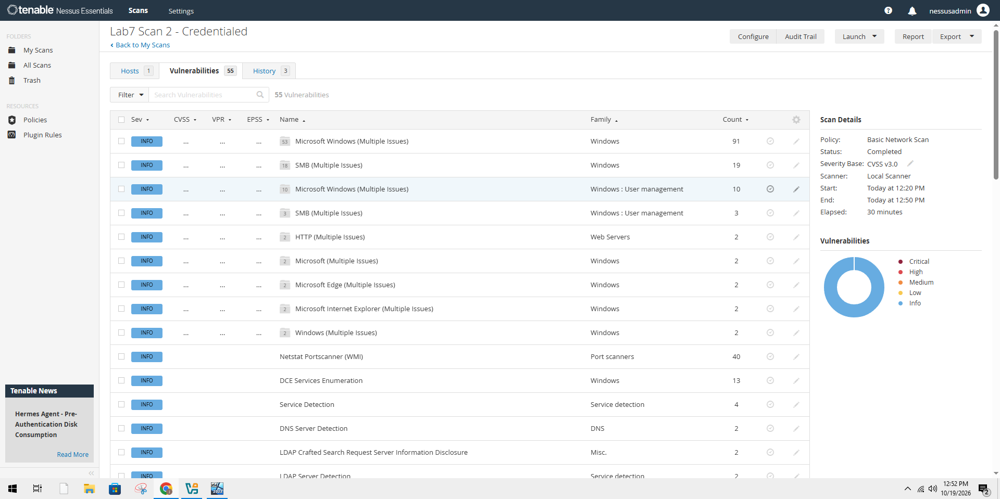

*Final re-scan: 0 Critical, 0 High.*

**Investigation**

| | Scan 1 (no credentials) | Scan 2 (credentialed) | After patching | After registry fix |
| --- | --- | --- | --- | --- |
| Total findings | 25 | 59 | 56 | 55 |
| Critical | 0 | 1 | 0 | 0 |
| High | 0 | 7+ | 1 | 0 |
| Medium | 0 | 1+ | 0 | 0 |

- **Outside vs inside:** without a login, DC01 looked clean. With a login, Nessus found 8 missing monthly Windows Server 2025 updates (February to September 2026) and 5 missing .NET updates. A non-credentialed scan alone would have given a false sense of security.
- **Prioritizing:** the worst finding was CVSS 9.8 (Critical) but had an EPSS of about 3%. A CVSS 7.0 finding had an EPSS of about 80%. Severity (CVSS) and likelihood of attack (EPSS) together decide what to fix first.
- **Patching wasn't enough:** after updating, one High remained: CVE-2013-3900 (WinVerifyTrust signature validation, CVSS 8.8). Microsoft's fix is opt-in, so no update enables it.
- **Info can still matter:** Scan 1 flagged LLMNR as "Info", but attackers use LLMNR to capture passwords on a network.

**Root cause:** DC01 had not received security updates since it was installed, and an opt-in hardening setting had never been enabled.

**Resolution**

- Installed the October 2026 cumulative update. Windows updates are cumulative, so one update fixed all 8 missing monthly patches; the .NET update fixed the other 5.
- Troubleshot a Windows Update stuck at 7%: checked disk space (29.7 GB free), reset the update cache, restarted, then verified with `Get-HotFix` and the build number that the update had actually installed.
- Enabled `EnableCertPaddingCheck` in both the 64-bit and 32-bit registry locations, verified it, and restarted.
- Re-scanned after each fix with the same credentialed scan for a fair before/after comparison.
- Saved the verification commands in [/detections](detections/lab7-remediation-checks.ps1).

**Lessons learned**

- Always run credentialed scans. The outside view hid every serious finding.
- Don't trust the screen, check the evidence. The progress bar said 7%; PowerShell proved the update was installed. My first registry check also caught that the fix had never been applied.
- Patching does not equal fully fixed. Some vulnerabilities need a configuration change.
- Prioritize with both severity (CVSS) and exploit likelihood (EPSS), not severity alone.
- Re-scan to prove a fix. A fix isn't done until the scanner agrees.

---

## Lab 8: Linux security monitoring with Splunk

**Objective:** Extend monitoring to Linux, by forwarding an Ubuntu server's security log to Splunk Cloud, simulating SSH password guessing and a privilege escalation attempt, building detections and a dashboard, then hardening SSH and proving the attack is blocked.

**Setup**

- Ubuntu Server 26.04.1 LTS VM (`ubuntu01`, 2 GB RAM) with NAT for internet and a Host-only adapter (192.168.56.102) for SSH from my laptop. DC01 powered off (one VM at a time).
- Patched with `apt`, snapshots before each major change.
- Splunk Universal Forwarder 10.6.1.1 sending `/var/log/auth.log` (`sourcetype = linux_secure`) to Splunk Cloud. Credentials package copied over with `scp`.
- The forwarder runs as the low-privilege user `splunkfwd`. It couldn't read `auth.log` (`syslog:adm`, mode 640), so I added it to the `adm` group for read-only access. In Lab 4 I fixed the same problem on Windows by running the forwarder as LocalSystem; this time I applied least privilege.
- Configured the forwarder to start at boot with systemd.

**Evidence**

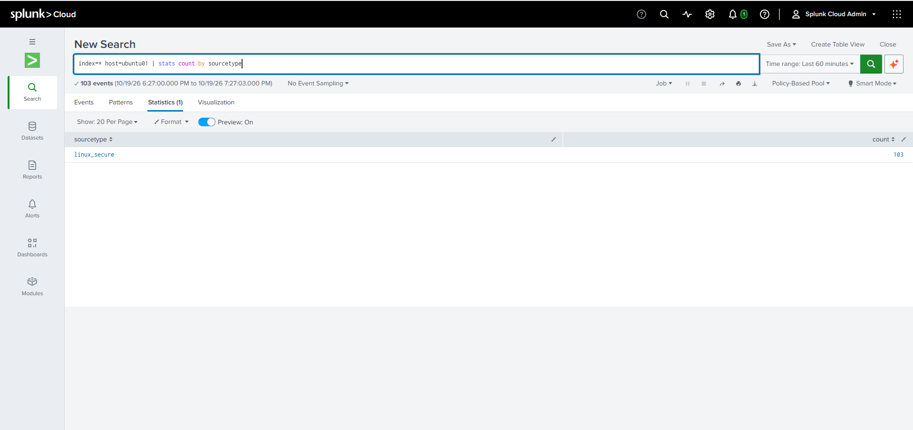

*Ubuntu's auth.log arriving in Splunk Cloud as linux_secure.*

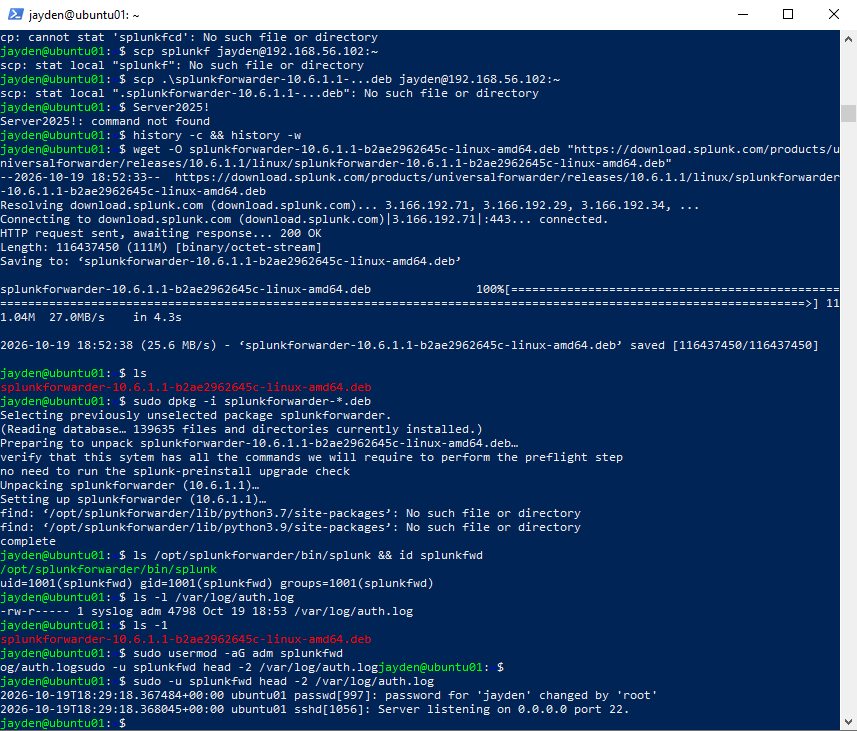

*The splunkfwd user reading auth.log after being added to the adm group.*

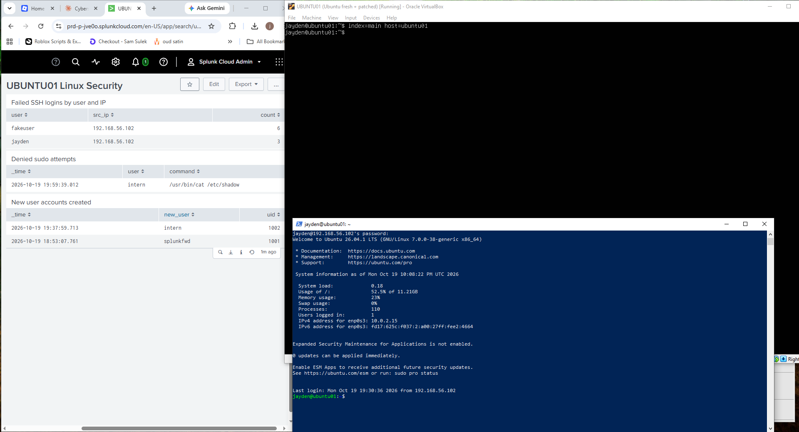

*"UBUNTU01 Linux Security" dashboard: failed SSH logins, denied sudo, and new accounts.*

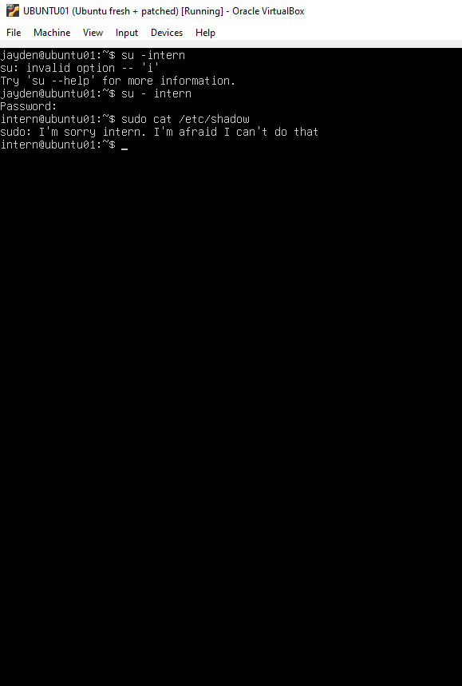

*The new sudo-rs denied intern's attempt to read /etc/shadow, but logged nothing.*

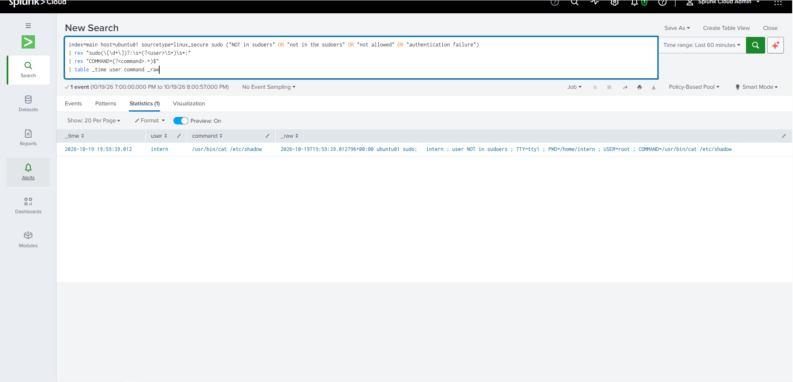

*After switching to classic sudo, Splunk catches the denied attempt.*

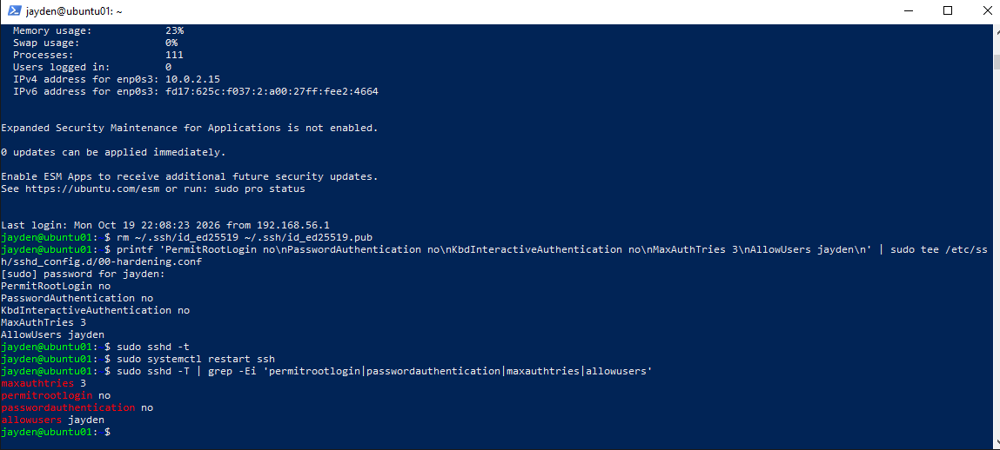

*SSH confirmed using the hardened settings.*

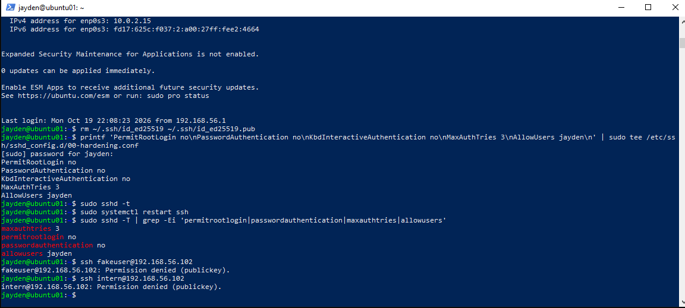

*After hardening, login attempts are rejected instantly with no password prompt.*

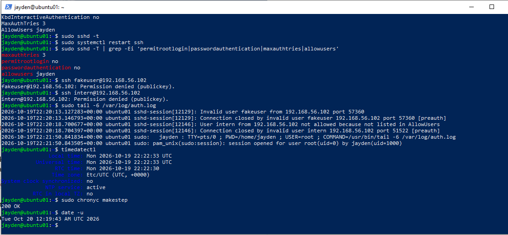

*The VM clock was 2 hours behind ("System clock synchronized: no") until I resynced it.*

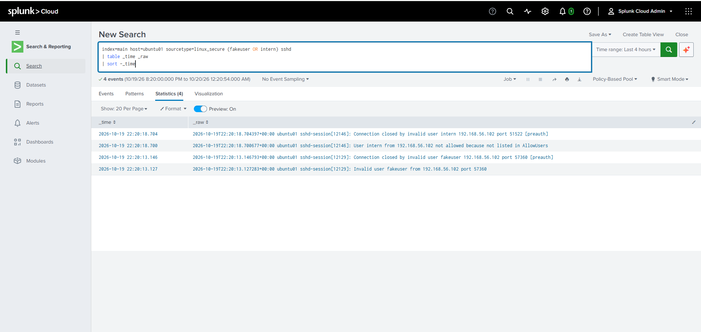

*The blocked attempts still show up in Splunk: blocked and recorded.*

**Investigation**

| What I tested | What I found |
| --- | --- |
| 9 wrong SSH passwords (6 for a fake user, 3 for a real user) | My first search counted only 2 for the real user. Pivoting on the SSH port showed the 3rd attempt was logged as `Connection closed by authenticating user ... [preauth]`, so I tuned the search to count both line types. |
| A regular user (`intern`) running `sudo cat /etc/shadow` | Denied, but Ubuntu 26.04's new `sudo-rs` logged nothing in auth.log or journald. A user could try to escalate privileges with no record. |
| Creating the `intern` account | `useradd` logs `new user: name=intern, UID=1002`, the Linux equivalent of Windows Event 4720. |
| Blocked attempts after hardening | Logged on Ubuntu but missing from a "Last 15 minutes" search. The VM clock was 2 hours behind, so Splunk filed the events in the past. |

**Root cause:** SSH allowed password logins from any account, and two visibility problems (sudo-rs not logging denials, and clock drift) could hide attacker activity.

**Resolution**

- Switched from `sudo-rs` to classic sudo (`update-alternatives --config sudo`), re-tested, and Splunk now catches the denied attempt (`intern`, `/usr/bin/cat /etc/shadow`).
- Hardened SSH in `/etc/ssh/sshd_config.d/00-hardening.conf`: no root login, no passwords (key-only), `MaxAuthTries 3`, and `AllowUsers jayden`. Set up an ed25519 key from my laptop first so I wouldn't lock myself out, then verified with `sshd -t` and `sshd -T`.
- Re-ran the attack: `fakeuser` and `intern` were rejected instantly with `Permission denied (publickey)`. Nothing left to guess.
- Fixed the clock with `chronyc makestep` and confirmed the blocked attempts in Splunk.
- Built a 3-panel dashboard and saved all searches in [/detections](detections/lab8-linux-splunk.md).

**Lessons learned**

- Test detections against what actually happened. My first SSH search undercounted.
- No log doesn't mean nothing happened. A modern tool (sudo-rs) silently skipped logging a denied privilege escalation. It's a real trade-off: memory safety vs visibility.
- Time sync matters. A 2-hour clock drift made real events invisible in a normal search.
- Hardening changes the logs. After disabling passwords, attempts show up as `Invalid user` instead of `Failed password`, so detections need updating too.
- Keep a second session open and test with a key before disabling password logins.
- Next step: `auditd` for sudo and sensitive-file monitoring, and connecting DC01 to the same Splunk instance for one Windows + Linux dashboard.

---

## Lab 9: Home lab v2: hardware assessment and architecture redesign

**Objective:** Labs 1-8 ran on one 8 GB machine, one VM at a time. Before building a bigger lab, inventory both computers I now own, audit the existing VMs, and design a segmented company network with its own SOC server, without weakening host security.

**Setup**

- Read-only PowerShell inventory script: [lab9-hardware-inventory.ps1](scripts/lab9-hardware-inventory.ps1) (CPU, RAM slots, disks, OS, network adapters, virtualization security)
- `VBoxManage list vms --long` to audit the existing VirtualBox VMs
- Vendor documentation to check limits: Gigabyte motherboard specs, Microsoft VBS docs, Wazuh, Splunk, VMware and Proxmox requirements

| | New laptop | Old desktop (runs Labs 1-8) |
| --- | --- | --- |
| CPU | Ryzen AI 7 350, 8 cores / 16 threads | AMD FX-6300, 6 threads |
| RAM | 32 GB | 8 GB DDR3, 1 of 4 slots used |
| Storage | 1 TB NVMe SSD | 1 TB 7200 rpm hard drive |
| Motherboard limit | - | Gigabyte GA-78LMT-USB3: 4x DDR3, max 32 GB, SATA 3 Gb/s |
| OS | Windows 11 Home | Windows 10 Home 22H2 |
| Network | Gigabit Ethernet (unused) + Wi-Fi 6E | Gigabit Ethernet (unused) + USB Wi-Fi |
| Host security | VBS running, Memory Integrity on | VBS off |
| Hypervisor | None yet | VirtualBox 7.2.20 |

**Evidence**

VM audit (from `VBoxManage`, trimmed):

```text
Name:            HelpDesk-PC     Guest OS: Windows 11 (64-bit)          Memory: 4096MB  NIC 1: NAT
Name:            DC01            Guest OS: Windows Server 2022 (64-bit) Memory: 3072MB  NIC 1: NAT Network, NIC 2: Host-only
Name:            UBUNTU01        Guest OS: Ubuntu 25.04 (64-bit)        Memory: 2048MB  NIC 1: NAT, NIC 2: Host-only
```

Laptop virtualization security (`Win32_DeviceGuard`):

```text
VirtualizationBasedSecurityStatus : 2      <- VBS enabled and running
SecurityServicesRunning           : {2}    <- Memory Integrity (HVCI)
```

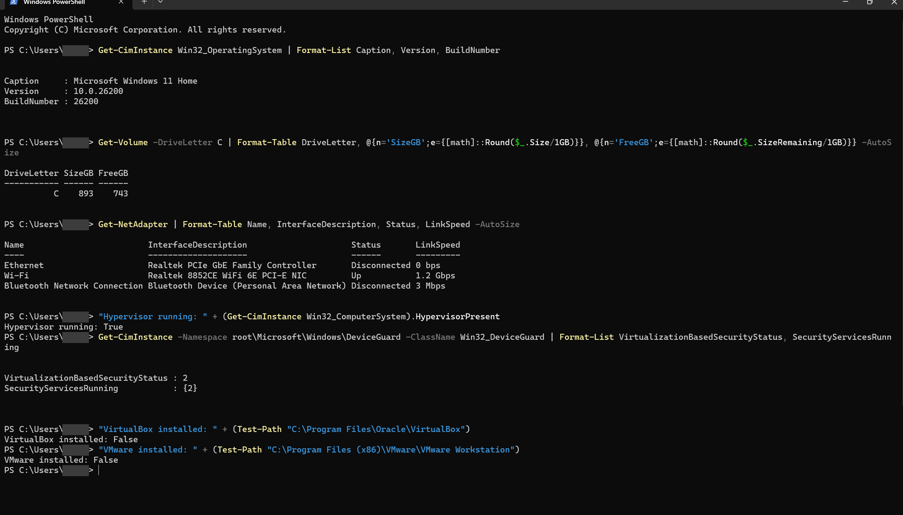

*Laptop inventory: Windows 11 Home, 743 GB free, an unused Ethernet port, and VBS + Memory Integrity running.*

**Investigation**

| Finding | What I found |
| --- | --- |
| Not enough RAM | The three VMs need 9 GB together; the host has 8 GB. That is why running two VMs crashed it in Lab 2. |
| Slow storage | VM disks on a spinning hard drive, and RAM in single-channel mode (one stick). |
| No domain-joined workstation | HelpDesk-PC is on plain NAT (its own private network), while DC01 is on a NAT Network. They can't reach each other, so the domain has no real workstation in it. |
| VM labels don't match reality | VirtualBox lists DC01 as Server 2022 and UBUNTU01 as Ubuntu 25.04, but they run Server 2025 and Ubuntu 26.04 LTS. The labels were never updated after install. |
| Lab can reach the host | The Host-only network (used for Nessus and SSH in Labs 7-8) gives VMs a direct path to my real computer. Fine for scanning, not for attack simulations. |
| Aging host OS | The desktop runs Windows 10, past end of support (October 2025). It only gets security fixes through the Extended Security Updates program. |
| Security vs speed on the laptop | Many VM guides say to turn off Hyper-V/VBS for speed. Memory Integrity protects the Windows kernel, so I kept it on and picked a hypervisor that runs alongside it. |

**Root cause:** The lab outgrew its hardware. One 8 GB machine forced one-VM-at-a-time testing, and ad-hoc network adapters left the domain without workstations and the lab without isolation.

**Resolution (design)**

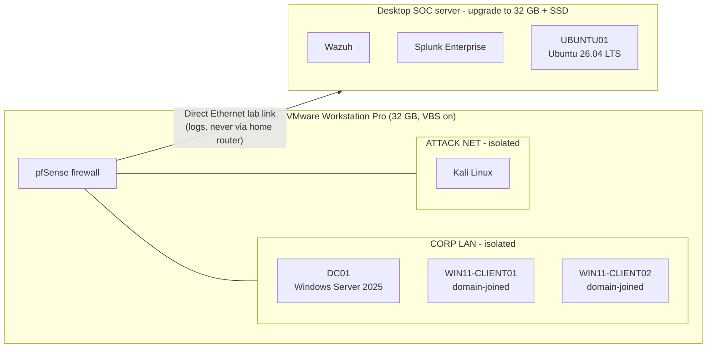

- **Laptop = the company network and the attacker.** VMware Workstation Pro (free since November 2024) runs on top of Windows' own hypervisor, so VBS and Memory Integrity stay on.
- **pfSense is the gatekeeper.** The corporate LAN and attack network are internal-only segments. Attack traffic can't reach my home network or the internet.
- **Real workstations.** Windows 11 clients join `helpdesk.local` on the same segment as DC01, which uses DC01 for DNS.
- **Desktop = SOC server.** Upgrade to 32 GB DDR3 (dual-channel) and add a SATA SSD, then self-host Wazuh and Splunk Enterprise. This replaces the cloud trials from Lab 4.
- **Direct cable between the two machines.** Both have unused gigabit Ethernet ports, so logs travel over a private link, not the household router.
- **RAM budget per session (laptop):** pfSense 1 GB, DC01 4 GB, client 4 GB, Kali 4 GB, about 13-17 GB, leaving the rest for Windows.
- Existing VMs get backed up before anything on the desktop changes.

**Lessons learned**

- Inventory before buying. PowerShell showed exactly which RAM fits (DDR3, 4 slots, 32 GB max) and why the old lab struggled.
- Virtual network types are real networking. "NAT" vs "NAT Network" decides which machines can talk, just like separate VLANs.
- Asset records drift. The VM labels were wrong, which is why a SOC verifies facts instead of trusting the inventory.
- Keep host protections on, and design around the performance cost.
- Check `hostname` before running commands. I ran the laptop checks on the desktop by mistake first, the same kind of slip as Lab 3.
- Next: Lab 10, hypervisor and firewall with segmented networks.

> **Update:** the build uses VirtualBox and OPNsense instead of VMware and pfSense. Both vendors now require an account to download, and I pivoted rather than lose time. See Lab 10.

---

## Lab 10: OPNsense firewall and isolated lab network

**Status:** In progress. The firewall is installed; next is a lab PC on the private network to manage it.

**Objective:** Build the gatekeeper for home lab v2: a firewall VM that separates a private company network (CORP-LAN) from the internet, so lab machines and future attack simulations stay sealed off from my real computer and home network.

**Setup**

- New laptop (32 GB RAM, Windows 11 Home, VBS and Memory Integrity left **on**)
- VirtualBox 7.2.22 (Expert Mode, for Internal Network options)
- OPNsense 26.7 (open-source firewall, FreeBSD based)
- Firewall VM `OPNsense-FW`: 2 GB RAM, 2 vCPU, 16 GB disk
  - **Adapter 1 / em0 = WAN:** VirtualBox NAT (internet access, 10.0.2.15)
  - **Adapter 2 / em1 = LAN:** Internal Network `CORP-LAN` (192.168.1.1/24)
- Every installer was verified with `Get-FileHash` against the vendor's published SHA256 before use

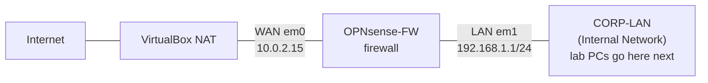

**Evidence**

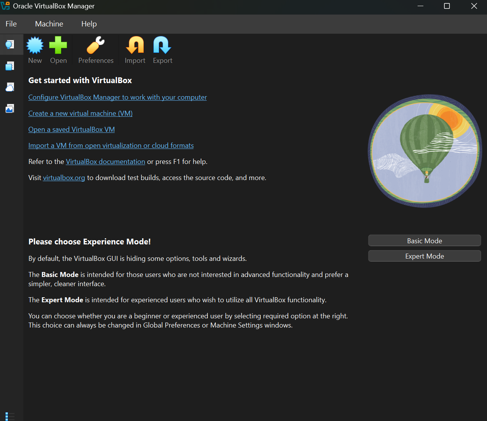

*Fresh VirtualBox install on the laptop.*

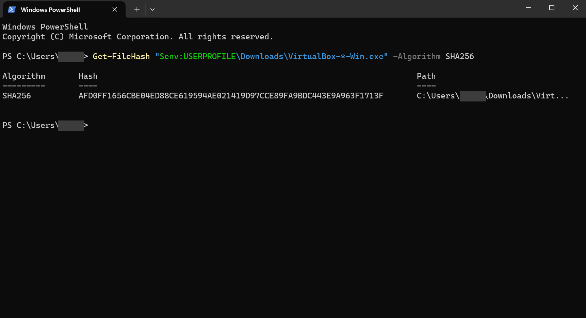

*VirtualBox installer SHA256 matched Oracle's published checksum for 7.2.22.*

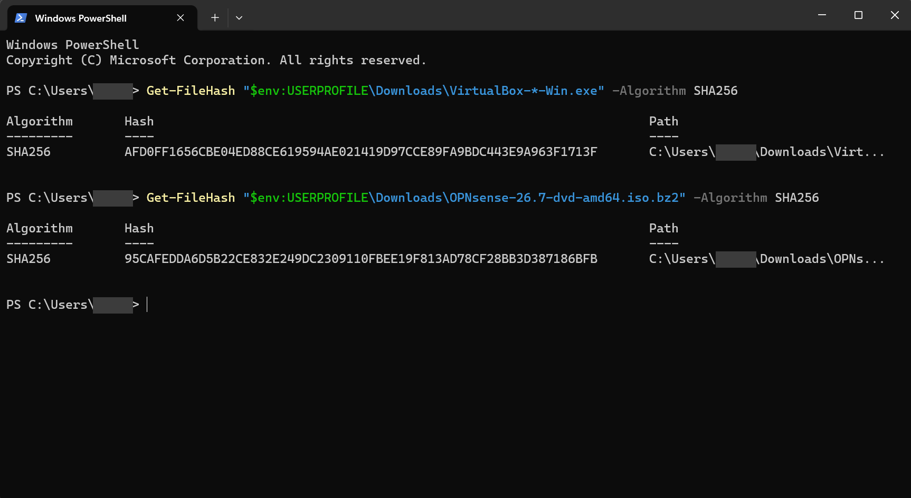

*OPNsense 26.7 image SHA256 matched the official checksum file.*

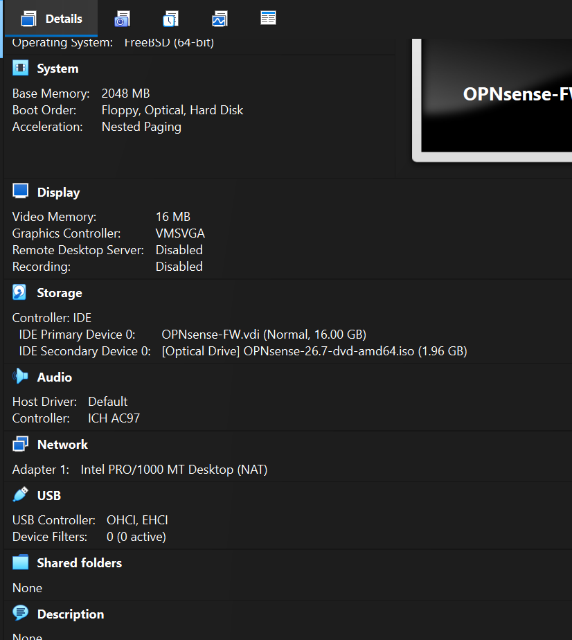

*Firewall VM created: FreeBSD 64-bit, 2 GB RAM, installer ISO attached.*

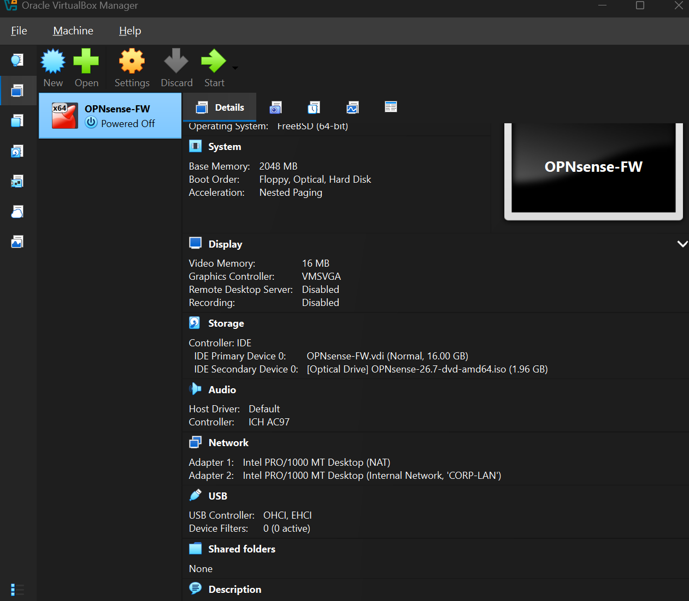

*Two adapters: NAT for the WAN and the isolated Internal Network `CORP-LAN` for the LAN.*

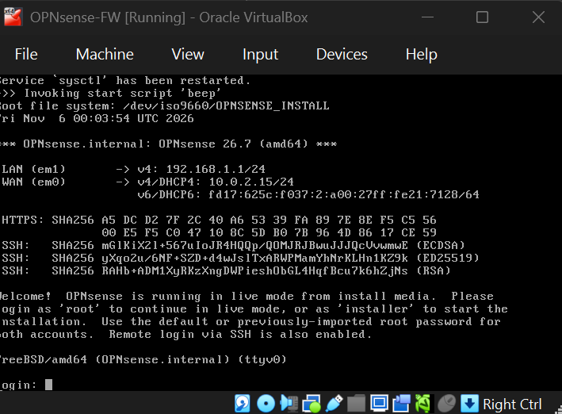

*Manual interface assignment: WAN on em0 (DHCP from NAT), LAN on em1 (192.168.1.1/24).*

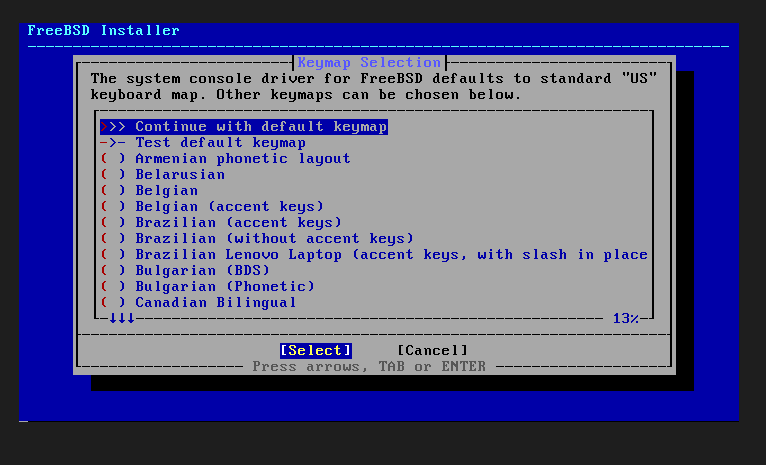

*OPNsense installer started.*

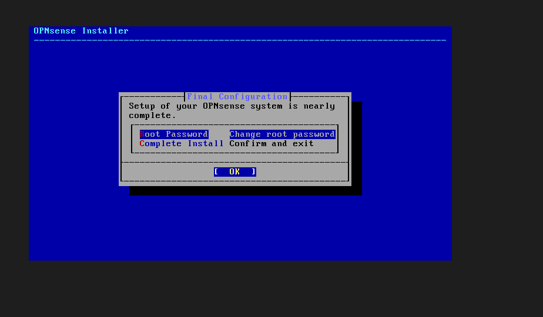

*Install finished; root password set (not shown).*

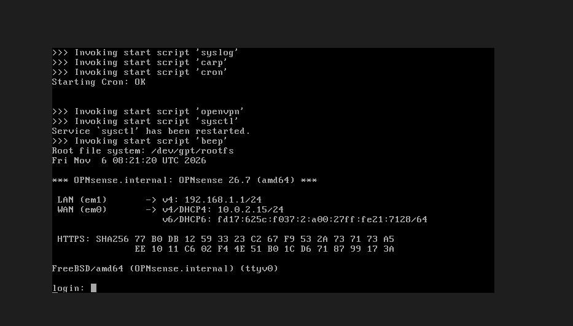

*First boot from the virtual disk (`/dev/gpt/rootfs`) with the correct WAN/LAN mapping.*

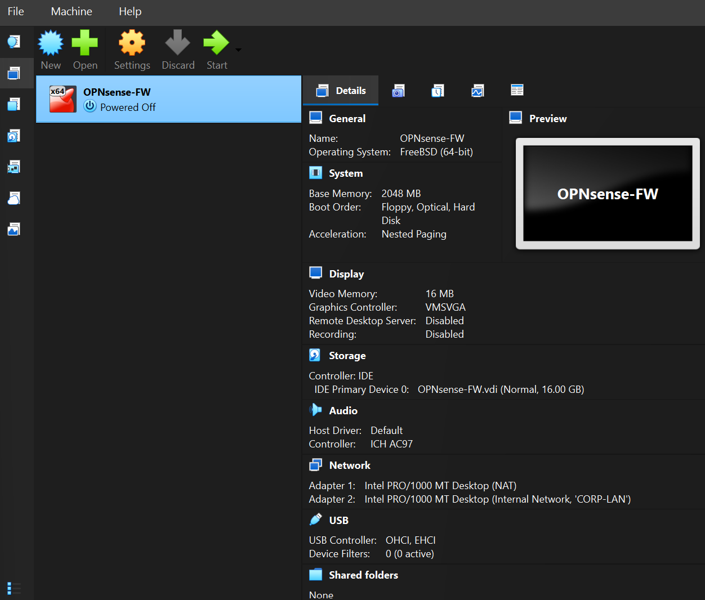

*Final VM state: installer ISO removed, NAT + CORP-LAN adapters.*

**Investigation**

| Problem | What I found |
| --- | --- |
| VMware download blocked | Broadcom's support portal requires an account, and login kept rejecting my username. |
| pfSense download | pfSense CE now ships only through the Netgate online installer with a store account. |
| Wrong network sides by default | Booting the installer without manual assignment made em0 the LAN, but em0 is the NAT (internet) adapter. |
| Firewall kept booting the installer | After install, it still showed "running in live mode from install media" because the ISO was still attached and boots first. |
| Couldn't remove the ISO | Storage settings were locked because the VM was in a **Saved** state, not powered off. |

**Resolution**

- Pivoted to VirtualBox (no account, already used in Labs 1-8) and OPNsense (direct download, same firewall concepts as pfSense), and still verified both downloads by hash.
- Assigned interfaces manually: **WAN = em0 (NAT)**, **LAN = em1 (CORP-LAN)**.
- Installed to disk with UFS (lighter than ZFS for a 2 GB VM).
- Discarded the saved state, removed the ISO, and confirmed boot from `/dev/gpt/rootfs` with the right interface mapping.

**Lessons learned**

- Verify every download. A matching SHA256 proves the file is exactly what the vendor published.
- When a tool fights you, pivot. Same lesson as Lab 4: the goal is the skill, not the brand.
- Know which adapter is which. NAT = outside (WAN), Internal Network = inside (LAN). Swapping them would put the firewall backwards.
- "Saved" is not "off." VirtualBox locks hardware changes until the VM is fully powered off.
- An installed system should boot from its disk. If it still says "live mode", the installer media is still attached.
- Next: a lab PC on CORP-LAN to reach the OPNsense web dashboard at https://192.168.1.1 and set firewall rules.
