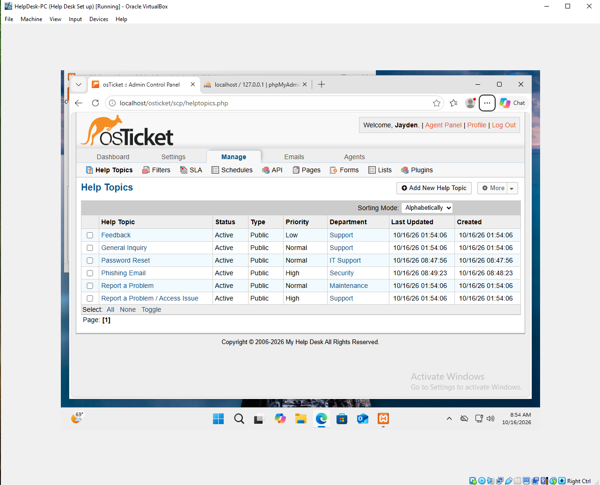
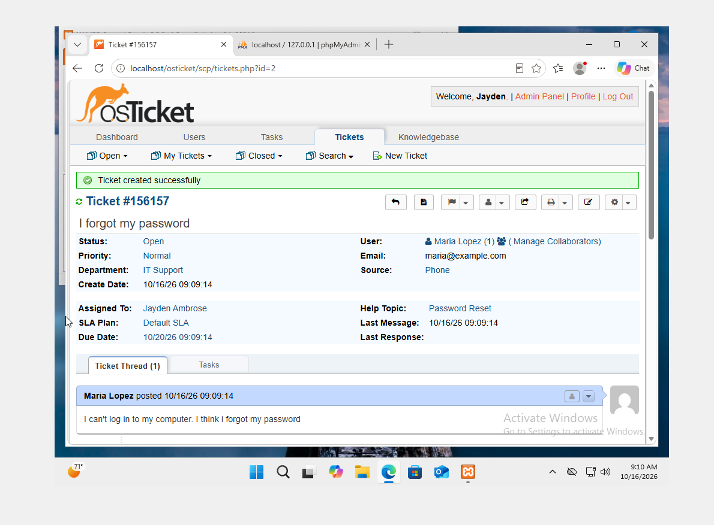
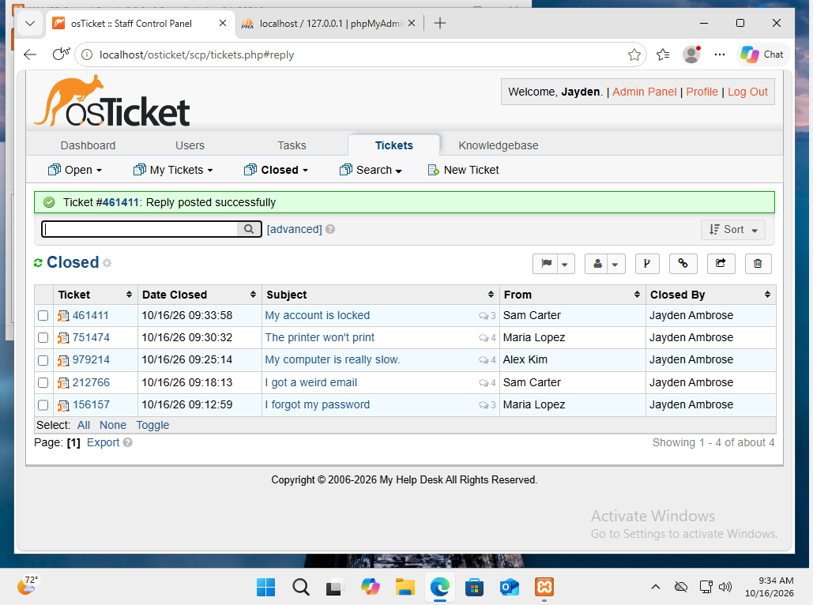

# Lab 1: Help desk ticket system

[🏠 Portfolio home](../../README.md) · [Lab 2 →](../02-active-directory-domain/)

| | |
| --- | --- |
| **Focus** | Help Desk |
| **Tools** | VirtualBox · Windows 11 · XAMPP (Apache, MariaDB, PHP) · osTicket |
| **Skills demonstrated** | Ticket lifecycle · help desk triage · reading Apache error logs · least-privilege database accounts · identity verification before resets |
| **Key result** | Built a ticketing system with routing rules and resolved 5 support tickets end to end. |

**Objective:** Learn how a help desk ticket system works by building one and resolving support tickets from start to finish.

**Setup**

- VirtualBox virtual machine running Windows 11
- XAMPP (Apache web server, MariaDB database, PHP 8.2)
- osTicket 1.18.4 with 2 departments (IT Support, Security), 3 test users, and help topics that route tickets

**Evidence**

*Help topics route password resets to IT Support and phishing reports to Security at High priority.*

*A password reset ticket created, assigned, and tracked.*

*All five support tickets resolved and closed.*

**Investigation**

- The install failed with HTTP Error 500. The Apache error log showed "Access denied for user root," so the installer was using the wrong database account.
- The new ticket form was missing its Issue Summary field. Testing a second help topic showed it was not my setup but a known osTicket bug.
- For each ticket, I identified the cause: a forgotten password, a phishing email with a fake login link, too many programs running, an offline printer, and a lockout from typos.

**Resolution**

- Created a separate database user with access to only the osTicket database, then finished the install.
- Set a default help topic, which fixed the missing field.
- Resolved all 5 tickets, verifying identity before every password reset or unlock.
- Secured the install by deleting the setup folder and making the config file read-only.

**Lessons learned**

- Check error logs first. They named the exact problem faster than guessing.
- Clear browser autofill before typing credentials. It silently reused the wrong username.
- Take a snapshot before every big step, so mistakes are easy to undo.

---

[🏠 Portfolio home](../../README.md) · [Lab 2 →](../02-active-directory-domain/)
