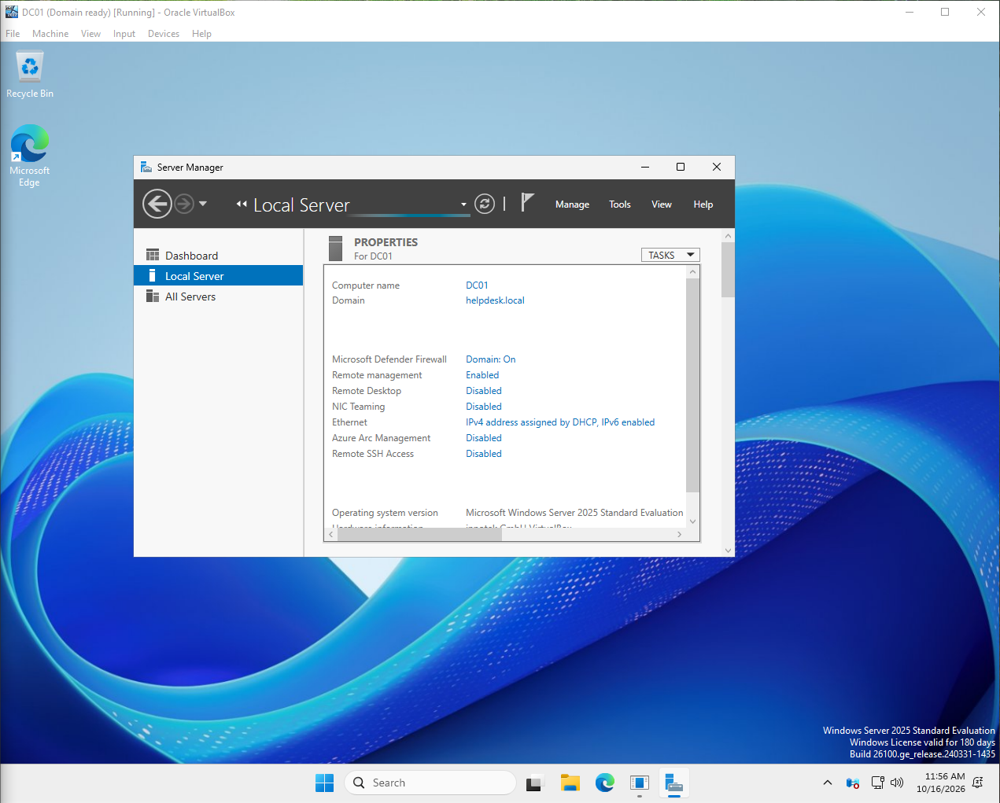
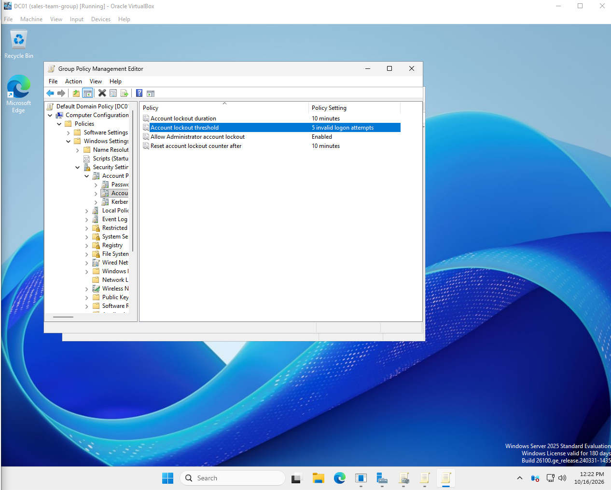
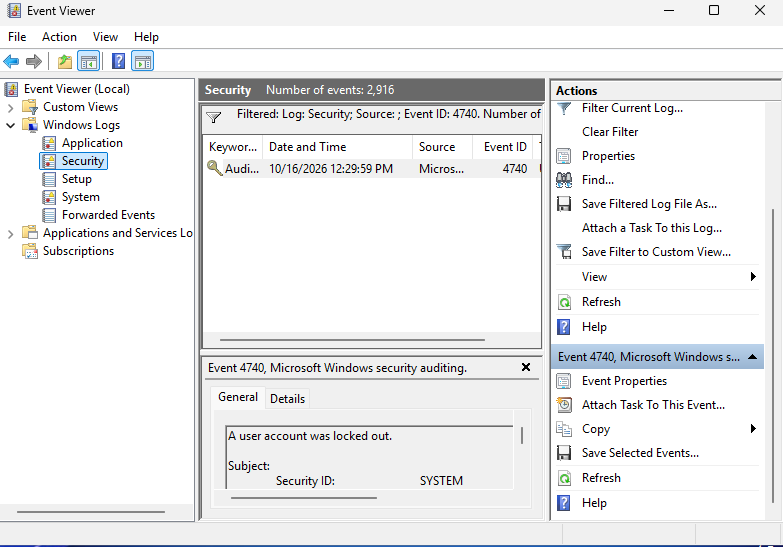

# Lab 2: Active Directory domain

[← Lab 1](../01-helpdesk-ticket-system/) · [🏠 Portfolio home](../../README.md) · [Lab 3 →](../03-windows-security-monitoring/)

| | |
| --- | --- |
| **Focus** | SysAdmin |
| **Tools** | Windows Server 2025 · Active Directory · Group Policy · Event Viewer · PowerShell |
| **Skills demonstrated** | Domain setup · OUs, users and groups · account lockout policy · unlock, reset and disable accounts · Event ID 4740 |
| **Key result** | Built the `helpdesk.local` domain and traced an account lockout to Event 4740. |

**Objective:** Learn how companies manage user accounts with Active Directory, and practice the account problems help desks handle every day.

**Setup**

- VirtualBox virtual machine running Windows Server 2025 (DC01)
- New domain: helpdesk.local
- OUs for IT, Sales and Security; 3 users; a Sales Team security group
- Account lockout policy in Group Policy: 5 failed logins locks an account for 10 minutes

**Evidence**

*DC01 running as the domain controller for helpdesk.local.*

*Account lockout policy: 5 failed logins locks an account for 10 minutes.*

*Event ID 4740 in the Security log, showing the lockout.*

**Investigation**

- Searched 2,916 Security events and found the 1 lockout event (4740), with the time, account and computer it came from.
- The domain policy could not be edited. My admin account had server rights but not Domain Admin rights.
- My first try at the lockout setting was in Default Domain Controllers Policy. User lockout rules only work in Default Domain Policy.

**Resolution**

- Unlocked the account and confirmed the error changed from 1909 (locked) to 1326 (wrong password).
- Reset a password and required a new one at next logon.
- Disabled the account of an employee who left, with a dated note, instead of deleting it.
- Logged each fix as a ticket in osTicket.

**Lessons learned**

- Use a separate admin account for admin work, instead of giving my everyday account Domain Admin rights.
- When a wizard freezes, try PowerShell. It installed Active Directory when the wizard would not.
- Check memory before running 2 virtual machines. With 8 GB, running both crashed my computer.

---

[← Lab 1](../01-helpdesk-ticket-system/) · [🏠 Portfolio home](../../README.md) · [Lab 3 →](../03-windows-security-monitoring/)
