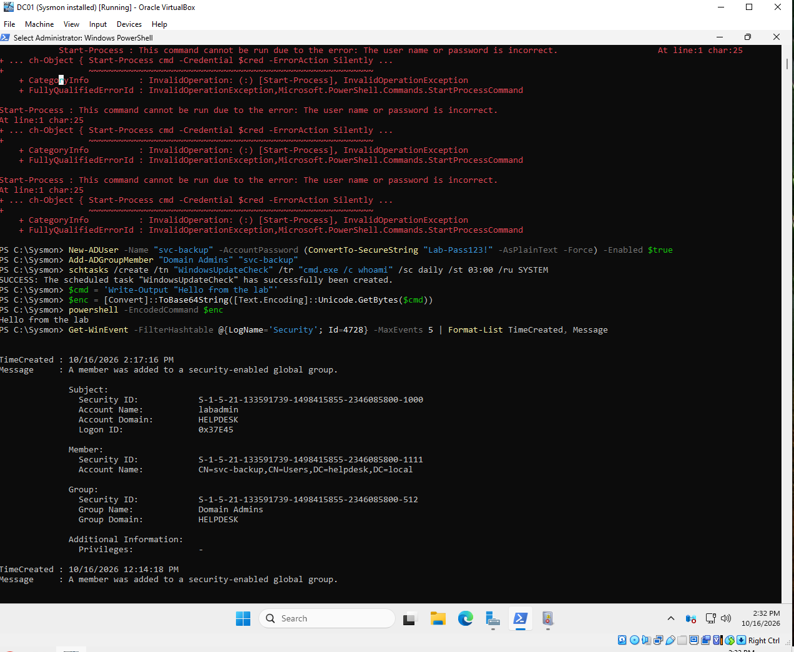
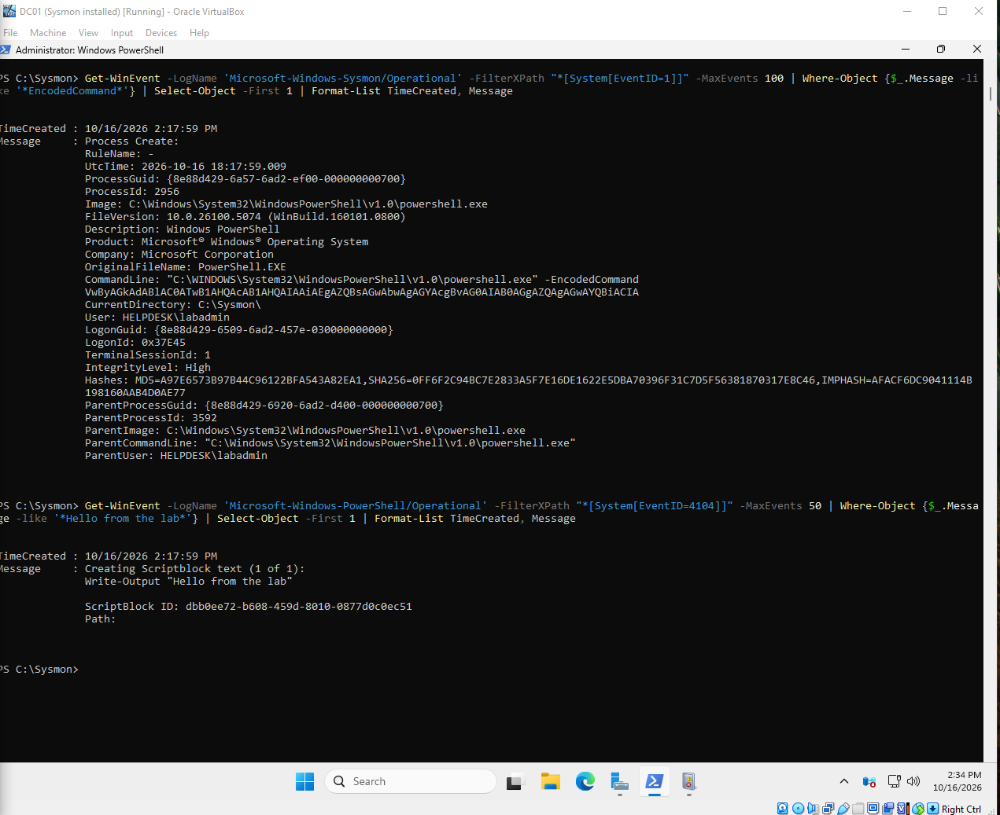
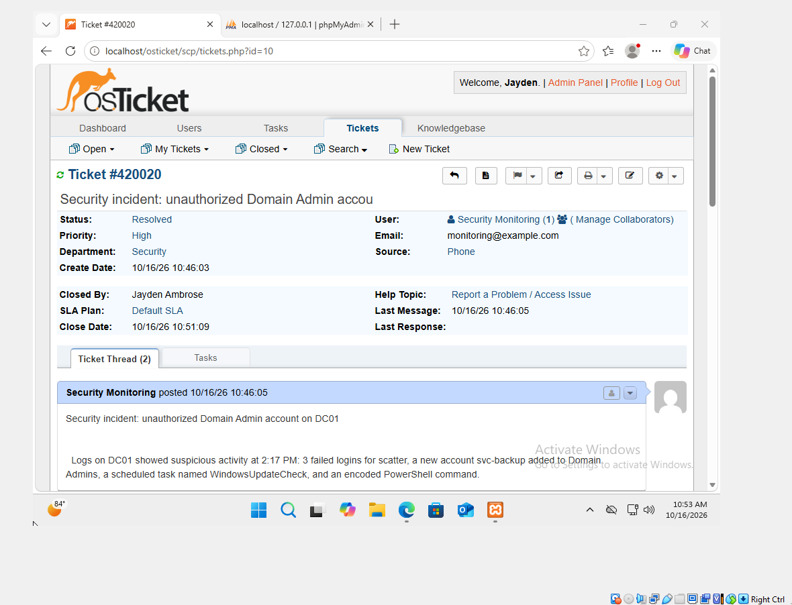

# Lab 3: Windows security monitoring

[← Lab 2](../02-active-directory-domain/) · [🏠 Portfolio home](../../README.md) · [Lab 4 →](../04-cloud-siem-splunk/)

| | |
| --- | --- |
| **Focus** | SOC |
| **Tools** | Sysmon (SwiftOnSecurity config) · Windows audit policy · Event Viewer · PowerShell `Get-WinEvent` · osTicket |
| **Skills demonstrated** | Attack detection in Windows logs · Event IDs 4625, 4720, 4728, 4698, 4104 · ruling out false positives · incident response |
| **Key result** | Detected 4 attack steps (password guessing, hidden admin, persistence task, encoded PowerShell) and removed them. |

**Objective:** Learn how a SOC analyst detects an attack in Windows logs, by attacking my own lab and then hunting for each step.

**Setup**

- DC01 (Windows Server 2025) from Lab 2
- Audit policy for logons, new programs with full command lines, account and group changes, and scheduled tasks
- Sysmon 15.22 with the SwiftOnSecurity config, and PowerShell script block logging
- Event Viewer custom view and PowerShell (Get-WinEvent) for searching

**Evidence**

*svc-backup added to Domain Admins (Event 4728).*

*The scrambled PowerShell command in Sysmon, decoded via Event 4104.*

*The incident documented and resolved in osTicket.*

**Investigation**

| What happened | Event ID | What the log showed |
| --- | --- | --- |
| Password guessing | 4625 | 3 failed logins for scarter within seconds |
| Hidden admin account | 4720, 4728 | New account svc-backup, added to Domain Admins |
| Persistence task | 4698 | Task "WindowsUpdateCheck" set to run cmd.exe daily at 3 AM |
| Encoded PowerShell | Sysmon 1, 4104 | Sysmon caught the scrambled command; Event 4104 showed the real one |

I also ruled out 2 false alarms: one failed login that was my own typo, and a group change made by Windows during setup.

**Resolution**

- Disabled svc-backup and removed it from Domain Admins.
- Deleted the scheduled task.
- Confirmed Domain Admins had only the expected accounts.
- Documented the investigation and response in an incident ticket.

**Lessons learned**

- Turn logging on before an incident happens. Without it, the encoded command would have been invisible.
- Check which window a command will run in. I once ran commands on my real computer by mistake.
- Remove installer discs from virtual machines after setup. One rebooted into the Windows installer, and a snapshot saved it.
- Next time, send logs to a SIEM tool like Wazuh or Splunk, so alerts happen automatically.

---

[← Lab 2](../02-active-directory-domain/) · [🏠 Portfolio home](../../README.md) · [Lab 4 →](../04-cloud-siem-splunk/)
