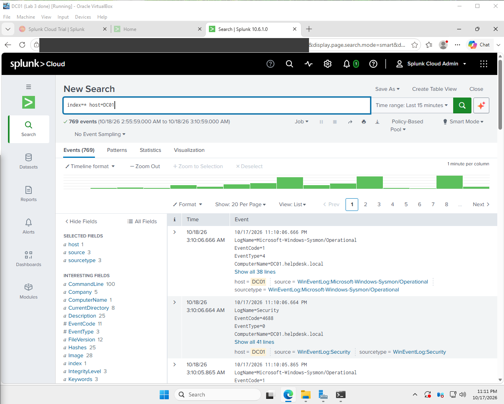
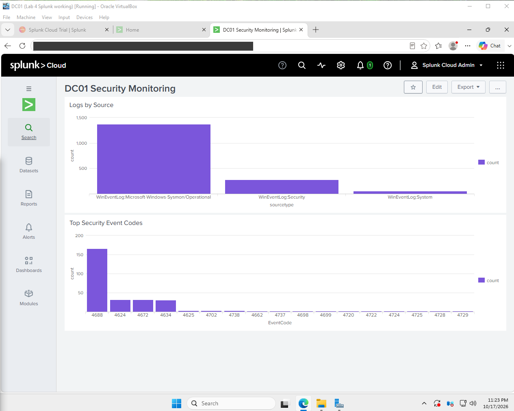

# Lab 4: Cloud SIEM monitoring with Splunk

[← Lab 3](../03-windows-security-monitoring/) · [🏠 Portfolio home](../../README.md) · [Lab 5 →](../05-suspicious-login-investigation/)

| | |
| --- | --- |
| **Focus** | SOC |
| **Tools** | Splunk Cloud · Splunk Universal Forwarder · Sysmon · Windows Server 2025 |
| **Skills demonstrated** | SIEM log onboarding · forwarder troubleshooting · service account permissions · dashboard building |
| **Key result** | Streamed Security, System and Sysmon logs into Splunk Cloud and built a monitoring dashboard. |

**Objective:** Learn how a SOC collects logs into one central SIEM, by streaming my domain controller's logs to Splunk Cloud and building a monitoring dashboard.

**Setup**

- DC01 (Windows Server 2025) from Labs 2 and 3
- Splunk Cloud Platform (free trial) as the central SIEM
- Splunk Universal Forwarder 10.6.1 on DC01, connected with the Splunk Cloud credentials package
- Log sources: Windows Security, System, and Sysmon

**Evidence**

*All three log sources streaming from DC01 into Splunk Cloud.*

*The "DC01 Security Monitoring" dashboard: logs by source and top Security event codes.*

**Investigation**

| Problem | What I found |
| --- | --- |
| Wazuh Cloud dashboard login kept failing | Single sign-on from the console would not pass through |
| Forwarder said "No users exist" | The admin account was never created during install |
| Only System logs arrived | The forwarder ran as a limited account that could not read the Security log |

The "Top Security Event Codes" panel showed my test activity and my cleanup, including account changes (4720, 4728, 4729, 4725) and scheduled task events (4698, 4699).

**Resolution**

- Switched from Wazuh Cloud to Splunk Cloud instead of losing time on a broken login.
- Created the forwarder admin account and installed the credentials package.
- Configured the forwarder to send Security, System, and Sysmon logs.
- Changed the forwarder service account so it could read every log.
- Built a two-panel monitoring dashboard.

**Lessons learned**

- When a tool keeps fighting you, pivot. Splunk Cloud did the same job without the login problems.
- Running the forwarder as LocalSystem worked, but in production I would use a dedicated account with only the access it needs (least privilege).
- Most events are normal noise. The skill is spotting the few that matter.
- A cloud SIEM let me run a real logging pipeline on an 8 GB laptop with one VM.

---

[← Lab 3](../03-windows-security-monitoring/) · [🏠 Portfolio home](../../README.md) · [Lab 5 →](../05-suspicious-login-investigation/)
