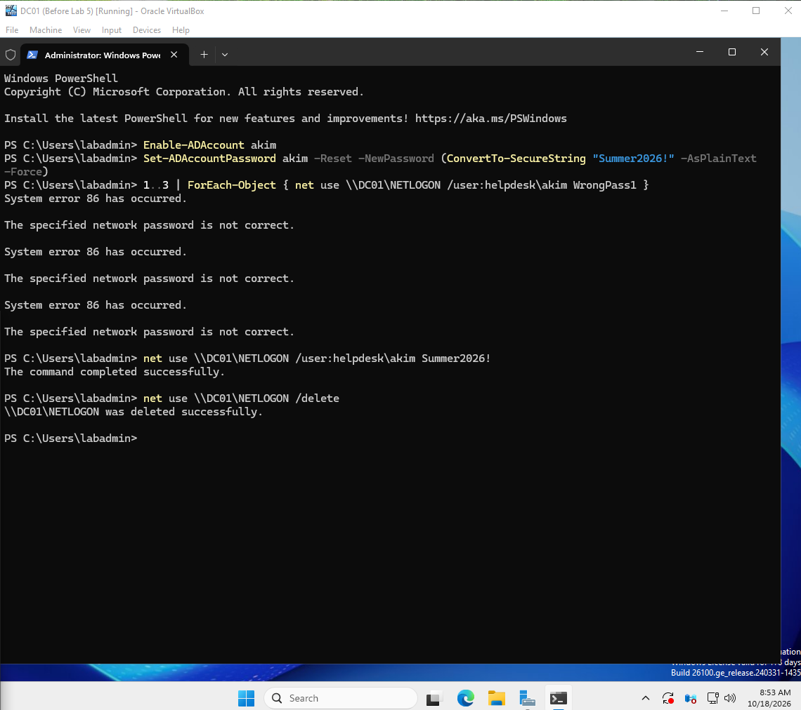
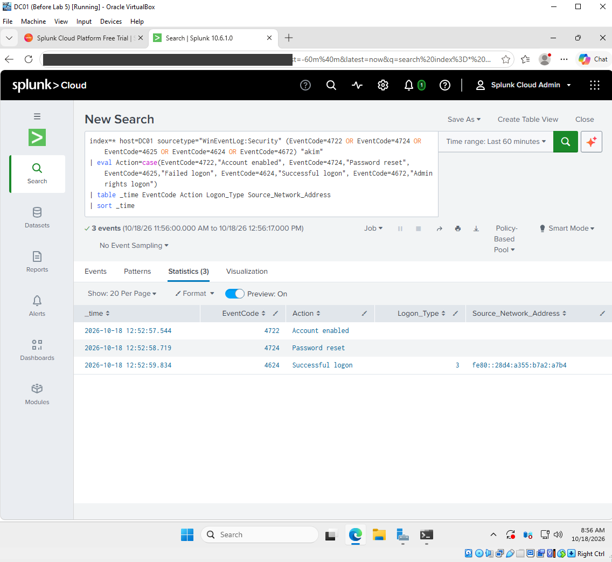
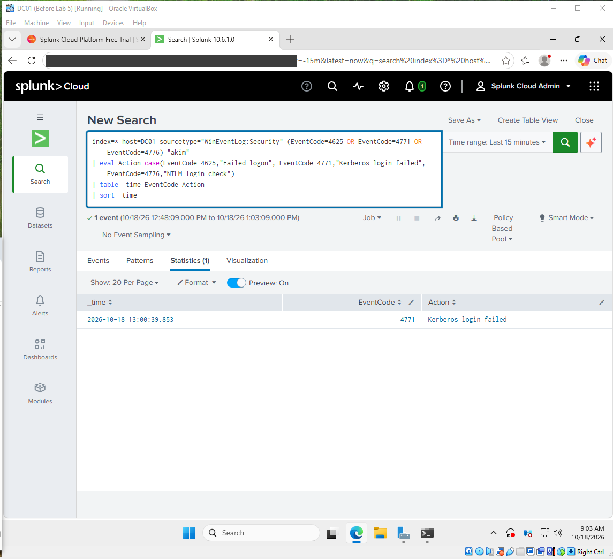
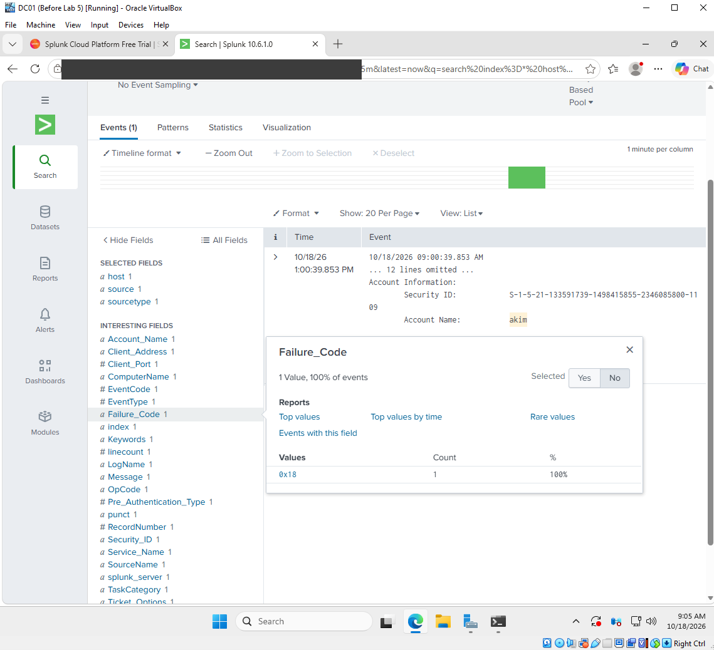
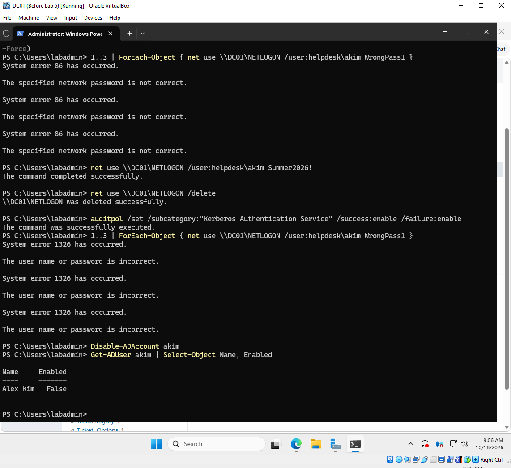

# Lab 5: Suspicious login investigation

[← Lab 4](../04-cloud-siem-splunk/) · [🏠 Portfolio home](../../README.md) · [Lab 6 →](../06-phishing-email-analysis/)

| | |
| --- | --- |
| **Focus** | SOC |
| **Tools** | Splunk Cloud (SPL) · Windows audit policy · PowerShell |
| **Skills demonstrated** | Timeline reconstruction · Kerberos failures (4771) · finding and fixing an audit gap · account remediation |
| **Key result** | Reconstructed a dormant-account takeover and found that failed logins were not being logged at all. |

**Objective:** Learn how a SOC analyst investigates an unexpected login, by simulating a dormant account being taken over outside business hours and tracing it in Splunk.

**Setup**

- DC01 (Windows Server 2025) streaming Security logs to Splunk Cloud (from Lab 4)
- Test account: `akim` (Alex Kim), disabled and unused
- Simulated activity on a Sunday morning: the account was re-enabled, its password reset, a few wrong-password attempts, then a successful network login

**Evidence**

*The simulated activity on DC01: account enabled, password reset, wrong-password attempts, then a successful login.*

*Account enabled, password reset, and network login, all within 2 seconds.*

*After the audit fix, Splunk caught the failed login as Event 4771.*

*Failure Code 0x18 confirms a wrong password.*

*Account disabled (Enabled: False) and password reset.*

**Investigation**

| Time (ET, Sun Oct 18) | Event ID | What happened |
| --- | --- | --- |
| 8:52:57 AM | 4722 | Dormant account `akim` re-enabled |
| 8:52:58 AM | 4724 | Password reset by an admin account |
| (not logged) | none | 3 wrong-password attempts left no record |
| 8:52:59 AM | 4624 | Successful network login (Logon Type 3) |
| 9:00:39 AM | 4771 | Wrong-password attempt caught after the audit fix (Failure Code 0x18) |

- **Red flags:** Sunday morning, a dormant account, and enable → reset → login in 2 seconds.
- **No 4672:** the account had no admin rights, which limited the impact.
- **Audit gap:** I searched for failed logins (4625, 4771, 4776) and found none. On a domain controller, failed domain logins log as 4771, and Kerberos failure auditing was off. The attempts happened, but nothing recorded them.

**Root cause:** A disabled account was turned back on and given a known password. Missing Kerberos failure auditing hid the password guessing.

**Resolution**

- Disabled the account and confirmed `Enabled: False`.
- Reset the password so the known one no longer works, and required a change at next logon.
- Turned on Kerberos Authentication Service auditing (success and failure) and re-tested to prove failures now reach Splunk.
- Saved the searches in [/detections](../../detections/lab5-suspicious-login.md), including an off-hours login alert idea.

**Lessons learned**

- No logs does not mean nothing happened. Test that each detection can actually fire.
- On a domain controller, failed logins show up as 4771 (Kerberos) or 4776 (NTLM), not just 4625.
- Speed between events is a clue. People do not enable, reset, and log in within 2 seconds.
- Next step: delete or tightly manage dormant accounts, and alert on 4722 for any account that has been disabled a long time.

---

[← Lab 4](../04-cloud-siem-splunk/) · [🏠 Portfolio home](../../README.md) · [Lab 6 →](../06-phishing-email-analysis/)
