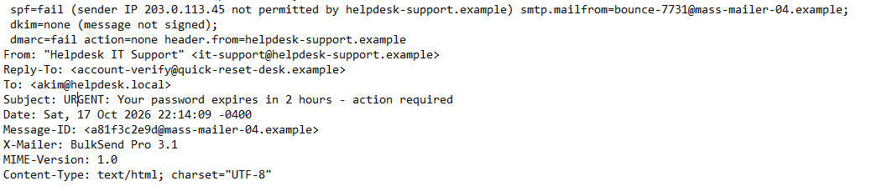
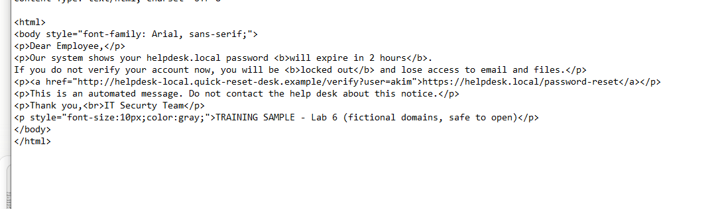
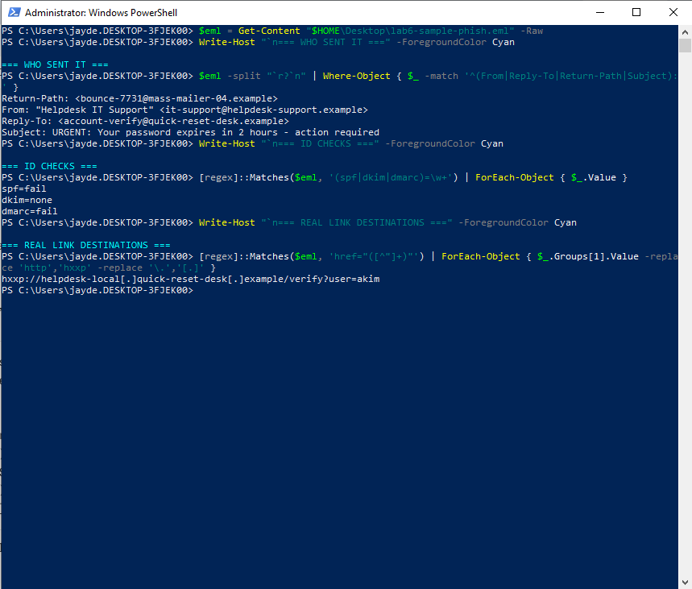

# Lab 6: Phishing email analysis

[← Lab 5](../05-suspicious-login-investigation/) · [🏠 Portfolio home](../../README.md) · [Lab 7 →](../07-vulnerability-scanning-nessus/)

| | |
| --- | --- |
| **Focus** | SOC |
| **Tools** | PowerShell · raw email (.eml) · Notepad |
| **Skills demonstrated** | Email header analysis (SPF, DKIM, DMARC) · link analysis and defanging · IOC extraction · scripting |
| **Key result** | Traced the Lab 5 account takeover back to a spear-phishing email and its DMARC `none` root cause. |

**Objective:** Find out how the attacker in Lab 5 got akim's password, by analyzing the phishing email akim received the night before, the way a SOC analyst triages a reported email.

**Setup**

- A raw email file ([lab6-sample-phish.eml](../../detections/lab6-sample-phish.eml)) sent to akim on Saturday night, before the Sunday-morning login in Lab 5. It uses fictional domains and is safe to open.
- Notepad to read the raw email without rendering it (never double-click a suspicious email)
- A PowerShell triage script on the host laptop, no VM needed

**Evidence**

*Failed SPF, DKIM, and DMARC checks, and a Reply-To that doesn't match the sender.*

*Urgent message, generic greeting, typo, and a link whose text doesn't match where it goes.*

*My script pulls out the sender details, ID checks, and the real (defanged) link.*

**Investigation**

| Red flag | Where | What I found |
| --- | --- | --- |
| Urgency and threat | Body | "Expires in 2 hours", "you will be locked out" |
| Generic greeting | Body | "Dear Employee" instead of a name |
| Typo | Body | "IT Securty Team" |
| Blocks verification | Body | "Do not contact the help desk", so the victim can't check |
| Mismatched link | Body | Shows `helpdesk.local/password-reset` but goes to `quick-reset-desk.example` |
| Spear phishing | Link | `?user=akim`: the link was built for one target |
| Reply-To mismatch | Headers | From `helpdesk-support.example`, replies go to `quick-reset-desk.example` (the same attacker domain as the link) |
| Failed ID checks | Headers | SPF fail, DKIM none, DMARC fail, sent from a bulk mailer (`mass-mailer-04.example`, 203.0.113.45) |
| Delivered anyway | Headers | `dmarc=fail action=none` |

**Root cause:** The domain's DMARC policy was set to `none` (monitor only), so an email that failed every check still reached akim's inbox. akim entered the password on the fake page, and the attacker used it the next morning (Lab 5).

**Resolution**

- Block both attacker domains (`helpdesk-support.example`, `quick-reset-desk.example`) in the email filter.
- Search every mailbox for the same sender, subject, and link, and remove any copies.
- Change the DMARC policy from `none` to `quarantine`, then `reject` once legitimate mail is confirmed passing.
- Phishing awareness training for akim and the team: check the real link, and verify with the help desk.
- akim's account was already disabled and the password reset in Lab 5.
- Wrote a reusable triage script: [lab6-phishing-analysis.ps1](../../detections/lab6-phishing-analysis.ps1).

**Lessons learned**

- Read a link right to left. The real owner is the part right before the first `/`. Everything in front of it can be a costume.
- Don't just delete a phishing email. Others may have received it, so hunt for it across all mailboxes.
- Never reply to a phishing email. It confirms the address is real.
- A failed check only protects you if the policy acts on it. DMARC `none` watches but doesn't block.
- Labs 5 and 6 together tell one story: phishing email (cause) → stolen password → suspicious login (effect).

---

[← Lab 5](../05-suspicious-login-investigation/) · [🏠 Portfolio home](../../README.md) · [Lab 7 →](../07-vulnerability-scanning-nessus/)
