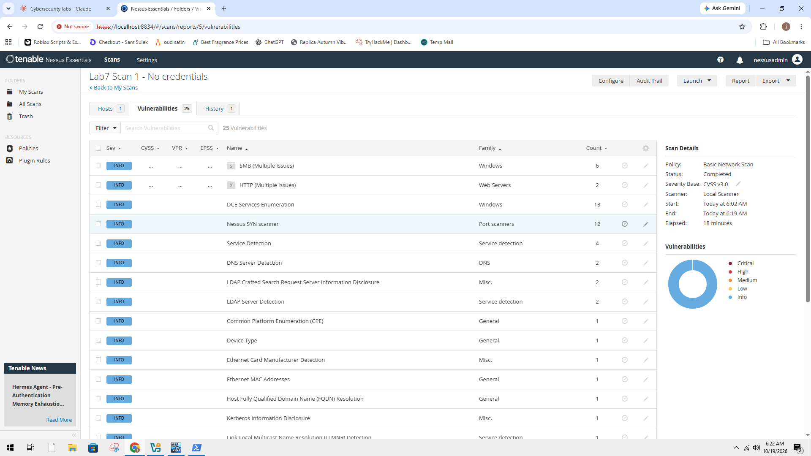
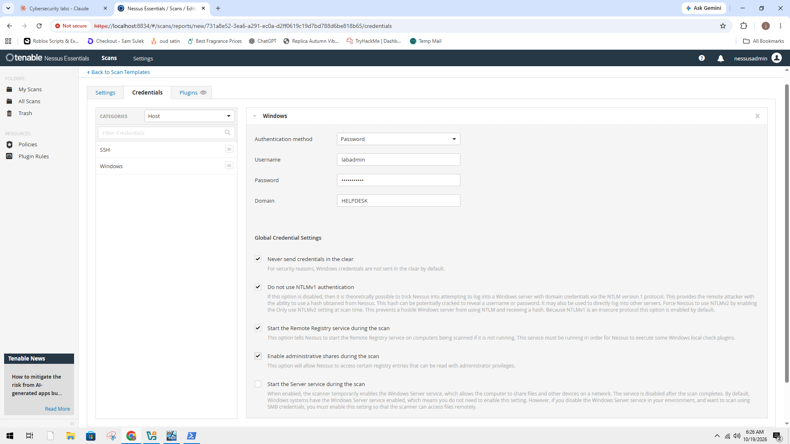
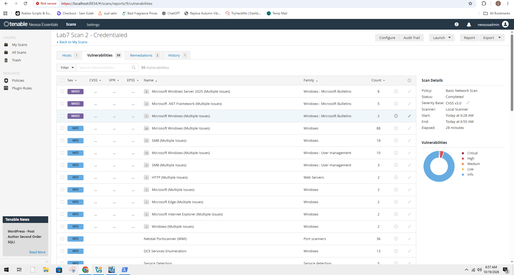
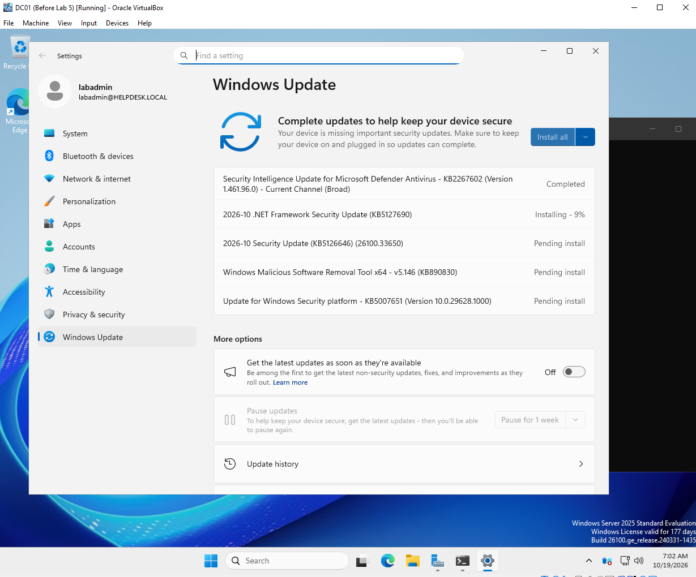
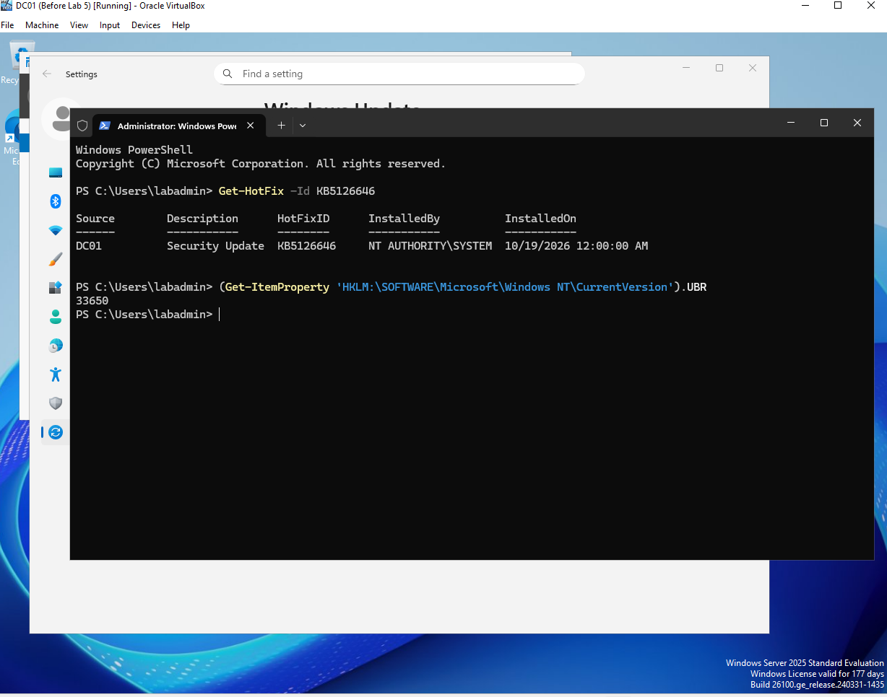
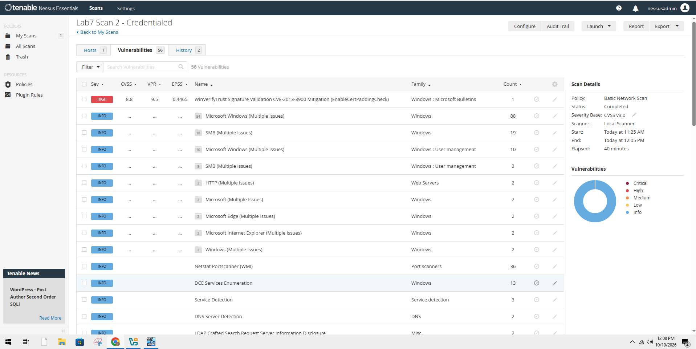
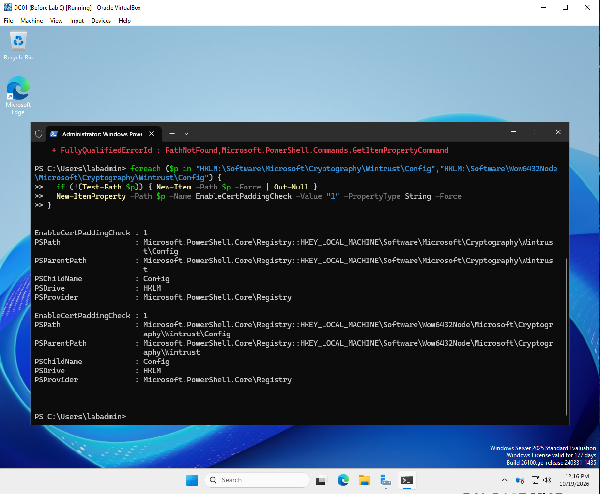
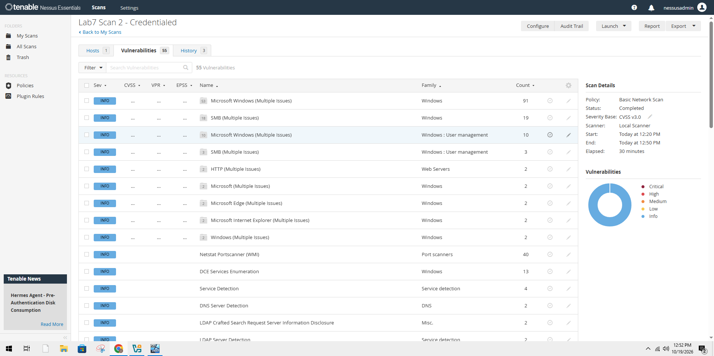

# Lab 7: Vulnerability scanning with Nessus

[← Lab 6](../06-phishing-email-analysis/) · [🏠 Portfolio home](../../README.md) · [Lab 8 →](../08-linux-security-monitoring/)

| | |
| --- | --- |
| **Focus** | SOC / SysAdmin |
| **Tools** | Nessus Essentials · Windows Update · PowerShell · Registry Editor |
| **Skills demonstrated** | Credentialed vs. non-credentialed scanning · CVSS vs. EPSS prioritization · patching · verifying fixes |
| **Key result** | Took a domain controller from **1 Critical + 7+ High** findings to **0 Critical, 0 High**. |

**Objective:** Learn how vulnerability management works, by scanning my domain controller with and without credentials, fixing what the scan found, and re-scanning to prove the fixes worked.

**Setup**

- Nessus Essentials 10.12.5 (free) installed on my host laptop
- Added a VirtualBox **Host-only** adapter to DC01 (192.168.56.101) so the scanner could reach it, while the NAT adapter kept the Splunk forwarder online
- Confirmed the path with `Test-NetConnection 192.168.56.101 -Port 445` (SMB, needed for credentialed checks)
- Two Basic Network Scans: one with no credentials, one with a domain admin login (Remote Registry and admin shares enabled during the scan, NTLMv1 disabled, credentials never sent in the clear)
- Snapshot taken before patching

**Evidence**

*Scan 1 (outsider view): 25 findings, all Info.*

*Scan 2 credentials: domain login, NTLMv1 disabled, credentials never sent in the clear.*

*Scan 2 (credentialed): 59 findings, including missing Windows and .NET security updates.*

*Installing the October 2026 Windows and .NET security updates (after taking a snapshot first).*

*PowerShell proof the October 2026 update (KB5126646, build 33650) installed, even though the Windows Update screen was stuck at 7%.*

*Re-scan after patching: Critical gone, one High left (CVE-2013-3900).*

*CVE-2013-3900 fix turned on in both registry locations.*

*Final re-scan: 0 Critical, 0 High.*

**Investigation**

| | Scan 1 (no credentials) | Scan 2 (credentialed) | After patching | After registry fix |
| --- | --- | --- | --- | --- |
| Total findings | 25 | 59 | 56 | 55 |
| Critical | 0 | 1 | 0 | 0 |
| High | 0 | 7+ | 1 | 0 |
| Medium | 0 | 1+ | 0 | 0 |

- **Outside vs inside:** without a login, DC01 looked clean. With a login, Nessus found 8 missing monthly Windows Server 2025 updates (February to September 2026) and 5 missing .NET updates. A non-credentialed scan alone would have given a false sense of security.
- **Prioritizing:** the worst finding was CVSS 9.8 (Critical) but had an EPSS of about 3%. A CVSS 7.0 finding had an EPSS of about 80%. Severity (CVSS) and likelihood of attack (EPSS) together decide what to fix first.
- **Patching wasn't enough:** after updating, one High remained: CVE-2013-3900 (WinVerifyTrust signature validation, CVSS 8.8). Microsoft's fix is opt-in, so no update enables it.
- **Info can still matter:** Scan 1 flagged LLMNR as "Info", but attackers use LLMNR to capture passwords on a network.

**Root cause:** DC01 had not received security updates since it was installed, and an opt-in hardening setting had never been enabled.

**Resolution**

- Installed the October 2026 cumulative update. Windows updates are cumulative, so one update fixed all 8 missing monthly patches; the .NET update fixed the other 5.
- Troubleshot a Windows Update stuck at 7%: checked disk space (29.7 GB free), reset the update cache, restarted, then verified with `Get-HotFix` and the build number that the update had actually installed.
- Enabled `EnableCertPaddingCheck` in both the 64-bit and 32-bit registry locations, verified it, and restarted.
- Re-scanned after each fix with the same credentialed scan for a fair before/after comparison.
- Saved the verification commands in [/detections](../../detections/lab7-remediation-checks.ps1).

**Follow-ups (not done yet)**

- **Remote Registry:** the credentialed scan used Nessus's "Start the Remote Registry service during the scan" option. Nessus stops the service again after the scan, but I still want to confirm it on DC01 with `Get-Service RemoteRegistry` (expected: `Stopped`).
- **LLMNR:** flagged in Scan 1 but not disabled yet. Fix: Group Policy → Computer Configuration → Administrative Templates → Network → DNS Client → **Turn off multicast name resolution** = Enabled.

**Lessons learned**

- Always run credentialed scans. The outside view hid every serious finding.
- Don't trust the screen, check the evidence. The progress bar said 7%; PowerShell proved the update was installed. My first registry check also caught that the fix had never been applied.
- Patching does not equal fully fixed. Some vulnerabilities need a configuration change.
- Prioritize with both severity (CVSS) and exploit likelihood (EPSS), not severity alone.
- Re-scan to prove a fix. A fix isn't done until the scanner agrees.

---

[← Lab 6](../06-phishing-email-analysis/) · [🏠 Portfolio home](../../README.md) · [Lab 8 →](../08-linux-security-monitoring/)
