# Lab 8: Linux security monitoring with Splunk

[← Lab 7](../07-vulnerability-scanning-nessus/) · [🏠 Portfolio home](../../README.md) · [Lab 9 →](../09-home-lab-v2-architecture/)

| | |
| --- | --- |
| **Focus** | SOC / Linux |
| **Tools** | Ubuntu Server 26.04 LTS · Splunk Universal Forwarder · OpenSSH · sudo / sudo-rs · systemd · chrony |
| **Skills demonstrated** | Linux log forwarding · least privilege · SSH hardening (key-only) · detection tuning · time synchronization |
| **Key result** | Detected SSH password guessing and a privilege-escalation attempt, found a logging gap in `sudo-rs`, and hardened SSH. |

**Objective:** Extend monitoring to Linux, by forwarding an Ubuntu server's security log to Splunk Cloud, simulating SSH password guessing and a privilege escalation attempt, building detections and a dashboard, then hardening SSH and proving the attack is blocked.

**Setup**

- Ubuntu Server 26.04.1 LTS VM (`ubuntu01`, 2 GB RAM) with NAT for internet and a Host-only adapter (192.168.56.102) for SSH from my laptop. DC01 powered off (one VM at a time).
- Patched with `apt`, snapshots before each major change.
- Splunk Universal Forwarder 10.6.1.1 sending `/var/log/auth.log` (`sourcetype = linux_secure`) to Splunk Cloud. Credentials package copied over with `scp`.
- The forwarder runs as the low-privilege user `splunkfwd`. It couldn't read `auth.log` (`syslog:adm`, mode 640), so I added it to the `adm` group for read-only access. In Lab 4 I fixed the same problem on Windows by running the forwarder as LocalSystem; this time I applied least privilege.
- Configured the forwarder to start at boot with systemd.

**Evidence**

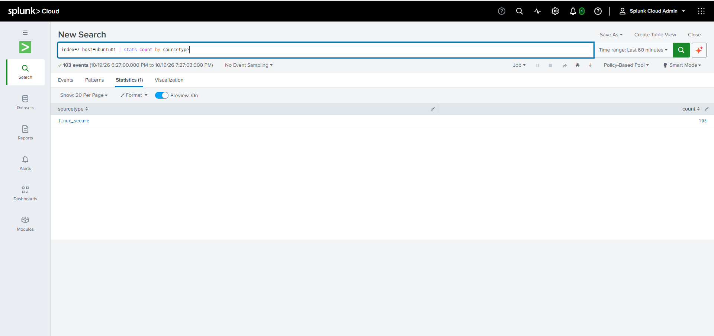

*Ubuntu's auth.log arriving in Splunk Cloud as linux_secure.*

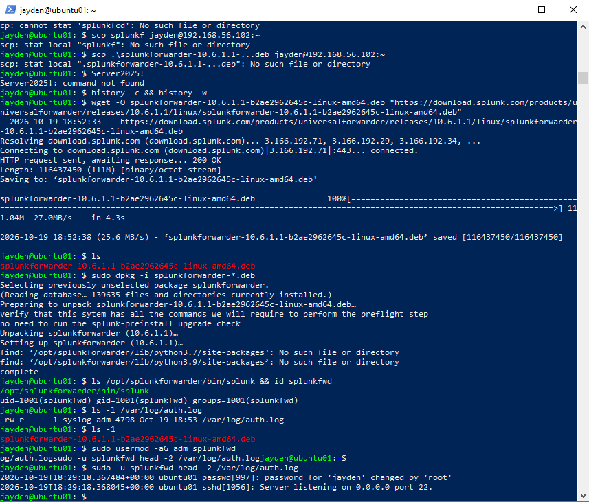

*The splunkfwd user reading auth.log after being added to the adm group.*

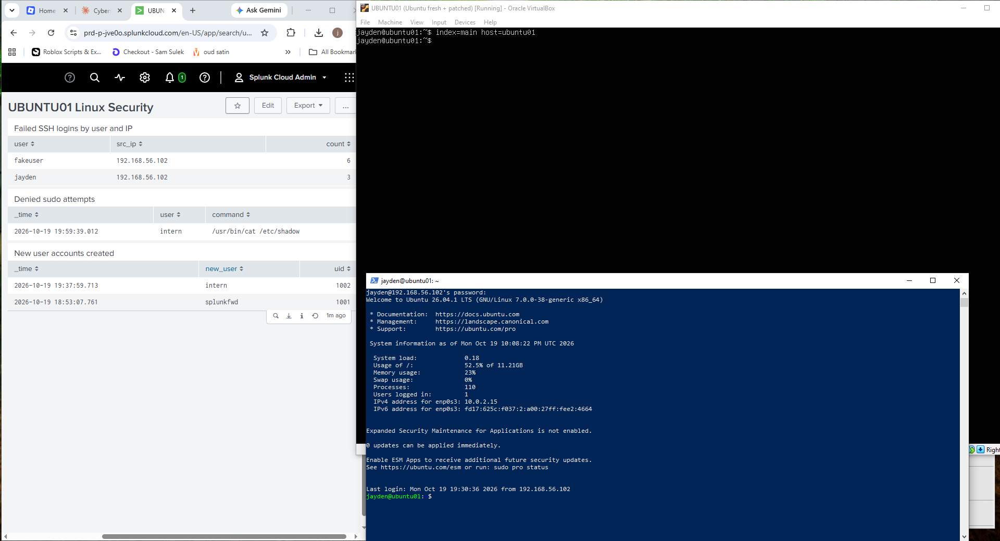

*"UBUNTU01 Linux Security" dashboard: failed SSH logins, denied sudo, and new accounts.*

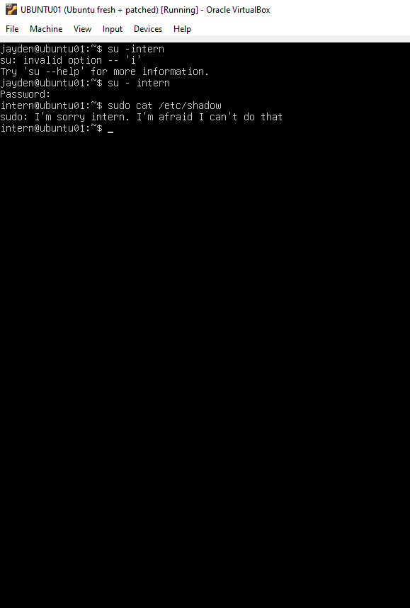

*The new sudo-rs denied intern's attempt to read /etc/shadow, but logged nothing.*

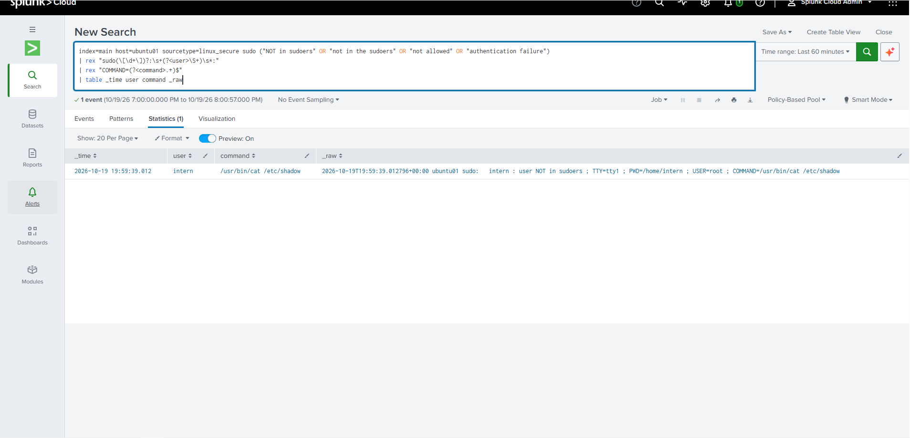

*After switching to classic sudo, Splunk catches the denied attempt.*

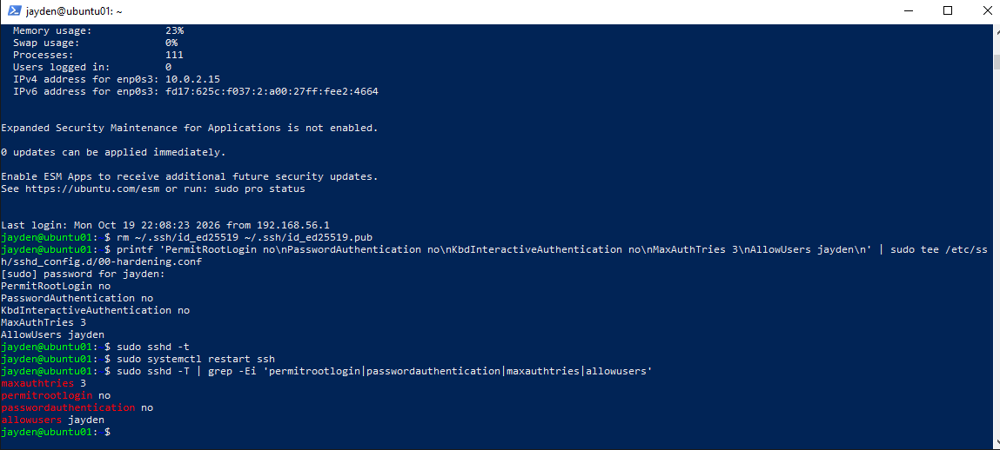

*SSH confirmed using the hardened settings.*

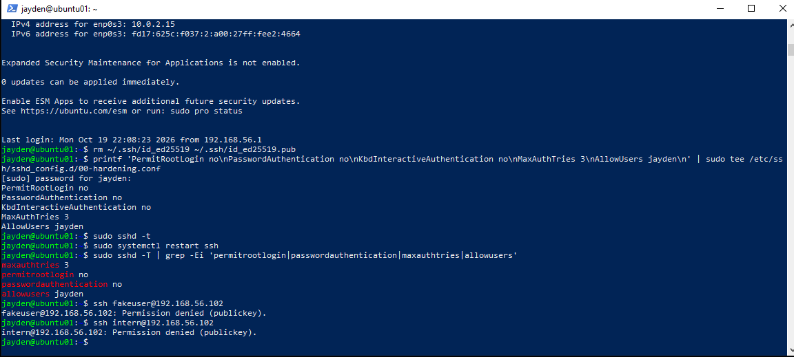

*After hardening, login attempts are rejected instantly with no password prompt.*

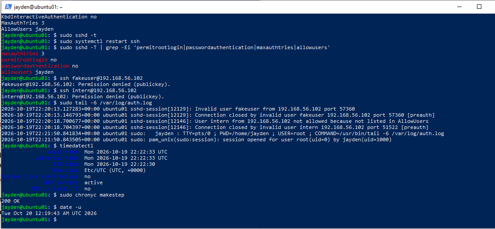

*The VM clock was 2 hours behind ("System clock synchronized: no") until I resynced it.*

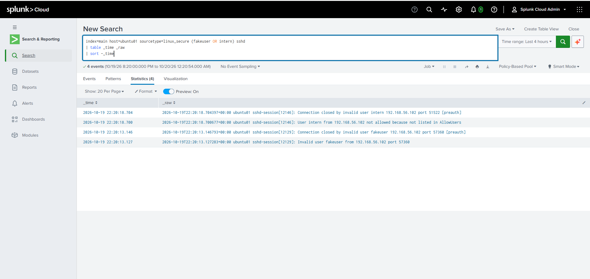

*The blocked attempts still show up in Splunk: blocked and recorded.*

**Investigation**

| What I tested | What I found |
| --- | --- |
| 9 wrong SSH passwords (6 for a fake user, 3 for a real user) | My first search counted only 2 for the real user. Pivoting on the SSH port showed the 3rd attempt was logged as `Connection closed by authenticating user ... [preauth]`, so I tuned the search to count both line types. |
| A regular user (`intern`) running `sudo cat /etc/shadow` | Denied, but Ubuntu 26.04's new `sudo-rs` logged nothing in auth.log or journald. A user could try to escalate privileges with no record. |
| Creating the `intern` account | `useradd` logs `new user: name=intern, UID=1002`, the Linux equivalent of Windows Event 4720. |
| Blocked attempts after hardening | Logged on Ubuntu but missing from a "Last 15 minutes" search. The VM clock was 2 hours behind, so Splunk filed the events in the past. |

**Root cause:** SSH allowed password logins from any account, and two visibility problems (sudo-rs not logging denials, and clock drift) could hide attacker activity.

**Resolution**

- Switched from `sudo-rs` to classic sudo (`update-alternatives --config sudo`), re-tested, and Splunk now catches the denied attempt (`intern`, `/usr/bin/cat /etc/shadow`).
- Hardened SSH in `/etc/ssh/sshd_config.d/00-hardening.conf`: no root login, no passwords (key-only), `MaxAuthTries 3`, and `AllowUsers jayden`. Set up an ed25519 key from my laptop first so I wouldn't lock myself out, then verified with `sshd -t` and `sshd -T`.
- Re-ran the attack: `fakeuser` and `intern` were rejected instantly with `Permission denied (publickey)`. Nothing left to guess.
- Fixed the clock with `chronyc makestep` and confirmed the blocked attempts in Splunk.
- Built a 3-panel dashboard and saved all searches in [/detections](../../detections/lab8-linux-splunk.md).

**Lessons learned**

- Test detections against what actually happened. My first SSH search undercounted.
- No log doesn't mean nothing happened. A modern tool (sudo-rs) silently skipped logging a denied privilege escalation. It's a real trade-off: memory safety vs visibility.
- Time sync matters. A 2-hour clock drift made real events invisible in a normal search.
- Hardening changes the logs. After disabling passwords, attempts show up as `Invalid user` instead of `Failed password`, so detections need updating too.
- Keep a second session open and test with a key before disabling password logins.
- Next step: `auditd` for sudo and sensitive-file monitoring, and connecting DC01 to the same Splunk instance for one Windows + Linux dashboard.

<b>More evidence (12 additional screenshots)</b>

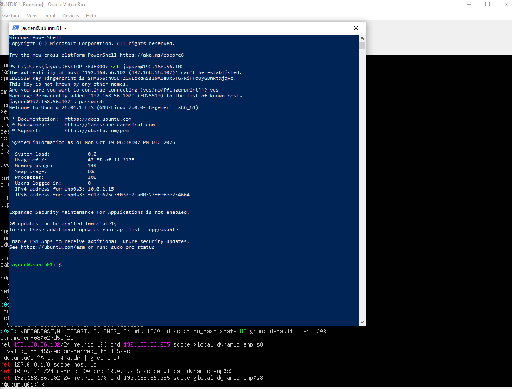

*First SSH connection from my laptop to UBUNTU01 over the Host-only network.*

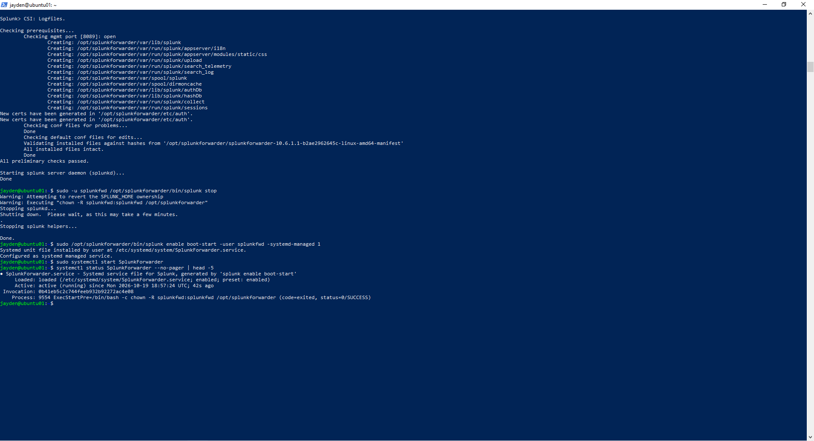

*Splunk Universal Forwarder installed and running as a service.*

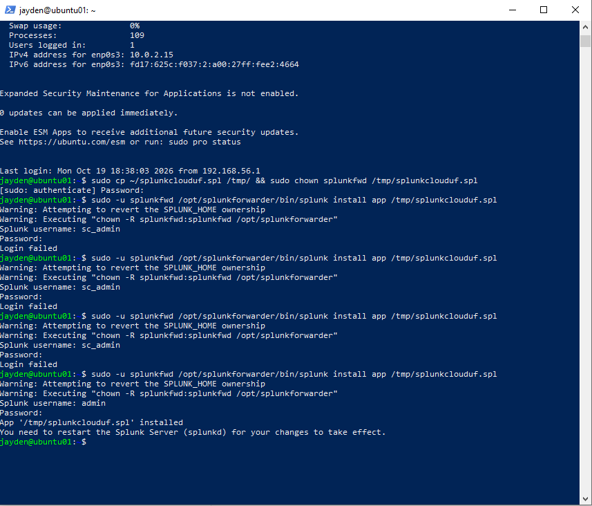

*Splunk Cloud credentials package installed on the forwarder (after troubleshooting failed logins).*

*`inputs.conf` monitoring `/var/log/auth.log` as `linux_secure`.*

*The simulated attack: wrong SSH passwords for `fakeuser` and a real user.*

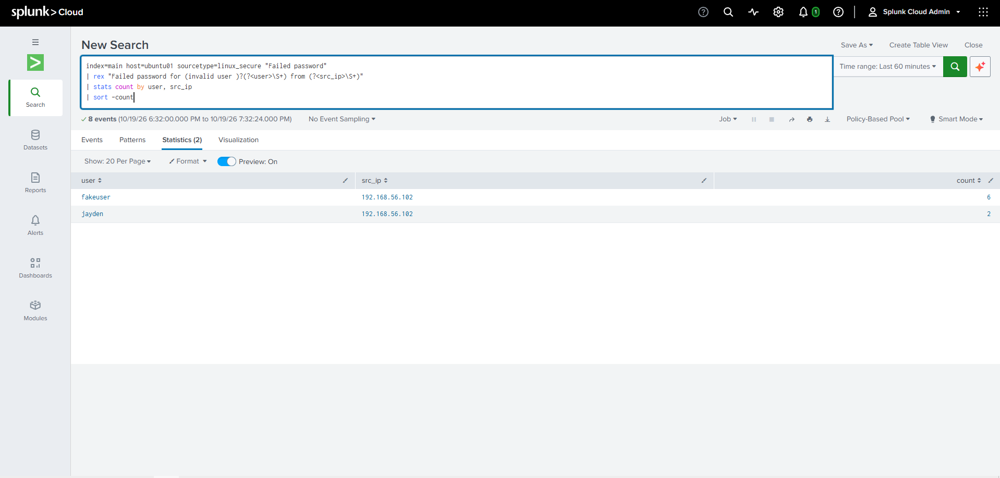

*First Splunk search for failed SSH logins, which undercounted.*

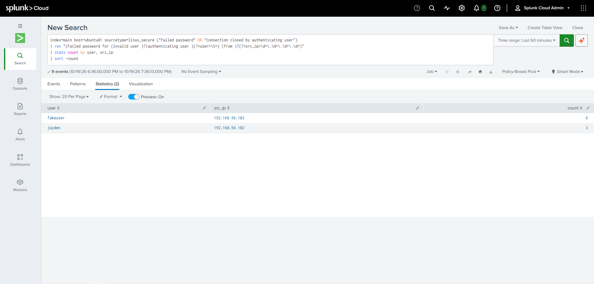

*Tuned search that counts both failure line types.*

*The gap: no record of the denied `sudo` attempt under `sudo-rs`.*

*Switching from `sudo-rs` to classic sudo with `update-alternatives`.*

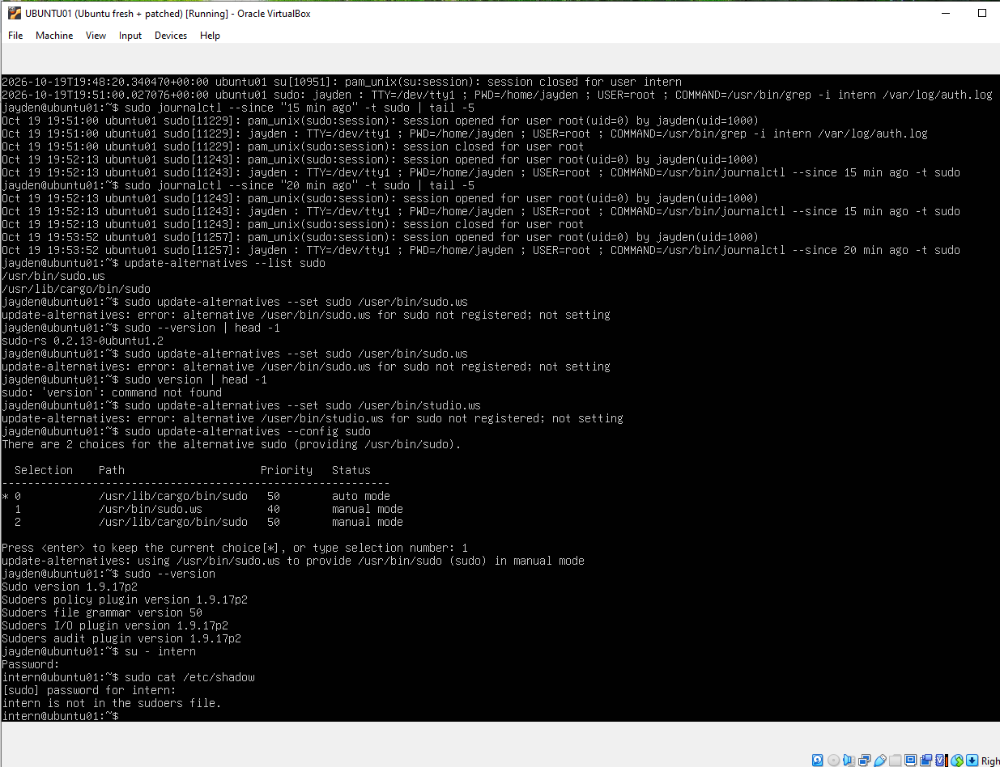

*Retest: classic sudo now records "intern is not in the sudoers file".*

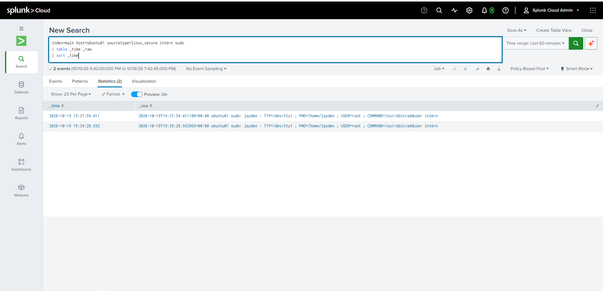

*sudo events searchable in Splunk.*

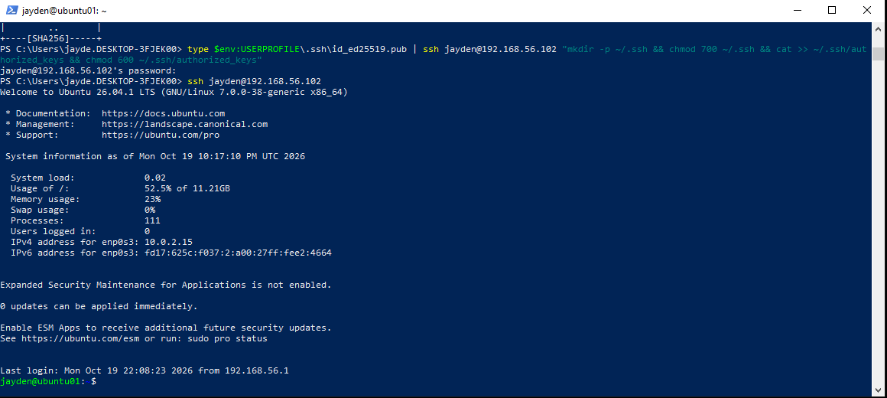

*ed25519 key copied and key-based SSH login working before passwords were disabled.*

---

[← Lab 7](../07-vulnerability-scanning-nessus/) · [🏠 Portfolio home](../../README.md) · [Lab 9 →](../09-home-lab-v2-architecture/)
