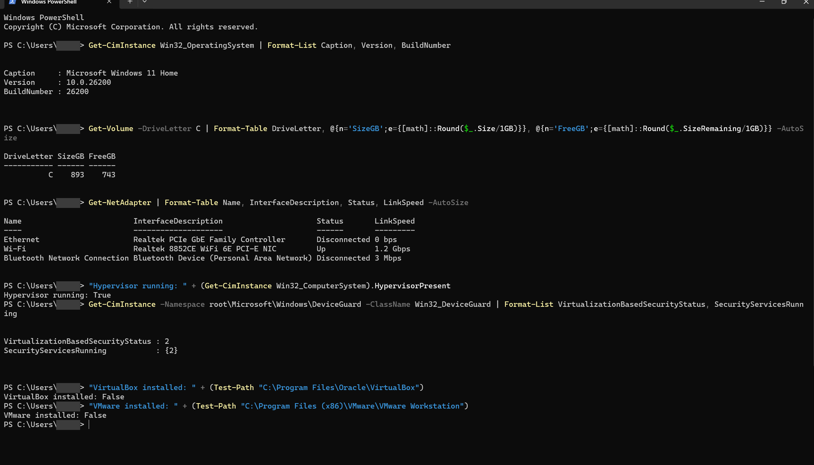
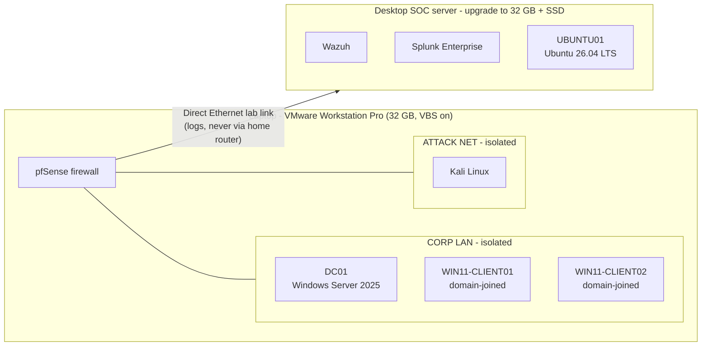

# Lab 9: Home lab v2: hardware assessment and architecture redesign

[← Lab 8](../08-linux-security-monitoring/) · [🏠 Portfolio home](../../README.md) · [Lab 10 →](../10-opnsense-firewall-network/)

| | |
| --- | --- |
| **Focus** | Planning |
| **Tools** | PowerShell (CIM/WMI) · `VBoxManage` · vendor documentation |
| **Skills demonstrated** | Asset inventory · capacity planning · network design · technical documentation |
| **Key result** | Audited two computers and an existing lab, found 7 problems, and designed a segmented v2 lab. |

**Objective:** Labs 1-8 ran on one 8 GB machine, one VM at a time. Before building a bigger lab, inventory both computers I now own, audit the existing VMs, and design a segmented company network with its own SOC server, without weakening host security.

**Setup**

- Read-only PowerShell inventory script: [lab9-hardware-inventory.ps1](scripts/lab9-hardware-inventory.ps1) (CPU, RAM slots, disks, OS, network adapters, virtualization security)
- `VBoxManage list vms --long` to audit the existing VirtualBox VMs
- Vendor documentation to check limits: Gigabyte motherboard specs, Microsoft VBS docs, Wazuh, Splunk, VMware and Proxmox requirements

| | New laptop | Old desktop (runs Labs 1-8) |
| --- | --- | --- |
| CPU | Ryzen AI 7 350, 8 cores / 16 threads | AMD FX-6300, 6 threads |
| RAM | 32 GB | 8 GB DDR3, 1 of 4 slots used |
| Storage | 1 TB NVMe SSD | 1 TB 7200 rpm hard drive |
| Motherboard limit | - | Gigabyte GA-78LMT-USB3: 4x DDR3, max 32 GB, SATA 3 Gb/s |
| OS | Windows 11 Home | Windows 10 Home 22H2 |
| Network | Gigabit Ethernet (unused) + Wi-Fi 6E | Gigabit Ethernet (unused) + USB Wi-Fi |
| Host security | VBS running, Memory Integrity on | VBS off |
| Hypervisor | None yet | VirtualBox 7.2.20 |

**Evidence**

VM audit (from `VBoxManage`, trimmed):

```text
Name:            HelpDesk-PC     Guest OS: Windows 11 (64-bit)          Memory: 4096MB  NIC 1: NAT
Name:            DC01            Guest OS: Windows Server 2022 (64-bit) Memory: 3072MB  NIC 1: NAT Network, NIC 2: Host-only
Name:            UBUNTU01        Guest OS: Ubuntu 25.04 (64-bit)        Memory: 2048MB  NIC 1: NAT, NIC 2: Host-only
```

Laptop virtualization security (`Win32_DeviceGuard`):

```text
VirtualizationBasedSecurityStatus : 2      <- VBS enabled and running
SecurityServicesRunning           : {2}    <- Memory Integrity (HVCI)
```



*Laptop inventory: Windows 11 Home, 743 GB free, an unused Ethernet port, and VBS + Memory Integrity running.*

**Investigation**

| Finding | What I found |
| --- | --- |
| Not enough RAM | The three VMs need 9 GB together; the host has 8 GB. That is why running two VMs crashed it in Lab 2. |
| Slow storage | VM disks on a spinning hard drive, and RAM in single-channel mode (one stick). |
| No domain-joined workstation | HelpDesk-PC is on plain NAT (its own private network), while DC01 is on a NAT Network. They can't reach each other, so the domain has no real workstation in it. |
| VM labels don't match reality | VirtualBox lists DC01 as Server 2022 and UBUNTU01 as Ubuntu 25.04, but they run Server 2025 and Ubuntu 26.04 LTS. The labels were never updated after install. |
| Lab can reach the host | The Host-only network (used for Nessus and SSH in Labs 7-8) gives VMs a direct path to my real computer. Fine for scanning, not for attack simulations. |
| Aging host OS | The desktop runs Windows 10, past end of support (October 2025). It only gets security fixes through the Extended Security Updates program. |
| Security vs speed on the laptop | Many VM guides say to turn off Hyper-V/VBS for speed. Memory Integrity protects the Windows kernel, so I kept it on and picked a hypervisor that runs alongside it. |

**Root cause:** The lab outgrew its hardware. One 8 GB machine forced one-VM-at-a-time testing, and ad-hoc network adapters left the domain without workstations and the lab without isolation.

**Resolution (design)**



- **Laptop = the company network and the attacker.** VMware Workstation Pro (free since November 2024) runs on top of Windows' own hypervisor, so VBS and Memory Integrity stay on.
- **pfSense is the gatekeeper.** The corporate LAN and attack network are internal-only segments. Attack traffic can't reach my home network or the internet.
- **Real workstations.** Windows 11 clients join `helpdesk.local` on the same segment as DC01, which uses DC01 for DNS.
- **Desktop = SOC server.** Upgrade to 32 GB DDR3 (dual-channel) and add a SATA SSD, then self-host Wazuh and Splunk Enterprise. This replaces the cloud trials from Lab 4.
- **Direct cable between the two machines.** Both have unused gigabit Ethernet ports, so logs travel over a private link, not the household router.
- **RAM budget per session (laptop):** pfSense 1 GB, DC01 4 GB, client 4 GB, Kali 4 GB, about 13-17 GB, leaving the rest for Windows.
- Existing VMs get backed up before anything on the desktop changes.

**Lessons learned**

- Inventory before buying. PowerShell showed exactly which RAM fits (DDR3, 4 slots, 32 GB max) and why the old lab struggled.
- Virtual network types are real networking. "NAT" vs "NAT Network" decides which machines can talk, just like separate VLANs.
- Asset records drift. The VM labels were wrong, which is why a SOC verifies facts instead of trusting the inventory.
- Keep host protections on, and design around the performance cost.
- Check `hostname` before running commands. I ran the laptop checks on the desktop by mistake first, the same kind of slip as Lab 3.
- Next: Lab 10, hypervisor and firewall with segmented networks.

> **Update:** the build uses VirtualBox and OPNsense instead of VMware and pfSense. Both vendors now require an account to download, and I pivoted rather than lose time. See Lab 10.

---

[← Lab 8](../08-linux-security-monitoring/) · [🏠 Portfolio home](../../README.md) · [Lab 10 →](../10-opnsense-firewall-network/)
